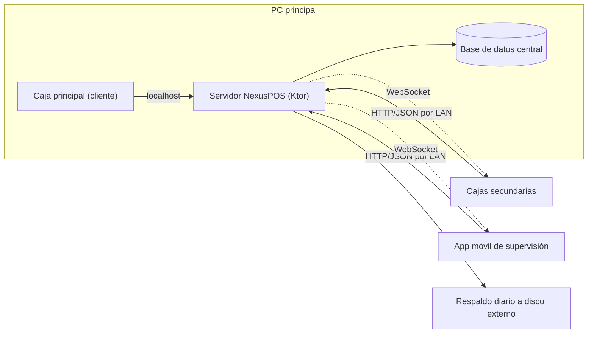

# NexusPOS — Arquitectura del proyecto

**Versión:** 2.0 (borrador de trabajo) · **Fecha:** 14 de octubre de 2026

**Propósito:** guiar el diseño, la implementación y la evolución de un sistema de punto de venta para una miscelánea / tienda de abarrotes. Es una guía viva: se revisa cuando haya nuevos requisitos, evidencia de operación o restricciones técnicas.

**Documentos relacionados**

| Archivo | Contenido |
| --- | --- |
| `01-arquitectura.md` | Este documento: estructura técnica, decisiones y reglas de código |
| `02-diseno-funcional.md` | Roles, pantallas, flujos, reglas de negocio, permisos y datos |


---

## 1. Contexto y objetivo

Una miscelánea tiene **una computadora** que será a la vez **servidor y caja principal**. A ella se conectan **otras cajas** (terminales de escritorio) y una **app móvil** de supervisión, todas por la **red local (LAN)**. NexusPOS está inspirado funcionalmente en el manual de eleventa y adaptado a este negocio.

Prioridades, en orden: **consistencia de dinero e inventario**, rapidez de cobro, operación sin internet, facilidad de mantenimiento y evolución por fases.

## 2. Decisiones confirmadas

| Tema | Decisión |
| --- | --- |
| Fiado | Incluido en el MVP: clientes, límite, cargos, abonos y liquidación |
| Venta al peso | Captura manual de cantidades decimales desde el MVP; la báscula se agrega después y **no elimina** el modo manual |
| Cajas | Varias cajas en una sola sucursal, por LAN |
| Nube | No se requiere al inicio; vender no depende de internet |
| Servidor | Una PC de la tienda ejecuta el backend y **centraliza la base de datos** |
| Acceso a datos | Las cajas y el móvil **solo** consultan y escriben mediante la API del servidor |
| Facturación electrónica | Fuera del MVP; si se requiere, integrar un PAC por API |
| Hardware inicial | Lector USB en modo teclado e impresoras térmicas ESC/POS de 58 u 80 mm |
| Plataforma | Cliente de escritorio Kotlin Multiplatform con Compose Multiplatform; servidor Kotlin/JVM con Ktor |

### Qué cambió respecto a la versión offline-first

La versión anterior daba a cada terminal su propia base SQLite y sincronizaba por eventos. Para una sola tienda eso complica sin necesidad el inventario compartido, el fiado y los cortes. Se sustituye por un **servidor autoritativo**.

| Pieza | Antes | Ahora |
| --- | --- | --- |
| Base de datos | Una por terminal más una en el servidor | **Una sola**, en el servidor |
| Sincronización | Outbox, `SyncEngine`, tabla `SyncEvent` | No existe |
| Conflictos (stock, fiado, folios) | Reglas de reconciliación | No hay conflictos: todo es una transacción |
| Caja sin servidor | Seguía vendiendo | **No vende**; se muestra el estado claramente |
| Idempotencia | Por evento | Por operación crítica (cobro, abono), se conserva |
| WebSocket | Telemetría al supervisor | Eventos en vivo a cajas y supervisor, se conserva |

El costo es un punto único de falla (sección 13). Se mitiga con respaldos, UPS y, si hiciera falta, un modo de contingencia acotado en fases posteriores.

## 3. Principios arquitectónicos

1. **Monolito modular primero:** un backend desplegable, una base de datos y módulos de negocio delimitados. Sin microservicios.
2. **Operación local (LAN-first):** todo funciona sin internet mientras la LAN y el servidor estén disponibles.
3. **Servidor como autoridad:** precios, totales, existencias, crédito y permisos se calculan y validan en el servidor, no solo en la interfaz.
4. **Una transacción por operación crítica:** venta, pagos, inventario, caja y crédito se confirman juntos o no se confirman.
5. **Separación de responsabilidades:** interfaz, casos de uso, dominio, API y persistencia no se mezclan.
6. **Historial auditable:** cancelaciones, devoluciones, pagos y ajustes son movimientos; nada completado se borra en silencio.
7. **Hardware detrás de adaptadores:** impresora, lector y báscula se encapsulan para poder probar sin dispositivos.
8. **Pruebas desde el inicio** en dinero, inventario, crédito, permisos y concurrencia.
9. **Evolución incremental:** no se crean módulos futuros antes de necesitarlos.
10. **Dependencias en un solo sentido**, sin ciclos, verificadas por pruebas de arquitectura.

## 4. Vista general



| Componente | Responsabilidad |
| --- | --- |
| Cliente de escritorio | Pantallas, estado de UI, hardware local (lector, impresora, báscula). No contiene reglas de negocio definitivas |
| Servidor | API, autenticación, casos de uso, reglas, transacciones, auditoría, respaldos |
| Base de datos | Persistencia transaccional; única fuente de verdad |
| App móvil (Fase 2) | Consulta y supervisión por la misma API |

## 5. Despliegue en la tienda

- **PC principal:** el servidor corre como **servicio aparte** con arranque automático; la **caja principal** es un cliente más que apunta a `localhost`. Cerrar la ventana de caja no detiene al servidor.
- **Cajas secundarias y móvil:** clientes por LAN. Cajas por cable; celulares por Wi-Fi, en una red distinta a la de los clientes de la tienda.
- **Dirección del servidor:** IP fija o reservada en el router, con descubrimiento automático en la red (mDNS) y captura manual como respaldo.
- **Instalador:** un paquete para la PC principal (servidor + caja + JVM incluida con `jlink`/`jpackage` + regla de firewall) y otro ligero para cajas secundarias. El envoltorio de servicio se evalúa según el sistema operativo (por ejemplo WinSW o NSSM en Windows, systemd en Linux).
- **Actualizaciones:** el cliente consulta `GET /api/v1/system/info` y se niega a operar con una versión de API incompatible. Orden: cerrar cajas → respaldo automático → actualizar servidor (migraciones al arrancar) → actualizar clientes.
- **Hardware:** cada caja usa sus propios lector e impresora; imprime el cliente, no el servidor.

## 6. Estructura del repositorio

```text
nexuspos/
├── settings.gradle.kts
├── build.gradle.kts
├── gradle/libs.versions.toml            # versiones en un solo lugar
├── shared/
│   ├── contracts/                       # DTOs, códigos de error y rutas (KMP, kotlinx.serialization)
│   └── core/                            # Money, Quantity, Unit, PricingRules: tipos puros
├── server/                              # módulo Gradle único al inicio
│   └── src/
│       ├── main/kotlin/mx/nexuspos/server/
│       │   ├── Application.kt           # arranque: solo ensambla
│       │   ├── config/                  # configuración externa
│       │   ├── platform/                # Ktor: auth, errores, JSON, WebSocket, idempotencia
│       │   ├── persistence/             # conexión, TransactionRunner, migraciones
│       │   └── modules/
│       │       ├── catalog/             # productos, presentaciones, departamentos, precios
│       │       ├── inventory/           # existencias y movimientos
│       │       ├── sales/               # ventas, pagos, cancelaciones, devoluciones
│       │       ├── credit/              # clientes y cuenta de crédito
│       │       ├── cash/                # sesiones de caja y movimientos de efectivo
│       │       ├── identity/            # usuarios, roles, permisos, dispositivos
│       │       ├── reports/             # consultas de reportes
│       │       └── system/              # salud, versión, respaldos, auditoría
│       └── test/kotlin/
├── client/
│   ├── app/                             # KMP: features, ApiClient, estado (commonMain, jvmMain)
│   └── desktop/                         # entrada JVM: ventana, ESC/POS, lector, báscula
├── installer/                           # empaquetado, servicio, scripts de respaldo
└── docs/
    ├── architecture/decisions/          # ADR
    ├── database/
    └── api/
```

**Módulos Gradle:** empezar con `:shared:contracts`, `:shared:core`, `:server`, `:client:app` y `:client:desktop`. Extraer un módulo de negocio a Gradle solo cuando aporte límites de dependencia, pruebas o compilación claros. `:androidApp` se agrega en la Fase 2.

**Reglas de dependencia**

- `shared:core` no depende de nada; `shared:contracts` solo de `shared:core` y kotlinx.serialization.
- El cliente depende de `shared:*`, nunca del servidor. El servidor depende de `shared:*`, nunca del cliente.
- `shared:core` guarda solo tipos puros usados por ambos lados; no es un cajón de utilidades.
- La UI muestra totales provisionales con `PricingRules` (el mismo código), pero **el servidor recalcula y manda el resultado definitivo**.

## 7. Servidor

### 7.1 Módulos de negocio

| Módulo | Responsabilidad | Tablas propias |
| --- | --- | --- |
| `catalog` | Productos, presentaciones y códigos de barras, departamentos, precios, historial de cambios | `products`, `product_presentations`, `departments`, `price_history` |
| `inventory` | Existencias, movimientos, mínimos y máximos | `stock_balances`, `stock_movements` |
| `sales` | Ventas, líneas, pagos, folios, cancelaciones, devoluciones | `sales`, `sale_lines`, `sale_payments`, `counters` |
| `credit` | Clientes, límite, cargos, abonos, saldo | `customers`, `credit_movements` |
| `cash` | Cajas, sesiones, movimientos de efectivo, cortes | `cash_registers`, `cash_sessions`, `cash_movements` |
| `identity` | Usuarios, PIN, roles, permisos, dispositivos y emparejamiento | `users`, `roles`, `devices`, `pairing_codes` |
| `reports` | Consultas de lectura sobre los demás módulos | (vistas y consultas) |
| `system` | Salud, versión, configuración, respaldos, auditoría | `settings`, `audit_log`, `idempotency_keys` |

**Regla:** un módulo **no lee ni escribe tablas de otro**. Si ventas necesita descontar inventario, usa la interfaz pública de `inventory`.

### 7.2 Estructura interna de un módulo

```text
modules/sales/
├── domain/          Sale.kt · SaleLine.kt · SaleStatus.kt · Payment.kt · SaleRules.kt
├── application/     CompleteSale.kt · CancelSale.kt · RefundSale.kt · GetSale.kt
├── ports/           SaleRepository.kt · InventoryOperations.kt · CreditOperations.kt · CashOperations.kt
├── api/             SaleRoutes.kt · SaleRequestMapper.kt
├── infrastructure/  SqlSaleRepository.kt
└── SalesModule.kt   # ensamblaje (DI); sin lógica de negocio
```

- `domain`: entidades, tipos de valor e invariantes. No depende de Ktor, SQL ni Compose.
- `application`: casos de uso que coordinan reglas y puertos. Sin HTTP ni SQL.
- `ports`: interfaces que **este** módulo necesita (repositorio propio y operaciones de otros módulos).
- `api`: rutas, traducción HTTP ↔ casos de uso y errores tipados → códigos HTTP.
- `infrastructure`: implementación SQL de los puertos del módulo. Aquí vive el SQL.
- Los DTO (`shared:contracts`) son distintos de las entidades de dominio, y las entidades de base de datos nunca salen por la API.

### 7.3 Transacción de cobro

`CompleteSale` se ejecuta dentro de `TransactionRunner.inTransaction { ... }` y coordina, mediante puertos:

1. Validar sesión de caja abierta, permisos, productos, precios vigentes y total esperado.
2. Validar pagos y calcular cambio.
3. Asignar folio consecutivo (contador incrementado dentro de la misma transacción, sin huecos por reversión).
4. Registrar venta, líneas y pagos.
5. Descontar inventario con movimientos (aplicando el factor de la presentación).
6. Registrar el movimiento de caja (efectivo).
7. Registrar el cargo de crédito si una parte queda fiada, validando el límite.
8. Guardar la clave de idempotencia con la respuesta y confirmar.

Cualquier fallo deja todo sin aplicar. La impresión ocurre **después** de confirmar.

### 7.4 Persistencia

**Propuesta (por confirmar con un spike): SQLite en modo WAL como base inicial, con acceso detrás de puertos para poder pasar a PostgreSQL.**

| Criterio | SQLite (WAL) | PostgreSQL |
| --- | --- | --- |
| Instalación y mantenimiento en la tienda | Un archivo; sin servicio adicional | Servicio aparte, versiones y actualizaciones |
| Respaldo | Copia consistente (`VACUUM INTO` o API de respaldo) | `pg_dump` o respaldos físicos |
| Concurrencia | Un escritor a la vez; suficiente para pocas cajas porque cada venta escribe en milisegundos | Escrituras concurrentes y bloqueos finos |
| Tipos y restricciones | Tipado flexible: exige disciplina (enteros para dinero) | Tipos y restricciones más estrictos |
| Crecimiento (multi-sucursal, nube) | Habría que migrar | Camino natural |

Condiciones para pasar a PostgreSQL: más cajas de las que SQLite sostiene en las pruebas de carga, multi-sucursal o nube, o reportes pesados que compitan con el cobro.

**Reglas para que el cambio sea posible:** un solo proceso servidor escribe en la base; nunca compartir el archivo SQLite por carpeta de red; SQL simple y portable en migraciones; pruebas de integración contra el motor elegido; `busy_timeout` y transacciones con `BEGIN IMMEDIATE`.

**Acceso a datos:** Exposed (DSL) en `infrastructure`, porque corre en JVM y admite SQLite y PostgreSQL. SQLDelight perdió su razón de ser principal al desaparecer las bases locales en las terminales. Validar el manejo de transacciones de Exposed con SQLite en el spike inicial.

**Migraciones:** Flyway, versionadas, ejecutadas al arrancar el servidor y precedidas de un respaldo automático.

**Dinero y cantidades**

- Dinero en **centavos enteros** (`Money`); nunca `Double`.
- Cantidades en **milésimas enteras** (`Quantity`, 0.250 kg = 250) con unidad explícita; piezas enteras.
- Cálculo por línea: `precioUnitarioCentavos × cantidadMilésimas ÷ 1000`, con redondeo explícito (propuesto: mitad hacia arriba al centavo, por línea). Ejemplo: 0.250 kg × $48.00/kg = $12.00.
- Impuestos: tasa por producto y bandera de precio con impuesto incluido; la regla fiscal exacta queda como decisión abierta.

### 7.5 Idempotencia y concurrencia

- La caja genera un UUID (`Idempotency-Key`) al iniciar el cobro y lo reutiliza en reintentos.
- Tabla `idempotency_keys(key, device_id, request_hash, status, response, created_at)`. La clave se inserta **en la misma transacción** de la venta; una restricción única impide que dos reintentos concurrentes apliquen dos veces.
- Misma clave y mismo contenido → misma respuesta. Misma clave y contenido distinto → `409`.
- Si el resultado de un cobro es incierto (timeout), la caja consulta `GET /api/v1/sales/by-key/{key}` antes de reintentar.
- Actualización de existencias y de saldo de crédito dentro de la transacción, con restricciones de base de datos como segunda barrera.

### 7.6 Errores

Formato único: `{ "code": "CREDIT_LIMIT_EXCEEDED", "message": "...", "details": {...}, "requestId": "..." }`.

| HTTP | Uso | Ejemplos de `code` |
| --- | --- | --- |
| 400 | Solicitud inválida | `VALIDATION_ERROR` |
| 401 / 403 | No autenticado / sin permiso | `UNAUTHENTICATED`, `PERMISSION_DENIED`, `AUTHORIZATION_REQUIRED` |
| 404 | No existe | `NOT_FOUND` |
| 409 | Conflicto de estado o idempotencia | `PRICE_CHANGED`, `IDEMPOTENCY_MISMATCH`, `SESSION_CLOSED` |
| 422 | Regla de negocio | `CREDIT_LIMIT_EXCEEDED`, `INSUFFICIENT_PAYMENT`, `INSUFFICIENT_STOCK` |
| 503 | Servidor no disponible | `SERVER_UNAVAILABLE` |

## 8. Cliente

### 8.1 Estructura

```text
client/app/src/commonMain/kotlin/mx/nexuspos/client/
├── App.kt · navigation/
├── core/               # ApiClient, SessionStore, ServerConnection, errores de UI
├── hardware/           # interfaces: ReceiptPrinter, ScaleReader, BarcodeInput
└── features/
    ├── sales/
    │   ├── SalesScreen.kt · SalesViewModel.kt · SalesUiState.kt
    │   ├── SalesAction.kt · SalesEvent.kt
    │   ├── SalesRepository.kt      # llama a la API y mapea DTO → modelo de UI
    │   └── components/             # BarcodeInput, ProductSearch, SaleCart, PaymentDialog, SaleTotals
    ├── products/ · inventory/ · customers/ · cash/ · users/ · reports/ · devices/
client/desktop/src/jvmMain/kotlin/
├── Main.kt                         # ventana y arranque
├── EscPosReceiptPrinter.kt
├── SerialScaleReader.kt            # Fase 2
└── KeyboardWedgeBarcodeInput.kt
```

- **Un ViewModel por pantalla o flujo**, no por botón. Componentes extraídos cuando tengan responsabilidad visual independiente.
- **El carrito vive en el cliente.** Solo el cobro viaja al servidor (`POST /sales` con líneas, pagos y total esperado). Menos viajes de red y no quedan ventas a medias en el servidor.
- **Estado de conexión visible:** `Conectado`, `Reconectando`, `Sin servidor`. Sin servidor, el cobro se bloquea y se explica por qué.
- **Configuración local mínima** en archivo (dirección del servidor, token del dispositivo, nombre de la caja); no es una base de datos.
- **Caché del catálogo en memoria** opcional, invalidada por eventos en vivo y por `GET /catalog/changes?since=`.
- **Teclado primero:** atajos para las acciones frecuentes (ver `02-diseno-funcional.md`).

### 8.2 Hardware

| Interfaz | Implementación inicial | Notas |
| --- | --- | --- |
| `BarcodeInput` | Lector USB en modo teclado | Distinguir lectura rápida + Enter de tecleo humano; prefijo/sufijo configurables |
| `ReceiptPrinter` | ESC/POS por USB/red | Un fallo de impresión **no revierte** el cobro; reimpresión disponible |
| `ScaleReader` | Captura manual (`ManualWeightInput`) | La báscula serial/USB llega en la Fase 2 y requiere confirmación del cajero; el modo manual siempre existe |

## 9. API

Versionada en `/api/v1`. JSON, fechas ISO-8601 en UTC, dinero en campos `...Cents` enteros, cantidades en `...Milli` enteros. Paginación por `limit` y `cursor`.

| Área | Método y ruta | Propósito |
| --- | --- | --- |
| Sistema | `GET /health` · `GET /api/v1/system/info` | Salud y versión de API |
| Emparejamiento | `POST /api/v1/pairing/codes` · `POST /api/v1/pairing/claim` | Generar código de un solo uso y canjearlo por un token de dispositivo |
| Dispositivos | `GET /api/v1/devices` · `DELETE /api/v1/devices/{id}` | Listar y revocar |
| Sesión | `POST /api/v1/auth/login` · `POST /api/v1/auth/logout` · `POST /api/v1/auth/authorize` | PIN de cajero, cierre y autorización puntual de encargado |
| Catálogo | `GET /api/v1/products?barcode=` · `?query=` · `POST/PUT /api/v1/products` · `GET /api/v1/catalog/changes?since=` | Búsqueda, altas, cambios y descarga incremental |
| Inventario | `GET /api/v1/inventory/stock` · `POST /api/v1/inventory/movements` | Existencias, entradas y ajustes |
| Ventas | `POST /api/v1/sales` · `GET /api/v1/sales/{id}` · `GET /api/v1/sales/by-key/{key}` | Cobrar, consultar y reimprimir |
|  | `POST /api/v1/sales/{id}/cancel` · `POST /api/v1/sales/{id}/refund` | Cancelación y devolución |
| Crédito | `GET /api/v1/customers/{id}/credit` · `POST /api/v1/customers/{id}/credit/payments` | Saldo, movimientos y abonos |
| Caja | `POST /api/v1/cash-sessions` · `GET /api/v1/cash-sessions/current` | Abrir y consultar sesión |
|  | `POST /api/v1/cash-sessions/{id}/movements` · `GET .../summary` · `POST .../close` | Entradas/salidas, vista previa del corte y cierre |
| Reportes | `GET /api/v1/reports/{sales-daily, profit, top-products, low-stock}` | Reportes básicos |
| Tiempo real | `GET /ws/events` (WebSocket) | Eventos en vivo |

**Eventos en vivo:** `catalog.changed`, `stock.low`, `sale.completed`, `cash.session.opened`, `cash.session.closed`, `device.revoked`. Al reconectar, el cliente pide los cambios perdidos con `catalog/changes?since=`.

## 10. Seguridad

- **Dos credenciales:** token de **dispositivo** (qué caja o móvil es; se guarda cifrado con hash en el servidor y se puede revocar) y sesión de **usuario** (quién opera, por PIN, con expiración por inactividad).
- **Emparejamiento:** el servidor muestra un código de un solo uso y de vida corta; el dispositivo nuevo lo captura y recibe su token. Sin token, el servidor rechaza todo salvo `/health`.
- **Permisos y roles** verificados en el servidor; acciones sensibles admiten **autorización puntual de un encargado** (PIN) sin cambiar de usuario.
- **Contraseñas y PIN** con hash adecuado y bloqueo tras intentos fallidos.
- **Red:** el servidor escucha solo en la interfaz LAN necesaria y no se expone a internet; firewall limitado a la red de la tienda. TLS con certificado autofirmado y fijación en el cliente se evalúa (decisión abierta), sobre todo si hay Wi-Fi.
- **Auditoría:** cancelaciones, devoluciones, ajustes de inventario, cambios de precio, retiros, cambios de permisos y emparejamientos.
- **Secretos** fuera del repositorio.

## 11. Tiempo real

El servidor emite eventos por WebSocket a cajas y supervisores (cambio de precio o producto, stock bajo, ventas, turnos, revocación de dispositivo). Los eventos son **avisos**, no la fuente de verdad: ante cualquier duda, el cliente consulta por la API.

## 12. Convenciones contra archivos espagueti

1. Una responsabilidad principal por archivo. Guía: 50–150 líneas; revisar los que pasen de 200. No es un límite rígido.
2. Funciones cortas, con nombres descriptivos y efectos secundarios visibles.
3. Nada de un `SalesService.kt` que concentre búsqueda, totales, descuentos, persistencia, inventario, crédito, impresión y reportes: cada operación es un caso de uso.
4. Sin carpetas `utils`, `common` ni `services` como cajón de sastre.
5. No introducir abstracciones por anticipación.
6. SQL solo en `infrastructure`. Rutas sin reglas de negocio. UI sin cálculos definitivos.
7. Errores tipados de dominio, traducidos a HTTP en la capa `api`.
8. DTO separados de entidades de dominio.
9. Estado inmutable en UI: un `data class` de estado por pantalla.
10. Decisiones importantes documentadas como ADR.
11. **Las reglas de dependencia se verifican con pruebas de arquitectura** (por ejemplo con Konsist), para que no dependan de la disciplina de nadie.

## 13. Disponibilidad y continuidad

**Limitación asumida:** no depender de internet no significa que las cajas secundarias vendan si el servidor o la LAN caen. El MVP lo comunica con claridad (`Sin servidor`) y no vende.

Mitigaciones:

- UPS en la PC principal y en el router; arranque automático del servidor tras un corte de luz.
- Cajas secundarias por cable; el móvil por Wi-Fi.
- **Respaldo automático diario** a un disco externo, con retención configurable, verificación de integridad y procedimiento de restauración documentado y probado. Respaldo adicional antes de cada migración.
- Pantalla de diagnóstico del servidor (estado, versión, último respaldo, dispositivos conectados).

**Modo de contingencia (Fase 3, solo si hace falta):** las cajas secundarias podrían registrar ventas **solo en efectivo** en una cola local cuando no haya servidor, y enviarlas al reconectar (sin fiado ni validación de existencias). La API actual ya lo permite sin cambios: la venta es idempotente y acepta `deviceId` y hora de creación. Requiere su propio ADR.

## 14. Pruebas

| Nivel | Qué cubre |
| --- | --- |
| Dominio | Subtotales, impuestos, descuentos, redondeo, peso decimal, factor de presentación, límite de crédito |
| Casos de uso | Cobro transaccional completo, cancelación y devolución sin duplicar movimientos, cortes |
| API / integración | Rutas, permisos, errores, idempotencia, contra el motor de base de datos real |
| Concurrencia | Dos cajas vendiendo el mismo producto al mismo tiempo; dos cobros con la misma clave de idempotencia |
| Arquitectura | Reglas de dependencia entre capas y módulos |
| Contratos | Compatibilidad de serialización de `shared:contracts` |
| Operación | Falla de impresora tras confirmar el cobro; pérdida de internet con LAN activa; caída del servidor y recuperación; respaldo y restauración; carga con varias cajas simuladas |

Hardware con adaptadores falsos. La UI se prueba al inicio solo en flujos críticos.

## 15. Stack

| Área | Tecnología | Versión de la ficha técnica | Notas |
| --- | --- | --- | --- |
| Lenguaje | Kotlin | 2.4.20 | Cliente y servidor |
| UI | Compose Multiplatform (Material 3) | 1.12.1 | Escritorio primero; Android después |
| Servidor | Ktor Server (CIO) | 3.1.0 | Validar compatibilidad con Kotlin |
| Cliente HTTP | Ktor Client | 3.1.0 | Idempotencia y reintentos |
| JSON | kotlinx.serialization | 1.7.3 | |
| Fechas | kotlinx-datetime | 0.6.1 | |
| Logs | Logback Classic | 1.5.16 | Rotación de archivos |
| Base de datos | SQLite (WAL) o PostgreSQL | por definir | Ver 7.4 |
| Acceso a datos | Exposed | por definir | Detrás de puertos |
| Migraciones | Flyway | por definir | |
| Inyección | Koin (opcional) | por definir | |
| Pruebas | kotlin.test + pruebas de integración | la de Kotlin | |
| Build | Gradle Kotlin DSL + catálogo de versiones | por definir | Sin versiones dinámicas |

Las versiones concretas se fijan en `gradle/libs.versions.toml` al iniciar y se actualizan de forma deliberada. Ktor 3.1.0 y kotlinx.serialization 1.7.3 parecen anteriores a Kotlin 2.4.20 y Compose 1.12.1: confirmar compatibilidad antes de fijarlas.

## 16. Calidad no funcional (objetivos iniciales, por validar)

| Atributo | Objetivo |
| --- | --- |
| Rapidez de captura | Código escaneado → línea en el carrito en menos de 200 ms en LAN |
| Rapidez de cobro | Confirmación del servidor en menos de 1 s |
| Concurrencia | Al menos 5 cajas y 2 móviles simultáneos sin degradación visible |
| Pérdida de datos | Máximo un día de datos ante falla total del disco (respaldo diario); más frecuente si se justifica |
| Recuperación | Restaurar el servicio desde un respaldo en menos de una hora siguiendo la guía |

## 17. Decisiones abiertas

- Sistemas operativos de las cajas (Windows, Linux, macOS) y envoltorio del servicio.
- Versiones exactas de Kotlin, Compose, Ktor y Gradle.
- SQLite frente a PostgreSQL y confirmación de Exposed (spike).
- Autenticación: tokens opacos o JWT; TLS en la LAN.
- Reglas fiscales: impuestos incluidos, IVA/IEPS, redondeo.
- Política de inventario negativo (propuesta: permitir con alerta, configurable).
- Precios históricos y cambio de precio durante una venta (propuesta: `409 PRICE_CHANGED` y reconfirmación).
- Reglas de devoluciones, cancelaciones y arqueo.
- Marca y modelo de impresora y báscula.
- Estrategia de actualización y de recuperación ante fallos.
- Si se tolerará una caída de la LAN con modo de contingencia o solo se mostrará el aviso.

## 18. ADR iniciales

Documentos breves en `docs/architecture/decisions/`, cada uno con contexto, decisión, alternativas, consecuencias y fecha.

| ADR | Tema | Estado |
| --- | --- | --- |
| 001 | Monolito modular en lugar de microservicios | Propuesto |
| 002 | Servidor autoritativo en la LAN (reemplaza al offline-first) | **Aceptado** |
| 003 | Base de datos: SQLite (WAL) frente a PostgreSQL | Propuesto, pendiente de spike |
| 004 | Cliente de escritorio con Compose Multiplatform | Propuesto |
| 005 | Dinero en centavos y cantidades en milésimas enteras | Propuesto |
| 006 | Venta transaccional e idempotente | Propuesto |
| 007 | Autenticación: token de dispositivo + PIN de usuario | Propuesto |
| 008 | Carrito en el cliente; el servidor solo recibe el cobro | Propuesto |
| 009 | Modo de contingencia sin servidor | Diferido (Fase 3) |

## 19. Orden de implementación técnica

1. Repositorio, Gradle, catálogo de versiones, convenciones, pruebas de arquitectura y CI básica.
2. Spike de persistencia: SQLite WAL + Exposed + Flyway con una prueba de concurrencia de dos escritores.
3. Servidor Ktor con `health`, `system/info`, configuración externa y errores tipados.
4. `shared:core`: `Money`, `Quantity`, `Unit` y `PricingRules`, con pruebas.
5. `shared:contracts` y `ApiClient` del cliente con estado de conexión.
6. Emparejamiento por código, token de dispositivo y login por PIN.
7. Catálogo: productos, presentaciones y búsqueda por código y nombre.
8. Primera venta en efectivo con transacción, inventario e idempotencia.
9. Sesiones de caja, entradas/salidas y corte.
10. Clientes y fiado (cargo, abono, liquidación).
11. Cancelaciones y devoluciones.
12. Ticket ESC/POS y reimpresión.
13. Reportes básicos y eventos en vivo.
14. Instalador, servicio, respaldos y guía de restauración.
15. Pruebas de operación multicaja y de carga.

Cada etapa debe compilar, tener pruebas y poder ejecutarse antes de iniciar la siguiente.

## 20. Definición de terminado

Una funcionalidad se considera terminada cuando:

- Respeta capas y dependencias permitidas (las pruebas de arquitectura pasan).
- Valida en el servidor y tiene permisos definidos.
- Tiene pruebas unitarias y, cuando aplica, de integración y de concurrencia.
- Maneja errores y estados de carga en la UI.
- Registra auditoría si la operación lo requiere.
- Incluye migraciones versionadas si cambia la base de datos.
- Actualiza la documentación de API y arquitectura si cambia un contrato.
- Se probó en el entorno objetivo (escritorio + LAN) para los flujos críticos.
- No introduce secretos ni configuración local en el repositorio.
