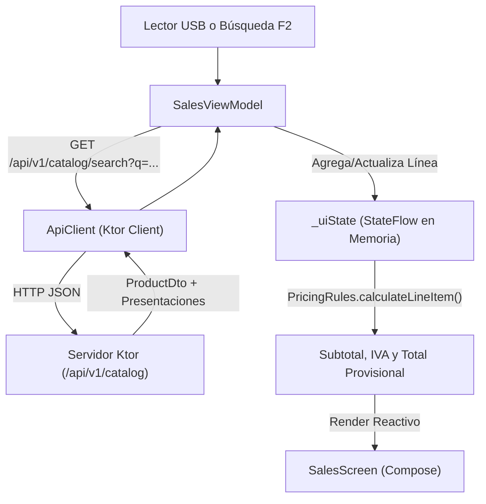
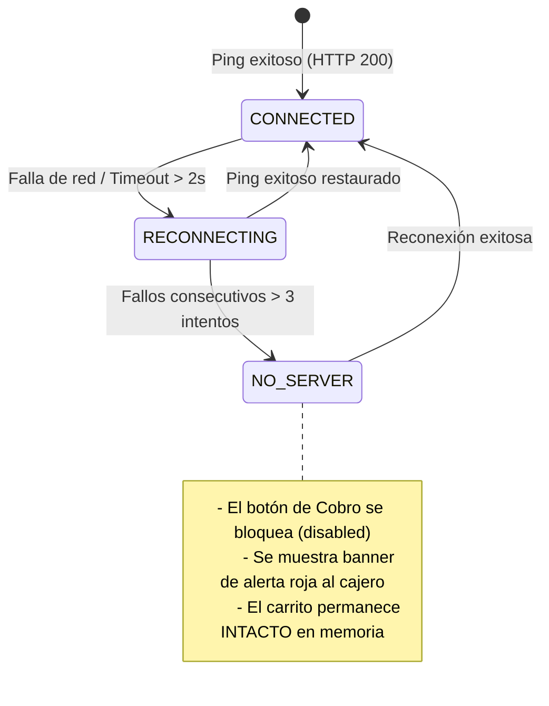
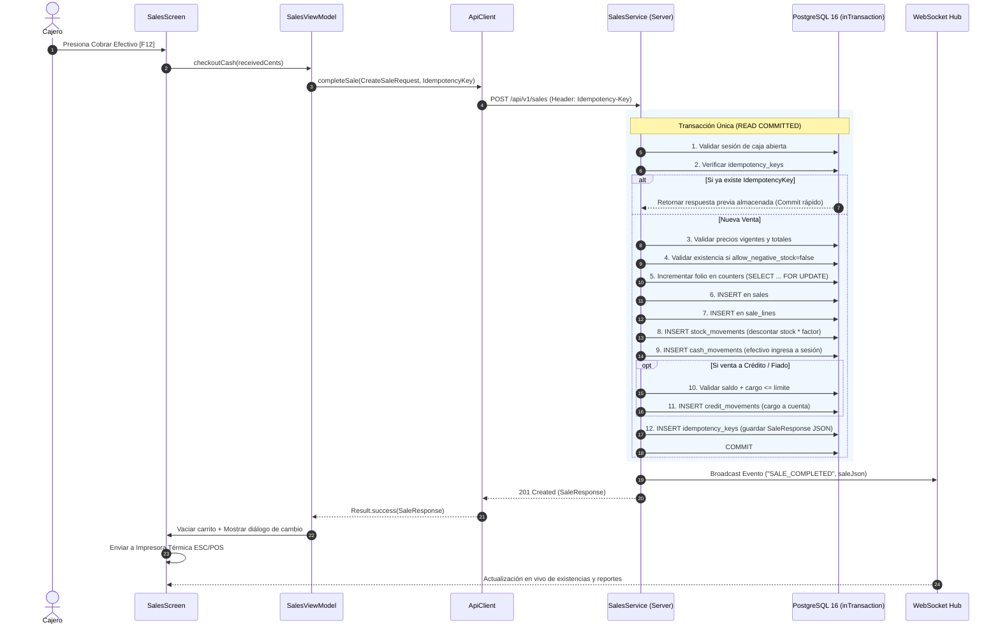

# Arquitectura: Flujo de Datos y Persistencia (Data Flow)

Este documento detalla cómo viaja la información a través de las capas del sistema, el ciclo de vida de los estados en el cliente, la gestión de la concurrencia y las transacciones en el servidor.

---

## 1. Ciclo de Vida del Carrito en el Cliente

El carrito de venta **reside exclusivamente en la memoria RAM** de la terminal de caja ([`SalesUiState`](file:///Users/eddch/Documents/OzafryDev/NexusPOS/client/app/src/commonMain/kotlin/mx/nexuspos/client/features/sales/SalesUiState.kt)):

### Principio de Aislamiento:
- Si el cliente agrega 10 productos al carrito, no se genera tráfico de escritura hacia la base de datos hasta el momento en que se presiona **Cobrar [F12]**.
- Si la conexión LAN parpadea mientras se escanean artículos, los productos capturados permanecen en memoria.

---

## 2. Máquina de Estados de Conexión LAN

Cada terminal de caja ejecuta un monitor en segundo plano ([`ServerConnection`](file:///Users/eddch/Documents/OzafryDev/NexusPOS/client/app/src/commonMain/kotlin/mx/nexuspos/client/core/ServerConnection.kt)) con sondeo de salud periódico (`GET /health`) y reconexión por WebSocket:

---

## 3. Flujo de Transacción Atómica de Cobro (`POST /api/v1/sales`)

Cuando el cajero confirma el pago, se desencadena una transacción ACID en el servidor autoritativo:

---

## 4. Deducción de Inventario con Factor de Presentación

En tiendas de abarrotes, los productos se venden en diferentes presentaciones que comparten la misma existencia base. Por ejemplo:
- **Producto:** Huevo Blanco a Granel (Inventario medido en kilogramos: `unit = KG`).
- **Presentación 1:** Kilo completo (`factorMillis = 1000L`).
- **Presentación 2:** Cono de 30 huevos (~1.800 kg: `factorMillis = 1800L`).
- **Presentación 3:** Medio kilo (`factorMillis = 500L`).

La deducción en `stock_movements` se calcula canónicamente en enteros:
$$\text{BaseDeductionMillis} = \frac{\text{quantityMillis} \times \text{factorMillis}}{1000}$$

---

## 5. Eventos en Tiempo Real por WebSocket

El servidor expone el endpoint `/ws/events`. Las cajas conectadas reciben notificaciones inmediatas:
- `CATALOG_UPDATED`: Cuando el administrador modifica un precio o alta de producto.
- `SALE_COMPLETED`: Folio, cajero y monto de venta confirmada.
- `CASH_MOVEMENT`: Movimientos manuales o abonos recibidos en turno.
- `SESSION_CLOSED`: Notificación de corte de turno efectuado.
