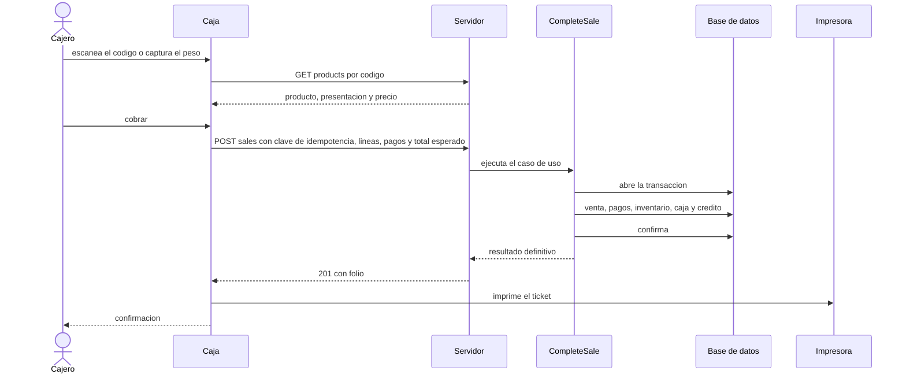
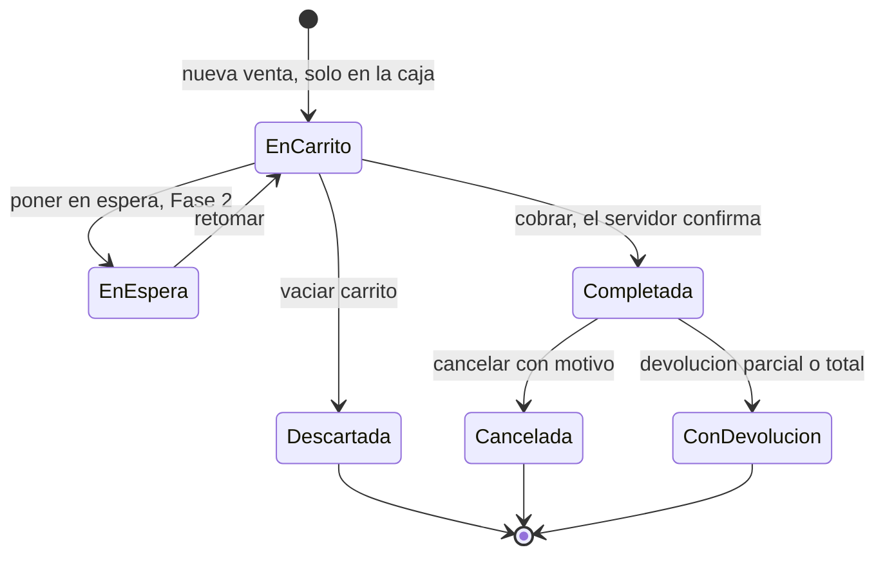
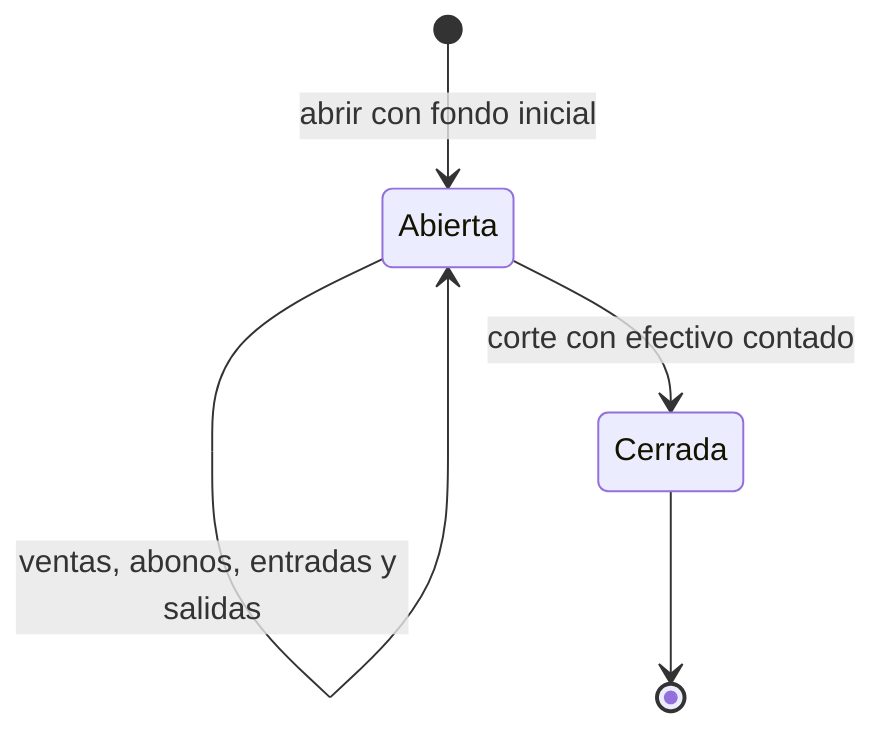

# NexusPOS — Diseño funcional

**Versión:** 2.0 (borrador de trabajo) · **Fecha:** 14 de octubre de 2026

Describe **qué hace** el sistema y cómo se comporta desde el punto de vista del negocio. La estructura técnica está en `overview.md` y en las especificaciones funcionales de `docs/features/`.

Convenciones: cada regla de negocio lleva un identificador (`RN-VEN-01`) para poder referirla en pruebas, criterios de aceptación y tareas. Lo marcado **(propuesta)** es una decisión por confirmar con el dueño de la tienda.

---

## 1. Alcance y actores

Una miscelánea con una PC que es servidor y caja principal, otras cajas de escritorio y una app móvil de supervisión, todo por LAN. Sin sucursales múltiples ni nube en el alcance inicial.

| Actor | Descripción |
| --- | --- |
| **Cajero** | Cobra, abona a clientes, registra entradas y salidas permitidas, abre y cierra su sesión de caja |
| **Encargado** | Todo lo del cajero, más autorizar acciones sensibles, ajustar inventario, ver reportes y cortes de todos |
| **Administrador (dueño)** | Todo lo anterior, más catálogo y precios, usuarios, dispositivos, configuración y respaldos |
| **Dispositivo** | Caja principal, caja secundaria o móvil supervisor, emparejado con el servidor |
| **Cliente de la tienda** | Persona que compra; puede tener cuenta de crédito (fiado) |

## 2. Módulos funcionales

| Módulo | Qué resuelve | Fase |
| --- | --- | --- |
| Venta (caja) | Capturar productos, cobrar, imprimir ticket | 1 |
| Formas de pago | Efectivo, tarjeta registrada, transferencia, crédito | 1 |
| Catálogo | Productos, presentaciones, departamentos, precios | 1 |
| Inventario | Existencias, entradas, ajustes, mínimos | 1 |
| Crédito (fiado) | Clientes, límite, cargos, abonos, liquidación | 1 |
| Caja | Sesiones, entradas y salidas de efectivo, corte | 1 |
| Cancelaciones y devoluciones | Revertir ventas con trazabilidad | 1 |
| Usuarios y permisos | PIN, roles, autorización de encargado | 1 |
| Dispositivos | Emparejar, listar y revocar cajas y móviles | 1 |
| Reportes básicos | Ventas, ganancia, más vendidos, bajo mínimo, corte | 1 |
| Respaldos y diagnóstico | Respaldo diario, estado del servidor | 1 |
| Báscula, ventas en espera, mayoreo, promociones, compras, importación, supervisor móvil | Eficiencia | 2 |
| Caducidades, recargas, contingencia, kardex, órdenes de compra, kits | Crecimiento | 3 |

## 3. Pantallas y navegación

| Pantalla | Quién | Contenido principal |
| --- | --- | --- |
| Emparejamiento | Dispositivo nuevo | Captura del código de un solo uso; muestra el estado de la conexión |
| Inicio de sesión | Todos | PIN del usuario; cambio rápido de cajero |
| **Venta** | Cajero | Entrada de código, búsqueda, carrito, totales, cobro, cliente |
| Cobro | Cajero | Formas de pago, efectivo recibido, cambio, cliente para fiado |
| Sesión de caja | Cajero | Apertura con fondo, entradas y salidas, vista previa y cierre |
| Productos | Administrador / encargado | Búsqueda, alta, edición, presentaciones, precios |
| Inventario | Encargado | Existencias, entradas, ajustes, bajo mínimo, movimientos |
| Clientes y crédito | Cajero / encargado | Búsqueda, alta, límite, saldo, movimientos, abono |
| Ventas del día | Encargado | Lista, detalle, reimpresión, cancelación, devolución |
| Reportes | Encargado | Reportes básicos con filtro de fechas |
| Usuarios y roles | Administrador | Altas, PIN, rol, permisos |
| Dispositivos | Administrador | Códigos de emparejamiento, lista, revocación |
| Configuración y respaldos | Administrador | Datos de la tienda, ticket, impresora, políticas, respaldo y diagnóstico |

### Atajos de teclado (propuesta)

La pantalla de venta se opera sin mouse. Los atajos son configurables.

| Atajo | Acción |
| --- | --- |
| `Enter` | Agregar el código escrito o escaneado |
| `F2` | Buscar producto por nombre |
| `F4` | Cambiar cantidad de la línea seleccionada |
| `F5` | Asignar cliente a la venta |
| `F8` | Descuento (con permiso) |
| `F9` | Venta de artículo común (precio libre) |
| `F12` | Cobrar |
| `Supr` | Quitar la línea seleccionada |
| `Esc` | Vaciar carrito (con confirmación) |

## 4. Flujos principales

### 4.1 Venta normal en efectivo

1. El cajero escanea o escribe el código (o busca por nombre).
2. La caja consulta el producto al servidor y agrega la línea con el precio vigente; el total provisional se actualiza.
3. El cajero ajusta cantidades o quita líneas.
4. Presiona **Cobrar**, elige efectivo, captura lo recibido y ve el cambio.
5. La caja envía la venta con una clave de idempotencia y el total esperado.
6. El servidor valida, registra todo en una transacción y responde con el folio.
7. La caja imprime el ticket y deja la pantalla lista para la siguiente venta.

**Alternativas**

- **Producto no encontrado:** se ofrece buscar por nombre o venderlo como artículo común.
- **Precio cambió mientras se cobraba:** el servidor responde `409 PRICE_CHANGED` con los importes nuevos; la caja los muestra y el cajero reconfirma.
- **Sin servidor:** el cobro se bloquea con un aviso claro; el carrito se conserva en pantalla.
- **Resultado incierto (timeout):** la caja consulta por la clave antes de reintentar; nunca registra dos veces.
- **Falla la impresora:** la venta ya está confirmada; se ofrece reimprimir.

### 4.2 Venta a granel (peso manual)

1. Al agregar un producto vendido por peso, se abre el diálogo de peso.
2. El cajero captura el peso en kilos con hasta tres decimales (por ejemplo `0.250`).
3. El importe se calcula con el precio por kilo: `0.250 kg × $48.00 = $12.00`.
4. Si hay báscula (Fase 2), la lectura se presenta para **confirmar**; el cajero siempre puede teclear el peso.

### 4.3 Venta por pieza y por paquete

Cada **presentación** tiene su propio código de barras, nombre, precio y un **factor** respecto a la unidad base. Vender una caja de 24 descuenta 24 piezas del inventario; vender una lata suelta descuenta 1. El ticket muestra la presentación vendida.

### 4.4 Venta a crédito (fiado)

1. El cajero asigna un cliente con crédito habilitado.
2. Al cobrar elige **Crédito** por todo el importe o por una parte (el resto en otra forma de pago, en Fase 2).
3. El servidor valida `saldo + cargo ≤ límite`. Si se excede responde `422 CREDIT_LIMIT_EXCEEDED`; un encargado puede autorizar el exceso con su PIN.
4. Se registra el cargo y el ticket muestra el **saldo restante**.

### 4.5 Abono y liquidación

1. Se busca al cliente y se abre su cuenta (saldo, límite, movimientos).
2. Se captura el abono; **liquidar** es abonar el saldo completo.
3. El abono en efectivo entra a la sesión de caja abierta y se imprime un comprobante con el saldo restante.

### 4.6 Cancelación y devolución

- **Cancelar** una venta completada exige motivo y permiso (o autorización de encargado). Se generan movimientos inversos de inventario, caja y crédito; la venta queda visible como cancelada.
- **Devolver** total o parcialmente líneas de una venta: se elige la cantidad (sin exceder lo vendido), el motivo y el destino del reembolso (efectivo de caja o abono al saldo del cliente). El producto regresa al inventario salvo que se marque como merma.

### 4.7 Sesión y corte de caja

1. Al iniciar turno, el cajero **abre sesión** con el fondo inicial.
2. Durante el turno registra **entradas y salidas** con concepto.
3. Al terminar, la caja muestra la **vista previa del corte** con el efectivo esperado.
4. El cajero captura el efectivo contado (opcionalmente por denominación); el sistema registra la **diferencia** y cierra la sesión.
5. El encargado consulta el **corte del día**, que consolida las sesiones cerradas.

### 4.8 Alta y cambio de producto

1. Administrador o encargado con permiso crea el producto: nombre, departamento, unidad base, costo, impuesto, si usa inventario, mínimo y máximo.
2. Agrega presentaciones con código de barras y precio.
3. Todo cambio de precio queda en el historial con usuario y fecha, y las cajas se enteran en vivo.

### 4.9 Ajuste de inventario

El encargado registra una **entrada** (mercancía recibida) o un **ajuste** (conteo físico, merma), siempre con motivo. Cada uno genera un movimiento; no se edita el saldo directamente.

### 4.10 Emparejar un dispositivo

1. El administrador genera un código de un solo uso y de vida corta en el servidor.
2. El dispositivo nuevo captura el código y la dirección del servidor (o la encuentra automáticamente).
3. El servidor entrega un token propio del dispositivo.
4. El administrador puede **revocarlo** en cualquier momento; el dispositivo pierde acceso de inmediato.

### 4.11 Autorización de encargado

Cuando una acción lo requiere (cancelar, exceder crédito, descuento mayor al permitido), la caja pide el **PIN de un encargado**. Esa autorización vale solo para esa acción y queda en la auditoría.

## 5. Estados

## 6. Reglas de negocio

### Ventas (`VEN`)

| ID | Regla |
| --- | --- |
| RN-VEN-01 | Una venta tiene al menos una línea y pertenece a una sesión de caja abierta del cajero |
| RN-VEN-02 | El servidor recalcula precios, impuestos y totales. Si difieren del total esperado por la caja, rechaza con `409 PRICE_CHANGED` y devuelve los importes vigentes |
| RN-VEN-03 | El precio aplicado es el vigente (lista o promoción) y se guarda como instantánea en la línea; cambios posteriores no alteran ventas pasadas |
| RN-VEN-04 | La cantidad es positiva; las piezas son enteras; el granel admite hasta tres decimales y la unidad debe coincidir con la del producto |
| RN-VEN-05 | Los artículos comunes llevan descripción, precio y, opcionalmente, departamento; no descuentan inventario |
| RN-VEN-06 | El descuento (por línea o total, porcentaje o monto) requiere permiso y respeta un tope por rol; se alerta si el precio queda bajo el costo |
| RN-VEN-07 | La suma de pagos cubre el total. Solo el efectivo genera cambio; tarjeta y transferencia no exceden el total; crédito exige cliente |
| RN-VEN-08 | El folio es consecutivo, lo asigna el servidor y no se reutiliza |
| RN-VEN-09 | Una venta completada no se edita: se cancela o se devuelve |
| RN-VEN-10 | Cancelar exige motivo y permiso; revierte inventario, caja y crédito mediante movimientos inversos |
| RN-VEN-11 | Una devolución no puede exceder lo vendido; registra motivo y destino del reembolso |
| RN-VEN-12 | La reimpresión lleva la marca **COPIA** |

### Catálogo (`CAT`)

| ID | Regla |
| --- | --- |
| RN-CAT-01 | El código de barras es único por presentación; un producto puede tener varios |
| RN-CAT-02 | Un producto con movimientos no se elimina: se desactiva |
| RN-CAT-03 | El precio es mayor o igual a cero; se alerta si queda bajo el costo |
| RN-CAT-04 | Todo cambio de precio se registra con usuario y fecha |
| RN-CAT-05 | Cada producto tiene una unidad base (pieza, kilo, litro…); las presentaciones convierten con un factor |

### Inventario (`INV`)

| ID | Regla |
| --- | --- |
| RN-INV-01 | Las existencias se llevan en la unidad base |
| RN-INV-02 | Todo cambio es un movimiento con tipo, cantidad con signo, usuario, fecha y referencia |
| RN-INV-03 | Solo los productos marcados **usa inventario** descuentan existencias |
| RN-INV-04 | Política de existencias negativas configurable (propuesta: permitir con alerta, para no frenar el cobro por conteos imprecisos) |
| RN-INV-05 | Cada producto puede tener mínimo y máximo; bajo el mínimo se genera alerta |
| RN-INV-06 | Entradas y ajustes exigen motivo y permiso |

### Crédito (`CRE`)

| ID | Regla |
| --- | --- |
| RN-CRE-01 | Solo clientes con crédito habilitado y límite definido pueden recibir cargos |
| RN-CRE-02 | Cargo permitido si `saldo + cargo ≤ límite`; un exceso requiere autorización de encargado |
| RN-CRE-03 | Un abono no puede exceder el saldo; parcial permitido; liquidar es abonar el saldo total |
| RN-CRE-04 | El saldo se deriva de los movimientos; se mantiene materializado en la misma transacción y se concilia con pruebas |
| RN-CRE-05 | Cancelar una venta fiada revierte el cargo |
| RN-CRE-06 | Un abono en efectivo entra a la sesión de caja abierta |
| RN-CRE-07 | Un cliente con saldo no se elimina: se desactiva |

### Caja (`CAJ`)

| ID | Regla |
| --- | --- |
| RN-CAJ-01 | Cada caja física tiene a lo sumo una sesión abierta, y pertenece a un cajero |
| RN-CAJ-02 | La sesión abre con un fondo inicial |
| RN-CAJ-03 | Entradas y salidas llevan concepto, usuario y, según permiso, autorización |
| RN-CAJ-04 | Efectivo esperado = fondo + ventas en efectivo − cambio entregado + abonos en efectivo + entradas − salidas − devoluciones en efectivo |
| RN-CAJ-05 | Al cerrar se captura el efectivo contado y se registra la diferencia |
| RN-CAJ-06 | Una sesión cerrada es inmutable; las correcciones son movimientos nuevos |
| RN-CAJ-07 | El corte del día consolida las sesiones cerradas |

### Usuarios y dispositivos (`USR`, `DIS`)

| ID | Regla |
| --- | --- |
| RN-USR-01 | Inicio de sesión por PIN; bloqueo temporal tras intentos fallidos |
| RN-USR-02 | La sesión expira por inactividad (tiempo configurable) y permite cambio rápido de cajero |
| RN-USR-03 | Los permisos se verifican siempre en el servidor |
| RN-DIS-01 | El código de emparejamiento es de un solo uso y expira pronto (propuesta: 10 minutos) |
| RN-DIS-02 | Un dispositivo revocado pierde acceso de inmediato |

## 7. Permisos por rol

`✓` permitido · `Aut.` requiere autorización de un encargado · `—` no permitido

| Acción | Cajero | Encargado | Administrador |
| --- | --- | --- | --- |
| Vender y cobrar | ✓ | ✓ | ✓ |
| Vender a crédito dentro del límite | ✓ | ✓ | ✓ |
| Exceder el límite de crédito | Aut. | ✓ | ✓ |
| Aplicar descuento | Aut. | ✓ | ✓ |
| Artículo común con precio libre | ✓ | ✓ | ✓ |
| Cancelar venta | Aut. | ✓ | ✓ |
| Devolución | Aut. | ✓ | ✓ |
| Registrar abono | ✓ | ✓ | ✓ |
| Abrir y cerrar su sesión de caja | ✓ | ✓ | ✓ |
| Entradas y salidas de efectivo | Aut. | ✓ | ✓ |
| Ver cortes de otros cajeros | — | ✓ | ✓ |
| Ajustar inventario | — | ✓ | ✓ |
| Alta y edición de productos | — | ✓ | ✓ |
| Cambiar precios | — | ✓ | ✓ |
| Ver costos y ganancias | — | ✓ | ✓ |
| Reportes de ventas | — | ✓ | ✓ |
| Gestionar usuarios y roles | — | — | ✓ |
| Emparejar y revocar dispositivos | — | — | ✓ |
| Configuración y respaldos | — | — | ✓ |

## 8. Modelo de datos funcional

Campos principales por entidad (los tipos y restricciones definitivas van en `docs/database/`).

| Entidad | Campos principales |
| --- | --- |
| `Product` | nombre, departamento, unidad base, usa inventario, costo, tasa de impuesto, activo |
| `ProductPresentation` | producto, código de barras, nombre, factor, precio |
| `Department` | nombre |
| `PriceHistory` | producto o presentación, precio anterior, precio nuevo, usuario, fecha |
| `StockBalance` | producto, cantidad (milésimas), mínimo, máximo |
| `StockMovement` | producto, tipo, cantidad con signo, motivo, referencia, usuario, fecha |
| `Sale` | folio, sesión de caja, usuario, cliente, estado, subtotal, impuestos, descuento, total, clave de idempotencia, fecha |
| `SaleLine` | venta, producto o descripción libre, presentación, cantidad, precio unitario aplicado, impuesto, descuento, total |
| `SalePayment` | venta, forma de pago, monto, efectivo recibido, cambio, referencia |
| `Customer` | nombre, teléfono, crédito habilitado, límite, saldo, activo |
| `CreditMovement` | cliente, tipo (cargo, abono, ajuste, reversa), monto, saldo posterior, venta, sesión de caja, usuario, fecha |
| `CashRegister` | nombre |
| `CashSession` | caja, usuario, apertura, fondo inicial, cierre, esperado, contado, diferencia |
| `CashMovement` | sesión, tipo (entrada, salida), monto, concepto, usuario, fecha |
| `User` · `Role` | nombre, PIN (con hash), rol, permisos, activo |
| `Device` | nombre, tipo, token (con hash), creado, último contacto, revocado |
| `AuditLog` | fecha, usuario, dispositivo, acción, entidad, detalle |
| `IdempotencyKey` | clave, dispositivo, huella de la solicitud, respuesta |
| `Setting` | datos de la tienda, ticket, política de inventario negativo, zona horaria, tiempos de sesión |

## 9. Ticket y reportes

**Ticket** (58 u 80 mm; aproximadamente 32 y 48 columnas, a validar con la impresora): nombre de la tienda, folio, fecha y hora, caja y cajero, líneas (cantidad, descripción, precio, importe), impuestos, total, formas de pago y cambio, y si hubo fiado, el cliente y su **saldo restante**. La reimpresión lleva **COPIA**. El pie es configurable.

**Reportes de la Fase 1**

| Reporte | Contenido |
| --- | --- |
| Ventas del día | Total y número de ventas, desglose por forma de pago |
| Ganancia | Ventas menos costo, por día o periodo |
| Más vendidos | Productos por cantidad e importe en un periodo |
| Bajo mínimo | Productos por debajo de su mínimo |
| Corte de caja | Por sesión y consolidado del día |
| Movimientos de inventario | Por producto y periodo |

## 10. Estados y mensajes de la interfaz

| Situación | Comportamiento |
| --- | --- |
| Conectado | Indicador discreto |
| Reconectando | Aviso visible; el carrito se conserva |
| Sin servidor | Cobro bloqueado con explicación; se reintenta la conexión solo |
| Dispositivo revocado | Se cierra la sesión y se pide emparejar de nuevo |
| Sesión expirada | Se pide el PIN sin perder el carrito |
| Sin sesión de caja | Se pide abrir caja antes de vender |
| Impresora no disponible | Aviso con opción de reimprimir; la venta no se afecta |
| Exceso de crédito | Mensaje con el saldo y el límite; opción de autorización |
| Existencias bajas o negativas | Alerta no bloqueante (según política) |

## 11. Criterios de aceptación de la Fase 1

Escenarios que deben cumplirse (`Dado / Cuando / Entonces`):

1. **Venta en efectivo.** Dado un producto con precio $18.50, cuando se vende 1 y se recibe $20.00, entonces se registra la venta, se descuenta 1 del inventario, se calcula cambio $1.50 y se imprime el ticket con folio.
2. **Granel.** Dado un producto a $48.00/kg, cuando se captura `0.250` kg, entonces el importe es $12.00 y se descuentan 0.250 kg.
3. **Paquete.** Dada una presentación "caja de 24", cuando se vende 1, entonces se descuentan 24 piezas.
4. **Fiado dentro del límite.** Dado un cliente con límite $500 y saldo $300, cuando se fía $150, entonces el saldo queda en $450 y el ticket muestra ese saldo restante.
5. **Fiado fuera del límite.** Con el mismo cliente, cuando se intenta fiar $250, entonces se rechaza con `CREDIT_LIMIT_EXCEEDED` salvo autorización de encargado.
6. **Abono y liquidación.** Dado un saldo de $450, cuando se abona $100 y luego $350, entonces el saldo queda en $0 y ambos abonos entran a la caja si fueron en efectivo.
7. **Cancelación.** Dada una venta fiada completada, cuando un encargado la cancela con motivo, entonces regresa el inventario, se revierte el cargo y la venta queda como cancelada.
8. **Reintento de cobro.** Dado un cobro con timeout, cuando la caja reintenta con la misma clave, entonces existe una sola venta y la misma respuesta.
9. **Dos cajas, mismo producto.** Dadas dos cajas que venden el último producto a la vez, entonces ambas ventas se registran en transacciones separadas y las existencias reflejan ambos movimientos (con alerta si quedan negativas).
10. **Corte.** Dada una sesión con ventas, entradas y salidas, cuando se cierra con el efectivo contado, entonces el esperado coincide con la fórmula RN-CAJ-04 y la diferencia queda registrada.
11. **Servidor caído.** Cuando el servidor no responde, entonces la caja lo indica, bloquea el cobro y no pierde el carrito.
12. **Impresora.** Cuando la impresión falla tras confirmar, entonces la venta sigue completada y se puede reimprimir.
13. **Revocación.** Cuando se revoca un dispositivo, entonces pierde acceso de inmediato.

## 12. Casos límite a considerar

- Producto sin código de barras o con código duplicado en dos presentaciones (se rechaza el alta).
- Redondeo en pesos con muchos decimales (regla única por línea).
- Descuento que deja el precio bajo el costo.
- Devolución parcial de una venta que tuvo descuento.
- Abono mayor al saldo (se rechaza y se sugiere liquidar).
- Cierre de caja con una venta en proceso en esa caja (se pide terminarla o descartarla).
- Cambio de precio o de producto mientras otra caja lo tiene en el carrito.
- Reloj de una caja desfasado: la hora oficial es la del servidor.
- Corte de luz durante un cobro: la clave de idempotencia permite saber si se registró.
- Cliente con saldo que se intenta desactivar.

## 13. Fuera de alcance inicial

Facturación electrónica, terminales bancarias integradas, multi-sucursal, nube, compras formales y lotes con caducidad.
