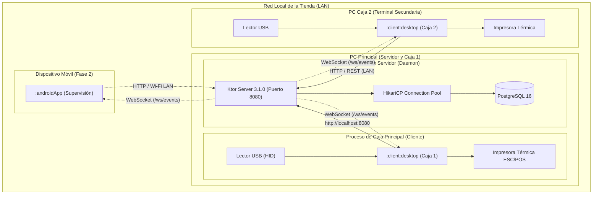

# Arquitectura: Visión General (Overview)

Este documento describe la arquitectura técnica, las capas lógicas, los límites modulares y la topología de red de **NexusPOS**.

---

## 1. Contexto y Objetivos del Sistema

NexusPOS está diseñado para satisfacer la operación diaria de una tienda de abarrotes y miscelánea con una o múltiples cajas de cobro. Las prioridades de diseño, en orden estricto, son:

1. **Consistencia financiera y de inventario:** Tolerancia cero a desajustes en el efectivo de caja, cuentas de crédito de clientes (fiado) y existencias.
2. **Rapidez de cobro:** Interfaz optimizada para teclado y lector de código de barras USB, sin latencias perceptibles en la captura.
3. **Operación continua sin Internet (LAN-First):** La tienda cobra y despacha independientemente del estado de la conexión a Internet o caídas de servicios externos en la nube.
4. **Mantenibilidad y simplicidad:** Monolito modular con límites claros, fácil de desplegar y mantener sin orquestadores complejos.

---

## 2. Topología de Red en la Tienda (LAN-First)

El sistema opera completamente dentro de la Red de Área Local (LAN) de la sucursal:



### Características de la Topología:
- **PC Principal:** Ejecuta el backend autoritativo (`:server`) y la base de datos central PostgreSQL como servicios independientes. La caja de la PC principal es un cliente de escritorio que apunta a `http://localhost:8080`.
- **Cajas Secundarias:** Terminales de escritorio conectadas por cable Ethernet al router de la tienda. Operan consumiendo exclusivamente la API HTTP del servidor.
- **Terminal Móvil (Fase 2):** Dispositivo Android conectado por Wi-Fi a la subred interna para tareas de supervisión, consulta de precios y ajustes de inventario.
- **Pivote Autoritativo:** Las cajas cliente **no sincronizan bases de datos SQLite locales**. El carrito se mantiene en la memoria RAM del cliente hasta que se ejecuta el cobro atómico. Si la red cae, la caja entra en estado `Sin servidor` y **bloquea las ventas**, garantizando que no existan ventas invisibles o desajustes de folios y stock.

---

## 3. Organización Modular en Gradle

El proyecto está estructurado en módulos Gradle de una sola responsabilidad con dependencias estrictas en una sola dirección:

```text
                               ┌─────────────────┐
                               │  :shared:core   │
                               └────────┬────────┘
                                        │
                                        ▼
                               ┌─────────────────┐
                               │:shared:contracts│
                               └────────┬────────┘
                                        │
                 ┌──────────────────────┴──────────────────────┐
                 ▼                                             ▼
          ┌─────────────┐                               ┌─────────────┐
          │   :server   │                               │ :client:app │
          └─────────────┘                               └──────┬──────┘
                                                               │
                                                               ▼
                                                        ┌───────────────┐
                                                        │:client:desktop│
                                                        └───────────────┘
```

| Módulo | Tipo de Proyecto | Responsabilidades |
| :--- | :--- | :--- |
| **`:shared:core`** | Kotlin Multiplatform | Tipos de valor `@JvmInline value class Money` y `Quantity`, enumeraciones (`ProductUnit`), reglas canónicas de cálculo e impuestos ([`PricingRules`](file:///Users/eddch/Documents/OzafryDev/NexusPOS/shared/core/src/commonMain/kotlin/mx/nexuspos/core/PricingRules.kt)). Sin dependencias externas de frameworks. |
| **`:shared:contracts`** | Kotlin Multiplatform | Contratos de comunicación DTO (`kotlinx.serialization`), catálogo de códigos de error tipados ([`ApiError`](file:///Users/eddch/Documents/OzafryDev/NexusPOS/shared/contracts/src/commonMain/kotlin/mx/nexuspos/contracts/ApiError.kt)), payloads de eventos WebSocket. |
| **`:server`** | Kotlin JVM | Monolito de servidor Ktor 3.1: routing `/api/v1`, pool HikariCP, migraciones Flyway sobre PostgreSQL 16, seguridad con **BCrypt**, transacciones ACID atómicas de venta, caja, crédito y auditoría. |
| **`:client:app`** | Compose Multiplatform | Lógica de presentación y vistas compartidas: [`SalesScreen`](file:///Users/eddch/Documents/OzafryDev/NexusPOS/client/app/src/commonMain/kotlin/mx/nexuspos/client/features/sales/SalesScreen.kt), [`SalesViewModel`](file:///Users/eddch/Documents/OzafryDev/NexusPOS/client/app/src/commonMain/kotlin/mx/nexuspos/client/features/sales/SalesViewModel.kt), diálogos modales (pesaje manual decimal, cobro con cambio, clientes), [`ApiClient`](file:///Users/eddch/Documents/OzafryDev/NexusPOS/client/app/src/commonMain/kotlin/mx/nexuspos/client/core/ApiClient.kt) y monitor de estado LAN. |
| **`:client:desktop`** | Kotlin JVM / Compose Desktop | Lanzador ejecutable para PC: empaquetado nativo (`jpackage`), atajos globales de teclado y adaptadores físicos de hardware ([`KeyboardWedgeBarcodeInput`](file:///Users/eddch/Documents/OzafryDev/NexusPOS/client/desktop/src/main/kotlin/mx/nexuspos/desktop/hardware/KeyboardWedgeBarcodeInput.kt) y [`EscPosReceiptPrinter`](file:///Users/eddch/Documents/OzafryDev/NexusPOS/client/desktop/src/main/kotlin/mx/nexuspos/desktop/hardware/EscPosReceiptPrinter.kt)). |
| **`:androidApp`** *(Fase 2)* | Android Application | Reservado para la app móvil de supervisión que reutilizará `:client:app`. |

---

## 4. Principios de Arquitectura

1. **Monolito Modular:** Toda la lógica de negocio y persistencia reside en un único artefacto desplegable en el servidor. Cero sobrecarga de microservicios.
2. **Servidor como Única Autoridad:** Precios finales, cálculo de impuestos, existencia real, límite de crédito y folios consecutivos se determinan en el servidor. La caja solo muestra una proyección previa.
3. **Una Sola Transacción por Operación Crítica:** Una venta registra simultáneamente el ticket, el descuento de stock, el movimiento de efectivo en la sesión de caja y el cargo a crédito (si aplica), o hace rollback total.
4. **Idempotencia Garantizada:** Toda solicitud de escritura crítica (`POST /api/v1/sales`) requiere una cabecera `Idempotency-Key` generada por el cliente. Si la red falla y el cliente reintenta, el servidor devuelve la respuesta previa sin duplicar cobros ni folios.
5. **Aislamiento de Hardware:** Lectores de código de barras, básculas e impresoras térmicas residen detrás de adaptadores desacoplados en el cliente, permitiendo ejecutar y probar el sistema sin dispositivos físicos conectados.
