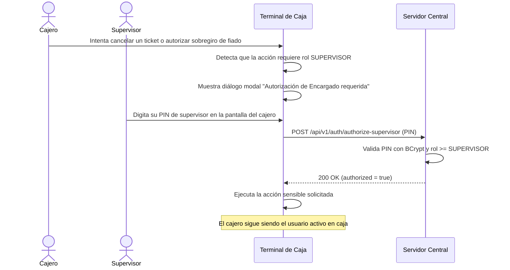

# Funcionalidad: Autenticación, Permisos y Estado de Red

Este documento detalla el mecanismo de inicio de sesión rápido por PIN numérico, cambio de cajero, autorización de supervisor y detección reactiva de conectividad LAN.

---

## 1. Objetivo
Permitir a los operadores de caja iniciar sesión y alternar turnos en segundos con la máxima agilidad en mostrador, proteger acciones sensibles mediante autorización de encargado con PIN, y monitorear de forma reactiva la salud de la red local para evitar ventas inconsistentes.

---

## 2. Alcance

### Incluye:
- Inicio de sesión mediante PIN numérico de 4 dígitos.
- Hashing y verificación con **BCrypt** (salt dinámico, factor de costo 10).
- Cambio rápido de cajero en la misma terminal.
- Autorización al vuelo (*Elevation of Privilege*) mediante diálogo modal de PIN de supervisor sin cerrar la sesión del cajero.
- Monitor en segundo plano de conectividad LAN con máquina de estados (`Connected`, `Reconnecting`, `NoServer`).
- Bloqueo preventivo de ventas cuando el servidor no responde en la red local.

### Queda fuera (Fases futuras):
- Autenticación biométrica por huella dactilar (Fase 3).
- Tarjetas de proximidad RFID / NFC para cajeros (Fase 3).

---

## 3. Actores y Precondiciones

- **Actores:** Cajero, Encargado, Administrador.
- **Precondiciones:**
  1. El usuario debe existir en la base de datos y tener estatus `ACTIVE`.
  2. La terminal debe tener acceso de red hacia el servidor autoritativo.

---

## 4. Flujo Funcional

### A. Inicio de Sesión y Cambio de Cajero
1. El cajero teclea su PIN de 4 dígitos en el teclado numérico.
2. La terminal envía la petición `POST /api/v1/auth/login`.
3. El servidor verifica el PIN contra el hash BCrypt.
4. Si es válido, responde con el objeto `LoginResponse` (nombre, rol y permisos).
5. La caja actualiza el encabezado superior con el nombre del cajero activo.

### B. Autorización de Supervisor al Vuelo

---

## 5. Reglas de Negocio

- **RN-AUT-01 (Formato y Protección de PIN):** Los PINs son de 4 dígitos numéricos. Nunca se almacenan en texto plano ni se transmiten en URLs.
- **RN-AUT-02 (Persistencia de Carrito en Cambio de Cajero):** Si un cajero releva a otro con un carrito armado a la mitad, los productos no se pierden automáticamente; el nuevo cajero puede continuar la venta o vaciarla conscientemente.
- **RN-AUT-03 (Acción Atómica de Autorización):** La autorización de supervisor es válida únicamente para la acción inmediata que la detonó; no otorga una sesión permanente de supervisor a la caja.
- **RN-AUT-04 (Protección de Integridad por Caída de LAN):** Cuando el monitor de red detecta `NO_SERVER`, se bloquea el cobro para evitar la emisión de tickets que no queden registrados en el servidor central.

---

## 6. Diseño Técnico

- **Componente de Red:** [`ServerConnection.kt`](file:///Users/eddch/Documents/OzafryDev/NexusPOS/client/app/src/commonMain/kotlin/mx/nexuspos/client/core/ServerConnection.kt).
- **Módulo Criptográfico:** [`Security.kt`](file:///Users/eddch/Documents/OzafryDev/NexusPOS/server/src/main/kotlin/mx/nexuspos/server/platform/Security.kt).
- **Servicio Backend:** [`IdentityService.kt`](file:///Users/eddch/Documents/OzafryDev/NexusPOS/server/src/main/kotlin/mx/nexuspos/server/modules/identity/IdentityService.kt).
- **Contratos DTO:** [`IdentityDtos.kt`](file:///Users/eddch/Documents/OzafryDev/NexusPOS/shared/contracts/src/commonMain/kotlin/mx/nexuspos/contracts/identity/IdentityDtos.kt) (`LoginRequest`, `LoginResponse`, `SupervisorAuthRequest`).
- **Endpoints:**
  - `POST /api/v1/auth/login`
  - `POST /api/v1/auth/authorize-supervisor`
  - `GET /health`

---

## 7. Feature Flags y Configuraciones

- `max_pin_attempts`: Número de intentos fallidos permitidos antes de suspender temporalmente el teclado numérico por 30 segundos.

---

## 8. Errores y Casos Límite

| Escenario | Comportamiento del Sistema |
| :--- | :--- |
| **PIN incorrecto** | El servidor responde `401 INVALID_PIN` y la caja limpia el campo solicitando reintentar. |
| **PIN correcto pero rol insuficiente** | Si un cajero ingresa su PIN en el diálogo de supervisor, el servidor responde `403 INSUFFICIENT_PERMISSIONS`. |
| **Pérdida súbita del cable de red** | El monitor pasa a `RECONNECTING` y luego a `NO_SERVER`; la interfaz desactiva los botones de cobro y previene errores 500. |

---

## 9. Pruebas y Criterios de Aceptación

1. El usuario inicial `Don Pepe` con PIN `1234` debe autenticarse correctamente retornando rol `ADMIN`.
2. Probar un PIN incorrecto (`9999`) debe ser rechazado con código HTTP 401.
3. Un cajero regular no debe poder autorizarse a sí mismo en el endpoint de supervisor.
- **Suite de pruebas:** [`ServerComprehensiveTest.testLoginAndAuth()`](file:///Users/eddch/Documents/OzafryDev/NexusPOS/server/src/test/kotlin/mx/nexuspos/server/ServerComprehensiveTest.kt#L30-L43).

---

## 10. Referencias
- [ADR-005: Seguridad y Hashing con BCrypt](file:///Users/eddch/Documents/OzafryDev/NexusPOS/docs/architecture/technical-decisions.md#adr-005-seguridad-con-hashing-bcrypt-para-pins-y-sha-256-para-dispositivos)
- [Documento de Seguridad](file:///Users/eddch/Documents/OzafryDev/NexusPOS/docs/architecture/security.md)
