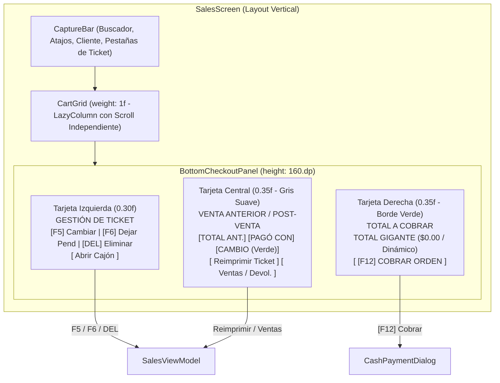

# Funcionalidad: Panel Inferior de Totales y Gestión (Bottom Checkout Panel)

Este documento describe la especificación técnica y funcional del componente **BottomCheckoutPanel** en **Compose Desktop** para NexusPOS, junto con el nuevo layout vertical de pantalla completa en `SalesScreen.kt`.

---

## 1. Objetivo

Dotar al módulo de ventas de NexusPOS de un panel inferior horizontal fijo (`160.dp`), organizado en tres tarjetas especializadas de alta ergonomía visual:
1. **Gestión de Ticket:** Control de cuentas multi-ticket con atajos de teclado (`F5`, `F6`, `DEL`) y apertura de cajón.
2. **Venta Anterior / Post-Venta:** Resumen inmediato de la última venta completada (Total, Pagó con, Cambio en verde) y accesos de reimpresión y turnos.
3. **Total a Cobrar:** Presentación destacada del importe actual en tipografía gigante y botón primario masivo `[F12] COBRAR ORDEN`.

Asimismo, unifica el área central de ventas en un esquema vertical donde `CartGrid` aprovecha el 100% del ancho horizontal disponible y hace scroll de manera independiente.

---

## 2. Alcance

### Incluye:
- **Tarjeta 1: GESTIÓN DE TICKET (weight ~0.30f):**
  - Cabecera con título en negrita y Badge `"En Curso"`.
  - Fila de 3 botones cuadrados/compactos:
    - `[F5] Cambiar`: Cicla entre tickets abiertos en memoria.
    - `[F6] Dejar Pend`: Pone en espera el ticket activo y crea un nuevo ticket limpio.
    - `[DEL] Eliminar`: Elimina la partida seleccionada o la última agregada (resaltado en rojo `error`).
  - Fila inferior: Botón de ancho completo `"Abrir Cajón"` con icono `Inbox`.
- **Tarjeta 2: VENTA ANTERIOR / POST-VENTA (weight ~0.35f):**
  - Surface con color `surfaceVariant` (gris suave) para distinguir que es un contexto histórico ya cerrado.
  - Cabecera con título e indicador de folio (`"Ticket #---"` inicial o `"Ticket #1042"`).
  - 3 cajas informativas con borde (`InfoBox`):
    - `TOTAL ANT.` (inicial `$0.00`).
    - `PAGÓ CON` (inicial `$0.00`).
    - `CAMBIO` (inicial `$0.00`, resaltado en color verde `Color(0xFF2E7D32)`).
  - 2 botones inferiores: `"Reimprimir Ticket"` y `"Ventas / Devol."`.
- **Tarjeta 3: TOTAL A COBRAR (weight ~0.35f):**
  - Borde verde principal de 2.dp (`BorderStroke(2.dp, Color(0xFF2E7D32))`) de alta prioridad visual.
  - Cabecera con título `"TOTAL A COBRAR"` e indicador `"Moneda: MXN ($)"`.
  - Monto total gigante alineado a la derecha (`36.sp`, `FontWeight.Black`, verde).
  - Botón primario masivo verde (`Color(0xFF1B5E20)`):
    - Texto: `"[F12] COBRAR ORDEN"`
    - Subtexto: `"Efectivo / Tarjeta / Fiado"`
- **Refactorización de Layout en `SalesScreen.kt`:**
  - Sustitución de la columna lateral del 32% por un flujo vertical homogéneo: `CaptureBar` superior, `CartGrid` con `weight(1f)` y `BottomCheckoutPanel` inferior.

### Queda fuera (Fases futuras):
- Soporte para cobro directo mediante terminal bancaria integrada (PinPad) por API o puerto serial (Fase 2).
- Modal avanzado de auditoría detallada de devoluciones de mercancía (Fase 2).

---

## 3. Actores y Precondiciones

- **Actores:** Cajero principal, Cajero de relevo, Supervisor de tienda.
- **Precondiciones:**
  1. La aplicación debe encontrarse en el módulo de ventas (`AppModule.SALES`).
  2. Para habilitar el botón `[F12] COBRAR ORDEN`, el carrito debe contener al menos un artículo (`cartLines.isNotEmpty()`), existir una sesión de caja abierta (`activeSession != null`) y haber comunicación con el servidor LAN (`connectionState == ServerConnectionState.CONNECTED`).

---

## 4. Flujo Funcional y Diagrama de Arquitectura



---

## 5. Estructura de Datos y Estado

### Modelo de Estado (`BottomCheckoutPanelState.kt`)
Ubicación: `client/app/src/commonMain/kotlin/mx/nexuspos/client/features/sales/BottomCheckoutPanelState.kt`

```kotlin
data class BottomCheckoutPanelState(
    // 1. Gestión de Ticket
    val activeTicketLabel: String = "Ticket 1",
    val statusBadgeText: String = "En Curso",
    val hasMultipleTickets: Boolean = false,
    val canDelete: Boolean = false,

    // 2. Venta Anterior
    val lastSaleFolio: String = "Ticket #---",
    val lastSaleTotalFormatted: String = "$0.00",
    val lastSaleReceivedFormatted: String = "$0.00",
    val lastSaleChangeFormatted: String = "$0.00",
    val hasLastSale: Boolean = false,

    // 3. Total a Cobrar
    val currentTotalFormatted: String = "$0.00",
    val currencyLabel: String = "Moneda: MXN ($)",
    val canCheckout: Boolean = false,
    val isServerConnected: Boolean = true
)

fun SalesUiState.toBottomCheckoutPanelState(): BottomCheckoutPanelState
```

---

## 6. Especificación de Componentes y Diseño Visual

| Sección | Elemento | Estilo / Dimensiones | Color / Acento | Propósito |
|---|---|---|---|---|
| **Contenedor** | Row principal | Altura `176.dp`, padding `14.dp` | Surface con tonalElevation | Contenedor ergonómico de 3 tarjetas a altura uniforme. |
| **Tarjeta 1** | Cabecera + Badge | `titleSmall` Bold + `labelSmall` | `primaryContainer` | Muestra estado del ticket en curso. |
| **Tarjeta 1** | Botones [F5], [F6], [DEL] | Altura `50.dp`, padding `4.dp` | [DEL] en rojo oscuro `0xFFB71C1C` con texto blanco | Operaciones rápidas con alto contraste en tema oscuro. |
| **Tarjeta 1** | Botón Abrir Cajón | Altura `44.dp`, centrado | Contorno outline, icono 18.dp | Disparo manual del solenoide del cajón de efectivo. |
| **Tarjeta 2** | Surface contenedor | Altura `176.dp`, radio `8.dp` | `surfaceVariant` (alpha 0.45f) | Denota contexto histórico/pasado de la transacción previa. |
| **Tarjeta 2** | InfoBoxes (3 cajas) | Altura `58.dp`, borde `1.dp` | CAMBIO en verde neón `0xFF00E676` | Desglose contable holgado de la última venta cerrada. |
| **Tarjeta 2** | Botones Reimprimir / Ventas | Altura `44.dp`, `11.5.sp` | Contorno outline, iconos centrados | Acciones auxiliares post-venta y consulta de turno. |
| **Tarjeta 3** | Surface contenedor | Borde `2.5.dp` verde sólido | `Color(0xFF4CAF50)` | Máxima jerarquía visual para el importe a cobrar. |
| **Tarjeta 3** | Total Gigante | `36.sp` Black, alineado a la derecha | Verde luminoso `Color(0xFF00E676)` | Lectura clara y radiante en fondos oscuros. |
| **Tarjeta 3** | Botón [F12] Cobrar | Altura `58.dp`, ancho completo | Verde activo `Color(0xFF2E7D32)` | Gatillo masivo de cobro con texto blanco nítido. |

---

## 7. Casos de Prueba y Validación

Las pruebas unitarias automatizadas se localizan en `client/desktop/src/test/kotlin/mx/nexuspos/desktop/sales/BottomCheckoutPanelTest.kt`:

1. **`testDefaultBottomCheckoutPanelState`:** Verifica los valores iniciales limpios en cero (`$0.00` y `Ticket #---`).
2. **`testMappingFromSalesUiStateEmpty`:** Valida la proyección del estado cuando no hay artículos en el carrito.
3. **`testMappingFromSalesUiStateWithCompletedSale`:** Valida el cálculo dinámico del folio, total anterior, importe recibido y cambio en verde tras concretar una venta.
4. **`testCycleNextTicketInViewModel`:** Verifica la alternancia circular de tickets abiertos (`[F5]`).
5. **`testHoldTicketAndNew`:** Valida que `[F6]` genere un nuevo ticket limpio manteniendo el anterior en espera.
6. **`testOpenCashDrawerAndReprintMessages`:** Valida los eventos de control de cajón y reimpresión de tickets.

---

## 8. Rendimiento y Ergonomía POS

- **Ancho Completo para la Parrilla:** Al suprimir la barra lateral derecha que consumía el 32% del ancho, el `CartGrid` ahora se expande horizontalmente en su totalidad, permitiendo que las 8 columnas contables (incluyendo badges de báscula RS-232 y cantidades decimales) se lean sin truncamiento ni apiñamiento.
- **Scroll Aislado:** La tabla de productos implementada con `LazyColumn` en `Modifier.weight(1f)` hace scroll independiente de forma fluida mientras el encabezado superior y el panel inferior permanecen completamente estáticos.
- **Operación 100% por Teclado:** Cada acción clave del panel inferior cuenta con su shortcut explícito (`F5`, `F6`, `DEL`, `F12`) visible directamente en la etiqueta de los botones.

---

## 9. Seguridad y Manejo de Errores

- **Bloqueo por Red:** Si el servidor local LAN se desconecta (`ServerConnectionState.NO_SERVER`), el botón `[F12] COBRAR ORDEN` se inhabilita de inmediato para proteger la integridad de los folios fiscales y del inventario central.
- **Protección de Sesión de Caja:** Si no hay un turno de caja abierto, al presionar `[F12]` la aplicación redirige automáticamente al cajero al diálogo de apertura de turno con fondo inicial.

---

## 10. Trazabilidad con Requerimientos

| Requerimiento Solicitado | Implementación | Verificación |
|---|---|---|
| Franja horizontal inferior con 3 tarjetas en Row | `BottomCheckoutPanel.kt` con altura `160.dp` | `BottomCheckoutPanelTest.kt` y `SalesScreen.kt` |
| Tarjeta Izquierda (~0.3f): Gestión de Ticket con F5, F6, DEL y Abrir Cajón | `TicketManagementCard` | `BottomCheckoutPanelTest.kt` |
| Tarjeta Central (~0.35f): Venta Anterior con fondo gris, Total, Pagó y Cambio (verde) | `PreviousSaleCard` y `InfoBox` | `BottomCheckoutPanelTest.kt` |
| Tarjeta Derecha (~0.35f): Borde verde, Total gigante a la derecha y botón [F12] | `TotalToChargeCard` | `BottomCheckoutPanelTest.kt` |
| Valores iniciales limpios en cero ($0.00 y Ticket #---) | `BottomCheckoutPanelState.kt` | `testDefaultBottomCheckoutPanelState` |
| Scroll independiente para tabla de productos en venta | `CartGrid` en `Column` con `weight(1f)` en `SalesScreen.kt` | Verificación en ejecución Desktop |
