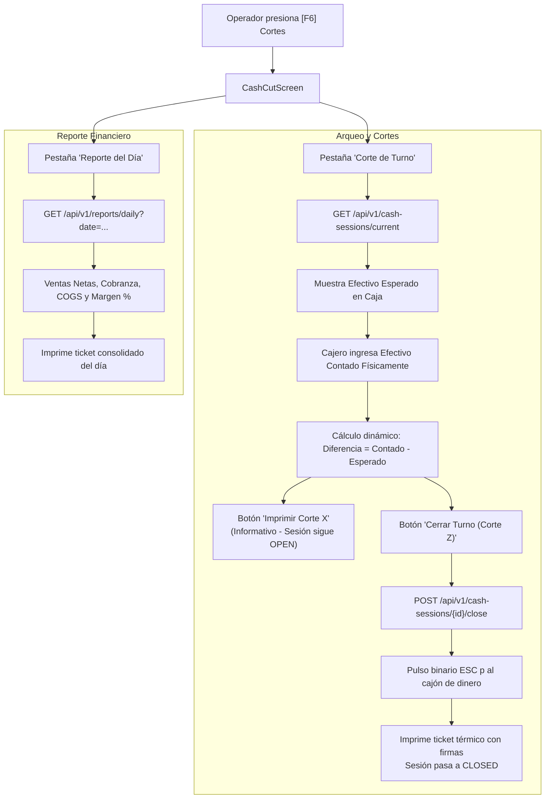

# Funcionalidad: Sesiones de Caja, Arqueo [F6] (Corte X y Z) y Reporte del Día

Este documento describe la gestión integral del efectivo en cada terminal de venta: apertura de turno con fondo inicial, movimientos de entrada/salida, arqueo físico en tiempo real, emisión de **Corte X** y **Corte Z**, y generación del **Reporte Financiero Consolidado del Día** con métricas de ganancia y costo de reposición.

---

## 1. Objetivo

Garantizar el control, la trazabilidad y la reconciliación matemática del dinero en efectivo que ingresa y sale de cada caja, eliminando descuadres inexplicables, proporcionando una fórmula auditable para el cálculo de sobrantes o faltantes en cada turno de trabajo y calculando la rentabilidad diaria del negocio.

---

## 2. Alcance

### Incluye:
- **Apertura de turno.** Desktop verifica el turno de la caja al iniciar sesión y solicita el fondo inicial según la configuración de Turnos.
- **Registro de Entradas y Salidas:** Atajos `[F7]` (Entrada manual de cambio) y `[F8]` (Retiro de efectivo para proveedores/gastos con concepto y monto).
- **Módulo de Cortes de Turno ([F6] Cortes):** Pantalla especializada [`CashCutScreen.kt`](file:///Users/eddch/Documents/OzafryDev/NexusPOS/client/app/src/commonMain/kotlin/mx/nexuspos/client/features/cash/CashCutScreen.kt) con dos pestañas de alto impacto:
  1. **Pestaña 1 — Corte de Turno:**
     - Tarjetas KPI: Fondo Inicial, Ventas Efectivo, Abonos Cobrados de Crédito, Entradas, Salidas y **Efectivo Esperado en Caja**.
     - Panel de Arqueo Físico: Campo para captura del efectivo contado por el cajero con cálculo dinámico de diferencia en vivo (`differenceCents`) y badge visual (**Cuadrado Exacto**, **Sobrante (Excedente)** o **Faltante**).
     - **Calculadora por Denominaciones:** Selector interactivo de billetes ($1000, $500, $200, $100, $50, $20) y monedas ($20, $10, $5, $2, $1, $0.50) con conteo de piezas y subtotal automático sincronizado con el campo de conteo total.
     - **Modo Arqueo Ciego (Blind Count):** Configurable a nivel sucursal (`blind_cash_count_enabled`); oculta el saldo esperado y las diferencias numéricas durante el conteo físico para evitar manipulación del arqueo.
     - **Corte X (Arqueo Parcial):** Genera e imprime un ticket informativo con el estado actual de la caja manteniendo el turno abierto (`OPEN`) para continuar operando.
     - **Corte Z (Cierre Oficial):** Envía el cierre al servidor (`POST /api/v1/cash-sessions/{id}/close`), emite el pulso de apertura al cajón de dinero, imprime el ticket térmico oficial con renglones de firma para cajero y supervisor, y marca la sesión como `CLOSED`.
     - Botón `[F7] Abrir Cajón` para verificación física del efectivo.
  2. **Pestaña 2 — Reporte del Día:**
     - Consulta de ventas consolidadas del día mediante `GET /api/v1/reports/daily`.
     - Desglose por método de pago (Efectivo, Crédito Fiado, otros), cobranza de abonos de fiados, tickets completados y cancelados.
     - **Métricas de Rentabilidad:** Costo total de reposición de mercancía vendida (COGS), ganancia bruta estimada en pesos (`totalSales - totalCost`) y margen de utilidad porcentual (`profitMarginPercent`).
     - Botón para imprimir ticket térmico del reporte financiero diario.

### Queda fuera (Fases futuras):
- Cortes por turnos múltiples simultáneos en una sola máquina física (se opera una caja por máquina).

---

## 3. Actores y Precondiciones

- **Actores:** Cajero (su propia caja), Encargado (todas las cajas), Administrador.
- **Precondiciones:**
  1. Para abrir sesión: la terminal no debe tener una sesión previa abierta.
  2. Para operar ventas: debe existir una sesión abierta activa asociada a la terminal.

---

## 4. Flujo Funcional

### Apertura al iniciar sesión

En Desktop, después de validar el PIN de un usuario con permisos `cash.view` y `cash.open`, NexusPOS consulta la caja configurada en esa terminal.

| Estado de la caja | Qué ocurre |
| --- | --- |
| Turno abierto | Se entra con el turno existente. Se conserva su fondo y su operador. El relevo se realiza por separado y depende de **Permitir relevo de operador** y del permiso `cash.handoff`. |
| Sin turno y **Solicitar fondo inicial** activado | Aparece el diálogo **Fondo de caja** sobre la pantalla del PIN. Ingresa un monto desde cero con hasta dos decimales y selecciona **Abrir turno**. Usa `0` si la caja inicia sin cambio. **Cancelar** vuelve al PIN. |
| Sin turno y **Solicitar fondo inicial** desactivado | NexusPOS abre el turno con fondo cero y, una vez confirmado por el servidor, muestra la aplicación. |
| Error de conexión o apertura | La pantalla de acceso muestra el error y permite reintentar o cancelar. Si el servidor confirma un turno que apareció durante la apertura, Desktop usa ese turno. |

Cambia la política en **Configuración V2 → Turnos → Solicitar fondo inicial**. La opción se aplica en la siguiente apertura. Un rol que carece de alguno de los dos permisos conserva su acceso habitual sin activar la apertura al iniciar sesión.

### Arqueo y cortes

Después de confirmar el cierre del turno, Desktop ofrece **Salir de NexusPOS** o **Nuevo turno**. Al elegir **Nuevo turno**, la terminal vuelve al PIN y aplica la configuración del fondo de caja. Si el cierre se hizo desde **Cortes**, la confirmación también permite consultar y reimprimir el comprobante.

---

## 5. Reglas de Negocio

- **RN-CAJ-01 (Sesión Única por Caja):** Una caja solo puede tener una sesión abierta a la vez. No se permite abrir una segunda sesión sin haber cerrado la anterior.
- **RN-CAJ-02 (Fondo inicial).** Cada turno registra un fondo en centavos. Con la captura activada, el operador confirma el importe, incluido cero. Con la captura desactivada, el sistema registra cero.
- **RN-CAJ-03 (Registro de Movimientos):** Todo retiro o ingreso manual debe registrar monto en centavos, concepto descriptivo y usuario responsable.
- **RN-CAJ-04 (Fórmula Canónica de Efectivo Esperado):**
  $$\text{Efectivo Esperado} = \text{Fondo Inicial} + \text{Ventas Efectivo} + \text{Abonos Crédito} + \text{Entradas Manuales} - \text{Retiros} - \text{Cancelaciones Efectivo}$$
- **RN-CAJ-05 (Cálculo de Diferencia / Arqueo):**
  $$\text{Diferencia} = \text{Efectivo Contado Físicamente} - \text{Efectivo Esperado}$$
  - Si $\text{Diferencia} > 0$: Existe un **Sobrante (Excedente)**.
  - Si $\text{Diferencia} < 0$: Existe un **Faltante**.
  - Si $\text{Diferencia} = 0$: Cuadre exacto.
- **RN-CAJ-06 (Inmutabilidad del Corte Z):** Una vez cerrada una sesión con Corte Z, su estado pasa a `CLOSED` y no se le pueden asociar más ventas ni movimientos. Las ventas posteriores exigirán una nueva apertura de turno.
- **RN-CAJ-07 (Cálculo Financiero de Ganancia en Reporte Diario):**
  - Costo de Mercancía Vendida (COGS): $\sum \frac{\text{quantity\_millis} \times \text{cost\_cents}}{1000}$.
  - Ganancia Bruta: $\text{Ventas Netas} - \text{COGS}$.
  - Margen Porcentual: $\frac{\text{Ganancia Bruta}}{\text{Ventas Netas}} \times 100\%$.

---

## 6. Diseño Técnico

- **Vistas UI Compose:**
  - Captura de fondo al iniciar sesión en [LoginScreen.kt](../../client/app/src/commonMain/kotlin/mx/nexuspos/client/features/auth/LoginScreen.kt), coordinada por [AuthViewModel.kt](../../client/app/src/commonMain/kotlin/mx/nexuspos/client/features/auth/AuthViewModel.kt).
  - Pantalla principal de cortes: [`CashCutScreen.kt`](file:///Users/eddch/Documents/OzafryDev/NexusPOS/client/app/src/commonMain/kotlin/mx/nexuspos/client/features/cash/CashCutScreen.kt).
  - Calculadora interactiva por denominaciones: [`DenominationCalculator.kt`](file:///Users/eddch/Documents/OzafryDev/NexusPOS/client/app/src/commonMain/kotlin/mx/nexuspos/client/features/cash/DenominationCalculator.kt).
  - Diálogo de fondo inicial: [`CashSessionDialog.kt`](file:///Users/eddch/Documents/OzafryDev/NexusPOS/client/app/src/commonMain/kotlin/mx/nexuspos/client/features/cash/CashSessionDialog.kt).
- **Gestor de Estado:** [`CashCutViewModel.kt`](file:///Users/eddch/Documents/OzafryDev/NexusPOS/client/app/src/commonMain/kotlin/mx/nexuspos/client/features/cash/CashCutViewModel.kt), [`CashCutUiState.kt`](file:///Users/eddch/Documents/OzafryDev/NexusPOS/client/app/src/commonMain/kotlin/mx/nexuspos/client/features/cash/CashCutUiState.kt).
- **Servicios Backend:**
  - [`CashSessionService.kt`](file:///Users/eddch/Documents/OzafryDev/NexusPOS/server/src/main/kotlin/mx/nexuspos/server/modules/cash/CashSessionService.kt).
  - [`ReportsService.kt`](file:///Users/eddch/Documents/OzafryDev/NexusPOS/server/src/main/kotlin/mx/nexuspos/server/modules/reports/ReportsService.kt).
- **Contratos DTO:**
  - [`CashSessionDtos.kt`](file:///Users/eddch/Documents/OzafryDev/NexusPOS/shared/contracts/src/commonMain/kotlin/mx/nexuspos/contracts/cash/CashSessionDtos.kt) (`CashSessionSummary`, `CashDenominationCountDto`, `DailyFinancialReportDto`, `OpenSessionRequest`, `CloseSessionRequest`).
- **Formateador Térmico:** [`EscPosReceiptPrinter.kt`](file:///Users/eddch/Documents/OzafryDev/NexusPOS/client/desktop/src/main/kotlin/mx/nexuspos/desktop/hardware/EscPosReceiptPrinter.kt) (`formatCashCutText`, `formatDailyReportText`).
- **Endpoints:**
  - `POST /api/v1/cash-sessions`
  - `GET /api/v1/cash-sessions/current`
  - `GET /api/v1/cash-sessions/{id}/summary`
  - `POST /api/v1/cash-sessions/{id}/movements`
  - `POST /api/v1/cash-sessions/{id}/close`
  - `GET /api/v1/reports/daily`

---

## 7. Pruebas Automatizadas

- [AuthFeatureTest.kt](../../client/desktop/src/test/kotlin/mx/nexuspos/desktop/auth/AuthFeatureTest.kt) cubre los importes válidos e inválidos, el fondo cero, la cancelación, el reintento, los permisos y la reutilización de turnos existentes o abiertos desde otra terminal.
- **Pruebas de Backend Integrado:**
  - [`CashSessionDenominationsTest.kt`](file:///Users/eddch/Documents/OzafryDev/NexusPOS/server/src/test/kotlin/mx/nexuspos/server/CashSessionDenominationsTest.kt): Persistencia de denominaciones en `cash_session_denominations` y auditoría de modo ciego.
  - [`ReportsModuleTest.kt`](file:///Users/eddch/Documents/OzafryDev/NexusPOS/server/src/test/kotlin/mx/nexuspos/server/ReportsModuleTest.kt): Verificación de ventas, costos, COGS, ganancia bruta estimada y margen de utilidad.
- **Pruebas de Frontend Desktop:** [`CashCutFeatureTest.kt`](file:///Users/eddch/Documents/OzafryDev/NexusPOS/client/desktop/src/test/kotlin/mx/nexuspos/desktop/cash/CashCutFeatureTest.kt).
  - `testCountingDifferenceCalculation`: Validación matemática de arqueo exacto, sobrante y faltante.
  - `testDenominationCalculatorUpdatesCountedAndDifference`: Calculadora interactiva de billetes y monedas que actualiza en tiempo real el conteo físico y la diferencia.
  - `testPerformCorteXDispatchesPrintWithoutClosing`: Corte X emite ticket manteniendo el turno `OPEN`.
  - `testPerformCorteZClosesSessionAndTriggersDrawerAndPrint`: Corte Z cierra sesión en servidor, emite pulso al cajón y manda a imprimir con desglose de denominaciones.
  - `testDailyFinancialReportLoadingAndReceiptFormatting`: Carga y formateo de bytes del reporte diario.
