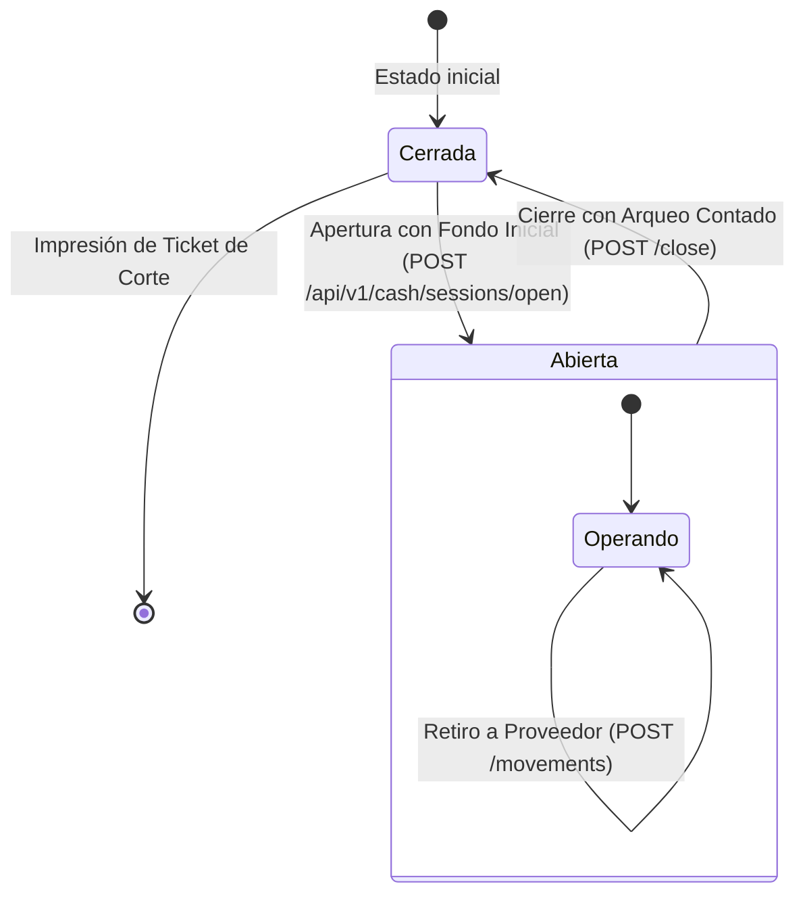

# Funcionalidad: Sesiones y Cortes de Caja

Este documento describe la gestión del ciclo de vida del efectivo en cada terminal: apertura de turno, registro de movimientos de entrada/salida, arqueo físico y cierre de corte.

---

## 1. Objetivo
Garantizar el control y la trazabilidad absoluta del dinero en efectivo que ingresa y sale de cada caja, eliminando descuadres inexplicables y proporcionando una fórmula auditable para el cálculo de sobrantes o faltantes en cada turno de trabajo.

---

## 2. Alcance

### Incluye:
- Apertura de turno con captura de fondo inicial de cambio.
- Registro de entradas manuales de efectivo (ej. aportación de morralla).
- Registro de salidas/retiros de efectivo (ej. pago a repartidor o proveedor de refrescos).
- Integración automática del efectivo cobrado por ventas y abonos de clientes fiados.
- Arqueo de caja y captura de efectivo contado físicamente al finalizar el turno.
- Cálculo automático de la diferencia (sobrante `+` o faltante `-`) según la regla canónica `RN-CAJ-04`.
- Emisión de ticket térmico de corte de caja con líneas para firma de cajero y supervisor.

### Queda fuera (Fases futuras):
- Denominador visual de billetes y monedas por piezas (desglose pieza por pieza) (Fase 2).
- Cortes ciegos donde el cajero no ve el esperado hasta después de capturar el contado (Fase 2).

---

## 3. Actores y Precondiciones

- **Actores:** Cajero (su propia caja), Encargado (todas las cajas), Administrador.
- **Precondiciones:**
  1. Para abrir sesión: la terminal no debe tener una sesión previa abierta.
  2. Para cerrar sesión: debe existir una sesión abierta activa asociada al cajero o terminal.

---

## 4. Flujo Funcional

---

## 5. Reglas de Negocio

- **RN-CAJ-01 (Sesión Única por Caja):** Una caja solo puede tener una sesión abierta a la vez. No se permite abrir una segunda sesión sin haber cerrado la anterior.
- **RN-CAJ-02 (Fondo Inicial Obligatorio):** Todo turno debe iniciar con un importe de fondo declarado (puede ser `$0.00` si se inicia sin cambio).
- **RN-CAJ-03 (Registro de Movimientos):** Todo retiro o ingreso manual debe registrar monto en centavos, concepto descriptivo y usuario responsable.
- **RN-CAJ-04 (Fórmula Canónica de Efectivo Esperado):**
  $$\text{Efectivo Esperado} = \text{Fondo Inicial} + \text{Ventas Efectivo} + \text{Abonos Crédito} + \text{Entradas Manuales} - \text{Retiros} - \text{Devoluciones}$$
- **RN-CAJ-05 (Cálculo de Diferencia / Arqueo):**
  $$\text{Diferencia} = \text{Efectivo Contado Físicamente} - \text{Efectivo Esperado}$$
  - Si $\text{Diferencia} > 0$: Existe un **Sobrante**.
  - Si $\text{Diferencia} < 0$: Existe un **Faltante**.
- **RN-CAJ-06 (Inmutabilidad del Corte):** Una vez cerrada una sesión, su estado pasa a `CLOSED` y no se le pueden agregar más ventas ni movimientos. Las ventas posteriores exigirán una nueva apertura de turno.

---

## 6. Diseño Técnico

- **Vistas UI:** [`CashSessionDialog.kt`](file:///Users/eddch/Documents/OzafryDev/NexusPOS/client/app/src/commonMain/kotlin/mx/nexuspos/client/features/cash/CashSessionDialog.kt).
- **Gestor de Estado:** [`SalesViewModel.openCashSession()`](file:///Users/eddch/Documents/OzafryDev/NexusPOS/client/app/src/commonMain/kotlin/mx/nexuspos/client/features/sales/SalesViewModel.kt), `closeCashSession()`.
- **Servicio Backend:** [`CashSessionService.kt`](file:///Users/eddch/Documents/OzafryDev/NexusPOS/server/src/main/kotlin/mx/nexuspos/server/modules/cash/CashSessionService.kt).
- **Contratos DTO:** [`CashSessionDtos.kt`](file:///Users/eddch/Documents/OzafryDev/NexusPOS/shared/contracts/src/commonMain/kotlin/mx/nexuspos/contracts/cash/CashSessionDtos.kt) (`OpenSessionRequest`, `CloseSessionRequest`, `CashSessionSummary`).
- **Formateador de Ticket:** [`EscPosReceiptPrinter.formatCashCutText()`](file:///Users/eddch/Documents/OzafryDev/NexusPOS/client/desktop/src/main/kotlin/mx/nexuspos/desktop/hardware/EscPosReceiptPrinter.kt).
- **Endpoints:**
  - `POST /api/v1/cash/sessions/open`
  - `POST /api/v1/cash/sessions/{id}/movements`
  - `POST /api/v1/cash/sessions/{id}/close`
  - `GET /api/v1/cash/sessions/active?registerId=...`

---

## 7. Feature Flags y Configuraciones

- `max_cash_outflow_without_supervisor`: Límite en pesos (ej. $500.00) sobre el cual un cajero regular requiere que el supervisor autorice la salida de dinero para pagar mercancía.

---

## 8. Errores y Casos Límite

| Escenario | Comportamiento del Sistema |
| :--- | :--- |
| **Intento de venta sin sesión abierta** | El cobro se rechaza con error `409 SESSION_CLOSED`. |
| **Intento de abrir sesión duplicada** | Si la caja ya tiene turno abierto, el servidor rechaza con `400 ALREADY_OPEN`. |
| **Retiro mayor al efectivo disponible** | Advertencia en pantalla alertando que la caja quedará con saldo negativo de efectivo. |

---

## 9. Pruebas y Criterios de Aceptación

1. Abrir con $500.00, registrar $3,450.00 de ventas en efectivo, $200.00 de abono a crédito y un retiro de $150.00 a proveedor debe arrojar un efectivo esperado de **exactamente $4,000.00**.
2. Si el cajero cuenta físicamente $4,005.00, la diferencia registrada debe ser **+$5.00 (Sobrante)**.
3. El ticket de corte debe desglosar cada concepto e incluir espacio para firma de cajero y supervisor.
- **Suite de pruebas:** [`ServerComprehensiveTest.testCashSessionAndCutDifference()`](file:///Users/eddch/Documents/OzafryDev/NexusPOS/server/src/test/kotlin/mx/nexuspos/server/ServerComprehensiveTest.kt#L106-L128).

---

## 10. Referencias
- [ADR-004: Precisión Financiera con Value Classes](file:///Users/eddch/Documents/OzafryDev/NexusPOS/docs/architecture/technical-decisions.md#adr-004-precision-financiera-con-value-classes-money-y-quantity)
- [Reglas de Caja en Diseño Funcional](file:///Users/eddch/Documents/OzafryDev/NexusPOS/docs/architecture/diseno-funcional.md#43-corte-de-caja)
