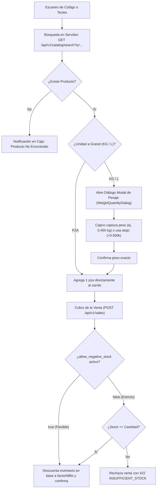

# Funcionalidad: Catálogo, Pesaje e Inventario

Este documento describe la estructura del catálogo de productos para abarrotes y misceláneas, la venta a granel (por peso o volumen), la deducción de existencias con factores de presentación y la política de inventario negativo.

---

## 1. Objetivo
Gestionar el inventario de la tienda de forma precisa y adaptable a las particularidades del comercio minorista: venta por piezas empaquetadas (refrescos, botanas, enlatados) y venta al peso o a granel (frutas, verduras, huevo, jamón), garantizando la deducción exacta de stock sin discrepancias.

---

## 2. Alcance

### Incluye:
- Catálogo jerárquico: Productos base y múltiples presentaciones (unidades de venta).
- Códigos de barras universales EAN-13 / UPC y códigos internos de tienda.
- Venta a granel: Diálogo de pesaje con fracciones exactas de hasta 3 decimales en kilogramos (`0.250 kg`, `0.450 kg`) o litros.
- Atajos de peso rápido en mostrador (+0.250k, +0.500k, +0.750k, +1.000k, +2.000k).
- Conversión de presentaciones mediante factor entero en milésimas (`factor_millis`).
- Descuento atómico de existencias en cada venta mediante `stock_movements`.
- Política de inventario negativo configurable por el administrador (`allow_negative_stock`).
- Búsqueda en tiempo real por escaneo de código de barras o texto parcial de nombre.

### Queda fuera (Fases futuras):
- Integración automática con básculas electrónicas por puerto serial USB/RS-232 (Fase 2; la báscula física complementará pero **no eliminará** la captura manual).
- Control de fechas de caducidad y lotes de proveedores (Fase 3).
- Importación masiva desde archivos Excel (Fase 2).

---

## 3. Actores y Precondiciones

- **Actores:** Cajero (consulta y venta), Encargado (entradas de mercancía y ajustes de inventario), Administrador (alta de productos, precios y configuración de stock).
- **Precondiciones:**
  1. Los productos deben tener definida su unidad de medida base (`PIECE`, `KILOGRAM`, `LITER`).
  2. Cada presentación debe tener un código de barras único y un factor de conversión asignado.

---

## 4. Flujo Funcional

---

## 5. Reglas de Negocio

- **RN-CAT-01 (Código de Barras Único):** No pueden existir dos presentaciones con el mismo código de barras.
- **RN-CAT-02 (Factor de Presentación):** Toda presentación define cuántas unidades base representa mediante `factor_millis` (ejemplo: six-pack de refrescos tiene factor `6000L`).
- **RN-CAT-03 (Venta al Peso con Precisión):** Los productos con unidad `KILOGRAM` o `LITER` se calculan en milésimas de unidad, evitando aproximaciones que generen pérdidas para la tienda o cobros injustos al cliente.
- **RN-INV-01 (Existencias Centralizadas):** El stock se almacena y audita exclusivamente en el servidor central; las terminales nunca mantienen existencias locales aisladas.
- **RN-INV-02 (Trazabilidad de Movimientos):** Todo cambio de inventario registra fecha, usuario, tipo (`SALE`, `PURCHASE`, `ADJUSTMENT`, `RETURN`) y cantidad en `stock_movements`.
- **RN-INV-04 (Política de Inventario Negativo Administrable):**
  - Si `allow_negative_stock = true`: La venta descuenta el inventario y no se detiene si la existencia llega a números negativos.
  - Si `allow_negative_stock = false`: La venta valida la existencia antes de persistir; si no alcanza, aborta la transacción y devuelve el error con los datos del producto faltante.

---

## 6. Diseño Técnico

- **Vistas UI:** [`WeightQuantityDialog.kt`](file:///Users/eddch/Documents/OzafryDev/NexusPOS/client/app/src/commonMain/kotlin/mx/nexuspos/client/features/sales/WeightQuantityDialog.kt), [`SalesScreen.kt`](file:///Users/eddch/Documents/OzafryDev/NexusPOS/client/app/src/commonMain/kotlin/mx/nexuspos/client/features/sales/SalesScreen.kt).
- **Tipos de Dominio:** [`Quantity.kt`](file:///Users/eddch/Documents/OzafryDev/NexusPOS/shared/core/src/commonMain/kotlin/mx/nexuspos/core/Quantity.kt), [`ProductUnit.kt`](file:///Users/eddch/Documents/OzafryDev/NexusPOS/shared/core/src/commonMain/kotlin/mx/nexuspos/core/ProductUnit.kt).
- **Servicio Backend:** [`CatalogService.kt`](file:///Users/eddch/Documents/OzafryDev/NexusPOS/server/src/main/kotlin/mx/nexuspos/server/modules/catalog/CatalogService.kt), [`SettingsService.kt`](file:///Users/eddch/Documents/OzafryDev/NexusPOS/server/src/main/kotlin/mx/nexuspos/server/modules/system/SettingsService.kt).
- **Contratos DTO:** [`CatalogDtos.kt`](file:///Users/eddch/Documents/OzafryDev/NexusPOS/shared/contracts/src/commonMain/kotlin/mx/nexuspos/contracts/catalog/CatalogDtos.kt) (`ProductDto`, `PresentationDto`).
- **Endpoints:**
  - `GET /api/v1/catalog/search?q=...`
  - `GET /api/v1/catalog/products/{id}`
  - `POST /api/v1/catalog/products`
  - `POST /api/v1/inventory/movements`

---

## 7. Feature Flags y Configuraciones

| Variable | Tipo | Por Defecto | Descripción |
| :--- | :---: | :---: | :--- |
| `allow_negative_stock` | Boolean | `true` | Determina si el sistema permite vender mercancía sin existencia registrada. El administrador puede alternarla en cualquier momento desde Configuración. |

---

## 8. Errores y Casos Límite

| Escenario | Comportamiento del Sistema |
| :--- | :--- |
| **Código no registrado** | La caja emite alerta visual indicando que el código no existe en el catálogo. |
| **Existencias insuficientes (`allow_negative_stock=false`)** | El servidor rechaza la transacción atómica con `422 INSUFFICIENT_STOCK` e indica el nombre del producto agotado. |
| **Pesaje con más de 3 decimales** | La interfaz trunca o redondea al gramo más cercano (`millis: Long`). |

---

## 9. Pruebas y Criterios de Aceptación

1. Buscar el código `7501055310884` debe retornar inmediatamente la *Coca-Cola Original 600ml*.
2. Capturar `0.450 kg` de *Jitomate Saladet* ($34.00/kg) debe arrojar exactamente un total de **$15.30**.
3. Con `allow_negative_stock = false`, intentar vender 5 piezas de un producto con stock 2 debe arrojar un error HTTP 422.
4. Con `allow_negative_stock = true`, la misma venta debe completarse exitosamente y dejar el stock en **-3**.
- **Suite de pruebas:** [`ServerComprehensiveTest.testInventoryNegativePolicyToggle()`](file:///Users/eddch/Documents/OzafryDev/NexusPOS/server/src/test/kotlin/mx/nexuspos/server/ServerComprehensiveTest.kt#L45-L67), [`CoreCalculationsTest.kt`](file:///Users/eddch/Documents/OzafryDev/NexusPOS/shared/core/src/commonTest/kotlin/mx/nexuspos/core/CoreCalculationsTest.kt).

---

## 10. Referencias
- [ADR-004: Precisión Financiera con Value Classes](file:///Users/eddch/Documents/OzafryDev/NexusPOS/docs/architecture/technical-decisions.md#adr-004-precision-financiera-con-value-classes-money-y-quantity)
- [ADR-006: Política de Inventario Negativo Configurable](file:///Users/eddch/Documents/OzafryDev/NexusPOS/docs/architecture/technical-decisions.md#adr-006-politica-de-inventario-negativo-configurable-allow_negative_stock)
- [Catálogo y Pesaje en Diseño Funcional](file:///Users/eddch/Documents/OzafryDev/NexusPOS/docs/architecture/diseno-funcional.md#2-modulos-funcionales)
