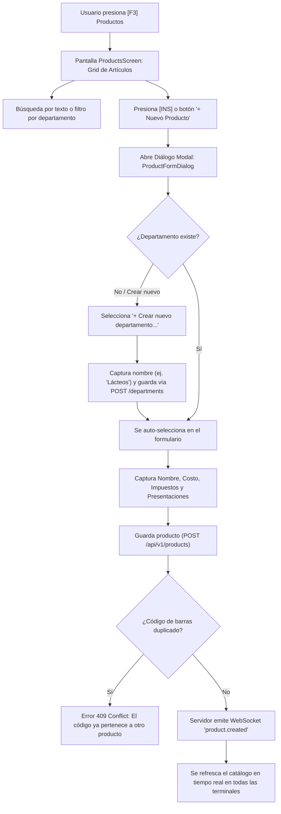

# Funcionalidad: Catálogo de Productos y Departamentos ([F3] Productos)

Este documento detalla la gestión integral del catálogo de productos y departamentos en **NexusPOS**, incluyendo el ciclo de vida de artículos (alta, edición, desactivación lógica, reactivación), administración de presentaciones con precios y factores de conversión, venta al peso/granel y organización departamental.

---

## 1. Objetivo
Proveer un módulo centralizado, rápido y ergonómico ([F3] Productos) para la administración del maestro de artículos de la tienda de abarrotes, permitiendo clasificar productos por departamentos, asociar múltiples presentaciones por código de barras, calcular precios de venta y asegurar la integridad de datos en el mostrador.

---

## 2. Alcance

### Incluye:
- **Gestión de Artículos (CRUD):** Alta, edición, búsqueda y desactivación lógica (*soft-delete*) de productos.
- **Generación Automática de SKU:** Asignación automática de SKU de formato `SKU-<HEX>` cuando no se capture manualmente.
- **Validación de Unicidad:** Bloqueo de duplicados en códigos de barras y SKUs en todo el catálogo.
- **Presentaciones Múltiples:** Cada producto base puede tener una o varias presentaciones con código de barras propio, factor de conversión en milésimas (`factor_millis`) y precio en centavos (`price_cents`).
- **Gestión de Departamentos/Categorías:**
  - Creación, modificación y eliminación de departamentos.
  - Creación rápida *"al vuelo"* desde el formulario de producto (`+ Crear nuevo departamento...`).
  - Reasignación automática a departamento "General" (`null`) al eliminar una categoría, sin pérdida de mercancía.
- **Venta al Peso o a Granel:** Diálogo de pesaje con fracciones exactas de hasta 3 decimales en kilogramos (`0.250 kg`, `0.450 kg`) o litros.
- **Visualización en Carrito:** Despliegue del nombre oficial del producto (ej. "Coca-Cola 600ml") en vez de solo la presentación ("Pieza").
- **Operación por Teclado:** Atajos `[F3]` para ingresar al catálogo, `[INS]` para nuevo producto, `[Enter]` para editar, `[Esc]` para cerrar formularios o volver a `[F1] Ventas`.

### Queda fuera (Fases futuras):
- Importación masiva desde archivos Excel/CSV (Fase 2).
- Gestión de lotes de proveedores y fechas de caducidad (Fase 3).
- Impresión de etiquetas de código de barras para estantes (Fase 2).

---

## 3. Actores y Precondiciones

- **Actores:** Administrador, Encargado de Tienda, Cajero (sólo consulta y venta).
- **Precondiciones:**
  1. Base de datos con migración inicial de catálogo y departamentos precargados.
  2. Cada producto debe contar con al menos una presentación principal (por defecto unidad con factor 1000).

---

## 4. Flujo Funcional

---

## 5. Reglas de Negocio

- **RN-CAT-01 (Código de Barras Único):** No pueden existir dos presentaciones en el catálogo con el mismo código de barras. Si se intenta registrar un código existente en otro producto, el servidor rechaza con `409 Conflict`.
- **RN-CAT-02 (Factor de Presentación):** Toda presentación define cuántas unidades base representa mediante `factor_millis` (ej.Six-Pack con factor `6000L`). La presentación individual estándar tiene factor `1000L`.
- **RN-CAT-03 (Venta al Peso con Precisión):** Los productos con unidad base `KILOGRAM` o `LITER` se calculan en milésimas de unidad, evitando discrepancias de redondeo monetario.
- **RN-CAT-04 (Autogeneración de SKU):** Si el campo SKU se envía vacío o en blanco, el servidor genera automáticamente un identificador único en mayúsculas (`SKU-<HEX8>`).
- **RN-CAT-05 (Integridad Departamental al Eliminar):** Al eliminar un departamento mediante `DELETE /api/v1/departments/{id}`, todos los productos vinculados son reasignados automáticamente a `department_id = NULL` ("General"). Ningún producto queda huérfano ni se produce error de llave foránea.
- **RN-CAT-06 (Desactivación Lógica / Soft Delete):** Al eliminar un producto mediante `DELETE /api/v1/products/{id}`, el registro no se borra físicamente de la base de datos para preservar el historial de tickets y kardex; se marca `is_active = FALSE`. Puede reactivarse mediante `POST /api/v1/products/{id}/reactivate`.
- **RN-CAT-07 (Consistencia de Nombre en Venta):** Las líneas del carrito de venta muestran como título principal el nombre del producto base (`prod.name`), acompañando el subtítulo con la presentación si difiere, evitando que el ticket diga únicamente "Pieza".

---

## 6. Diseño Técnico

### Componentes de UI (Desktop / Client)
- [`ProductsScreen.kt`](file:///Users/eddch/Documents/OzafryDev/NexusPOS/client/app/src/commonMain/kotlin/mx/nexuspos/client/features/products/ProductsScreen.kt): Vista principal con tabla de productos, barra de búsqueda en tiempo real, filtro departamental, toggle de inactivos y atajos de teclado.
- [`ProductFormDialog.kt`](file:///Users/eddch/Documents/OzafryDev/NexusPOS/client/app/src/commonMain/kotlin/mx/nexuspos/client/features/products/ProductFormDialog.kt): Modal de captura y edición de producto con administración de presentaciones y opción de alta rápida de departamento.
- [`DepartmentsManagementDialog.kt`](file:///Users/eddch/Documents/OzafryDev/NexusPOS/client/app/src/commonMain/kotlin/mx/nexuspos/client/features/products/DepartmentsManagementDialog.kt): Modal para crear, renombrar y suprimir departamentos con confirmación de seguridad.
- [`ProductsViewModel.kt`](file:///Users/eddch/Documents/OzafryDev/NexusPOS/client/app/src/commonMain/kotlin/mx/nexuspos/client/features/products/ProductsViewModel.kt): Gestión reactiva del estado `ProductsUiState`.

### Contratos de Datos (DTOs)
- [`CatalogDtos.kt`](file:///Users/eddch/Documents/OzafryDev/NexusPOS/shared/contracts/src/commonMain/kotlin/mx/nexuspos/contracts/catalog/CatalogDtos.kt):
  - `ProductDto`, `ProductPresentationDto`, `DepartmentDto`
  - `CreateProductRequest`, `UpdateProductRequest`, `CreatePresentationRequest`
  - `CreateDepartmentRequest`, `UpdateDepartmentRequest`

### Backend y Persistencia
- [`CatalogService.kt`](file:///Users/eddch/Documents/OzafryDev/NexusPOS/server/src/main/kotlin/mx/nexuspos/server/modules/catalog/CatalogService.kt):
  - `createProduct`, `updateProduct`, `deactivateProduct`, `reactivateProduct`, `getProductById`, `searchProducts`.
  - `getAllDepartments`, `createDepartment`, `updateDepartment`, `deleteDepartment`.
- [`Application.kt`](file:///Users/eddch/Documents/OzafryDev/NexusPOS/server/src/main/kotlin/mx/nexuspos/server/Application.kt): Endpoints REST `/api/v1/products` y `/api/v1/departments`.

---

## 7. Atajos de Teclado del Módulo

| Atajo | Acción | Contexto |
| :--- | :--- | :--- |
| **F3** | Ingresar al Módulo de Productos | Desde cualquier módulo |
| **INS** | Nuevo Producto | Vista principal de Productos |
| **Enter** | Editar Producto Seleccionado | Fila seleccionada en tabla |
| **Esc** | Cerrar Diálogo / Volver a [F1] Ventas | Modal abierto o pantalla principal |

---

## 8. Errores y Casos Límite

| Escenario | Respuesta del Sistema |
| :--- | :--- |
| **Código de barras ya asignado a otro artículo** | `409 Conflict: El código de barras '...' ya está registrado en el producto '...'` |
| **SKU ya existente** | `409 Conflict: El SKU '...' ya se encuentra registrado` |
| **Eliminar departamento con productos asignados** | El departamento se borra, y los productos se actualizan a departamento `General` sin error. |
| **Guardar producto sin presentaciones** | El formulario o el backend genera automáticamente la presentación predeterminada con factor 1000. |

---

## 9. Pruebas y Criterios de Aceptación

1. **Ciclo de Vida de Producto:** Alta de producto con 2 presentaciones, modificación de precio, desactivación lógica y reactivación exitosa (`ProductCatalogTest.testProductLifecycleCrud`).
2. **Validación de Duplicados:** Intentar crear un producto con un código de barras ya existente debe ser rechazado con excepción de conflicto (`ProductCatalogTest.testDuplicateBarcodeValidation`).
3. **Ciclo de Vida Departamental:** Alta de departamento, asignación de producto, eliminación de departamento y verificación de que el producto ahora tiene `departmentId = null` (`ProductCatalogTest.testDepartmentCrud`).
4. **Flujo de Pantalla Desktop:** Comportamiento del ViewModel con búsqueda, apertura de diálogos y persistencia (`ProductsFeatureTest.testProductsScreenFlowAndDepartmentManagement`).

---

## 10. Referencias
- [Especificación de Endpoints REST](file:///Users/eddch/Documents/OzafryDev/NexusPOS/docs/api/endpoints.md#c-catálogo-de-productos-y-departamentos)
- [Funcionalidad: Inventario y Kardex](file:///Users/eddch/Documents/OzafryDev/NexusPOS/docs/features/inventory-kardex.md)
- [ADR-004: Precisión Financiera con Value Classes](file:///Users/eddch/Documents/OzafryDev/NexusPOS/docs/architecture/technical-decisions.md#adr-004-precision-financiera-con-value-classes-money-y-quantity)
