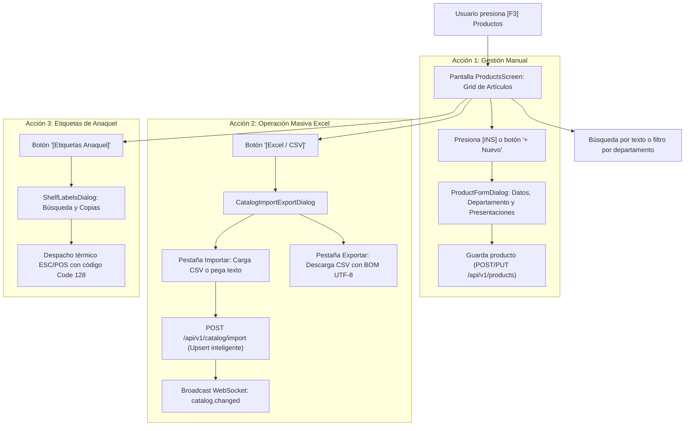

# Funcionalidad: Catálogo de Productos, Departamentos, Importador Excel y Etiquetas de Anaquel ([F3] Productos)

Este documento detalla la gestión integral del catálogo de productos y departamentos en **NexusPOS**, incluyendo el ciclo de vida de artículos (alta, edición, desactivación lógica, reactivación), presentaciones con precios y factores de conversión, venta al peso/granel, organización departamental, importación/exportación masiva compatible con Microsoft Excel y generación térmica de etiquetas de anaquel con códigos de barras ESC/POS.

---

## 1. Objetivo

Proveer un módulo centralizado, rápido y ergonómico ([F3] Productos) para la administración del maestro de artículos de la tienda de abarrotes, permitiendo clasificar productos por departamentos, asociar múltiples presentaciones por código de barras, calcular precios de venta, mantener actualizados miles de productos mediante hojas de cálculo Excel y emitir etiquetas de anaquel para estanterías físicas.

---

## 2. Alcance

### Incluye:
- **Gestión de Artículos (CRUD):** Alta, edición, búsqueda y desactivación lógica (*soft-delete*) de productos.
- **Generación Automática de SKU:** Asignación automática de SKU de formato `SKU-<HEX>` cuando no se capture manualmente.
- **Validación de Unicidad:** Bloqueo de duplicados en códigos de barras y SKUs en todo el catálogo.
- **Presentaciones Múltiples:** Cada producto base puede tener una o varias presentaciones con código de barras propio, factor de conversión en milésimas (`factor_millis`) y precio en centavos (`price_cents`).
- **Gestión de Departamentos/Categorías:**
  - Creación, modificación y eliminación de departamentos.
  - Creación rápida *"al vuelo"* desde el formulario de producto (`+ Crear nuevo departamento...`).
  - Reasignación automática a departamento "General" (`null`) al eliminar una categoría, sin pérdida de mercancía.
- **Venta al Peso o a Granel:** Diálogo de pesaje con fracciones exactas de hasta 3 decimales en kilogramos (`0.250 kg`, `0.450 kg`) o litros.
- **Importación / Exportación Masiva Excel (.csv / .xlsx):**
  - **Exportador Oficial:** Genera un archivo CSV con BOM UTF-8 (`\uFEFF`) y especificación RFC 4180 que se abre directamente en Microsoft Excel sin caracteres especiales corruptos ni desconfiguración de acentos.
  - **Importador Masivo Inteligente:** Procesa archivos o texto pegado con upsert automático (si el producto existe por SKU o código de barras, actualiza precios, costos, nombres y existencias; si no existe, lo crea). Da de alta departamentos inexistentes al vuelo.
  - Modal [`CatalogImportExportDialog.kt`](file:///Users/eddch/Documents/OzafryDev/NexusPOS/client/app/src/commonMain/kotlin/mx/nexuspos/client/features/products/CatalogImportExportDialog.kt) con previsualización, reporte de filas exitosas/fallidas y tabla de errores detallada.
- **Generador de Etiquetas de Anaquel ESC/POS:**
  - Modal [`ShelfLabelsDialog.kt`](file:///Users/eddch/Documents/OzafryDev/NexusPOS/client/app/src/commonMain/kotlin/mx/nexuspos/client/features/products/ShelfLabelsDialog.kt) para selección de productos y número de copias.
  - Previsualización visual térmica fidedigna antes de enviar a imprimir.
  - Generación de comandos binarios ESC/POS nativos con código de barras Code 128 Set B (`GS k 73`), texto legible inferior (HRI) y precio en gran formato para impresoras térmicas de 58mm y 80mm.
- **Operación por Teclado:** Atajos `[F3]` para ingresar al catálogo, `[INS]` para nuevo producto, `[Enter]` para editar, `[Esc]` para cerrar formularios o volver a `[F1] Ventas`.

### Queda fuera:
- Gestión de lotes de proveedores y fechas de caducidad (Fase 3).

---

## 3. Actores y Precondiciones

- **Actores:** Administrador, Encargado de Tienda, Cajero (sólo consulta y venta).
- **Precondiciones:**
  1. Base de datos con migración inicial de catálogo y departamentos precargados.
  2. Cada producto debe contar con al menos una presentación principal (por defecto unidad con factor 1000).

---

## 4. Flujo Funcional

---

## 5. Reglas de Negocio

- **RN-CAT-01 (Código de Barras Único):** No pueden existir dos presentaciones en el catálogo con el mismo código de barras. Si se intenta registrar un código existente en otro producto, el servidor rechaza con `409 Conflict`.
- **RN-CAT-02 (Factor de Presentación):** Toda presentación define cuántas unidades base representa mediante `factor_millis` (ej. Six-Pack con factor `6000L`). La presentación individual estándar tiene factor `1000L`.
- **RN-CAT-03 (Venta al Peso con Precisión):** Los productos con unidad base `KILOGRAM` o `LITER` se calculan en milésimas de unidad, evitando discrepancias de redondeo monetario.
- **RN-CAT-04 (Autogeneración de SKU):** Si el campo SKU se envía vacío o en blanco, el servidor genera automáticamente un identificador único en mayúsculas (`SKU-<HEX8>`).
- **RN-CAT-05 (Integridad Departamental al Eliminar):** Al eliminar un departamento mediante `DELETE /api/v1/departments/{id}`, todos los productos vinculados son reasignados automáticamente a `department_id = NULL` ("General"). Ningún producto queda huérfano ni se produce error de llave foránea.
- **RN-CAT-06 (Desactivación Lógica / Soft Delete):** Al eliminar un producto mediante `DELETE /api/v1/products/{id}`, el registro no se borra físicamente de la base de datos para preservar el historial de tickets y kardex; se marca `is_active = FALSE`. Puede reactivarse mediante `POST /api/v1/products/{id}/reactivate`.
- **RN-CAT-07 (Consistencia de Nombre en Venta):** Las líneas del carrito de venta muestran como título principal el nombre del producto base (`prod.name`), acompañando el subtítulo con la presentación si difiere, evitando que el ticket diga únicamente "Pieza".
- **RN-CAT-08 (Compatibilidad Nativa con Microsoft Excel):** Todo CSV generado por `GET /api/v1/catalog/export` debe incorporar al inicio la marca de orden de bytes UTF-8 BOM (`\uFEFF`) para que Excel en Windows y macOS abra el archivo con acentos y caracteres especiales sin distorsión.
- **RN-CAT-09 (Etiquetado Físico ESC/POS):** Las etiquetas de anaquel térmicas se imprimen centradas, incluyendo el nombre del negocio, nombre del producto en mayúsculas, precio destacado de gran tamaño, código de barras Code 128 Set B nativo (`GS k 73`) y texto legible inferior (HRI).

---

## 6. Diseño Técnico

### Componentes de UI (Desktop / Client)
- [`ProductsScreen.kt`](file:///Users/eddch/Documents/OzafryDev/NexusPOS/client/app/src/commonMain/kotlin/mx/nexuspos/client/features/products/ProductsScreen.kt): Vista principal con tabla de productos, barra de búsqueda en tiempo real, filtro departamental, y botones superiores para alta, departamentos, Excel y etiquetas.
- [`ProductFormDialog.kt`](file:///Users/eddch/Documents/OzafryDev/NexusPOS/client/app/src/commonMain/kotlin/mx/nexuspos/client/features/products/ProductFormDialog.kt): Modal de captura y edición de producto con administración de presentaciones.
- [`CatalogImportExportDialog.kt`](file:///Users/eddch/Documents/OzafryDev/NexusPOS/client/app/src/commonMain/kotlin/mx/nexuspos/client/features/products/CatalogImportExportDialog.kt): Modal de importación y exportación masiva Excel con tabla de errores y resumen de upsert.
- [`ShelfLabelsDialog.kt`](file:///Users/eddch/Documents/OzafryDev/NexusPOS/client/app/src/commonMain/kotlin/mx/nexuspos/client/features/products/ShelfLabelsDialog.kt): Modal de diseño y previsualización de etiquetas de estantería.
- [`CsvCatalogHelper.kt`](file:///Users/eddch/Documents/OzafryDev/NexusPOS/client/app/src/commonMain/kotlin/mx/nexuspos/client/features/catalog/CsvCatalogHelper.kt): Parser CSV robusto con soporte RFC 4180, normalización de acentos y prefijos monetarios.
- [`ProductsViewModel.kt`](file:///Users/eddch/Documents/OzafryDev/NexusPOS/client/app/src/commonMain/kotlin/mx/nexuspos/client/features/products/ProductsViewModel.kt): Gestión reactiva del estado `ProductsUiState`.

### Contratos de Datos (DTOs)
- [`CatalogDtos.kt`](file:///Users/eddch/Documents/OzafryDev/NexusPOS/shared/contracts/src/commonMain/kotlin/mx/nexuspos/contracts/catalog/CatalogDtos.kt): `ProductDto`, `ProductPresentationDto`, `DepartmentDto`.
- [`CatalogImportExportDtos.kt`](file:///Users/eddch/Documents/OzafryDev/NexusPOS/shared/contracts/src/commonMain/kotlin/mx/nexuspos/contracts/catalog/CatalogImportExportDtos.kt): `CatalogImportRowDto`, `CatalogImportRequest`, `CatalogImportResponse`, `CatalogImportRowResult`.

### Backend y Persistencia
- [`CatalogService.kt`](file:///Users/eddch/Documents/OzafryDev/NexusPOS/server/src/main/kotlin/mx/nexuspos/server/modules/catalog/CatalogService.kt):
  - CRUD de productos y departamentos.
  - `exportCatalogCsv`: Emisión de CSV con UTF-8 BOM.
  - `importCatalogRows`: Upsert masivo inteligente, creación de departamentos y actualización de saldos de existencias.
- [`Application.kt`](file:///Users/eddch/Documents/OzafryDev/NexusPOS/server/src/main/kotlin/mx/nexuspos/server/Application.kt): Endpoints `/api/v1/products`, `/api/v1/departments`, `/api/v1/catalog/export`, `/api/v1/catalog/import`.

---

## 7. Pruebas Automatizadas

- **Pruebas de Backend Ktor:** [`CatalogImportExportTest.kt`](file:///Users/eddch/Documents/OzafryDev/NexusPOS/server/src/test/kotlin/mx/nexuspos/server/CatalogImportExportTest.kt).
  - `testExportCatalogCsv`: Valida que la descarga CSV incluya BOM UTF-8, encabezados canónicos y precios formateados.
  - `testImportCatalogRows_create_and_update`: Valida upsert masivo: creación de nuevos productos, actualización de existentes y reporte no bloqueante de filas con error.
- **Pruebas de Frontend Desktop:** [`CatalogImportFeatureTest.kt`](file:///Users/eddch/Documents/OzafryDev/NexusPOS/client/desktop/src/test/kotlin/mx/nexuspos/desktop/products/CatalogImportFeatureTest.kt).
  - `testParseCsvToRowsWithQuotesAndCurrency`: Valida parser RFC 4180 ante comas en nombres, comillas y símbolos de moneda.
  - `testFormatShelfLabelText`: Valida plantilla de etiqueta de estantería.
  - `testGenerateShelfLabelBytesEscPos`: Valida secuencias binarias ESC/POS y comando Code 128 `GS k 73`.
