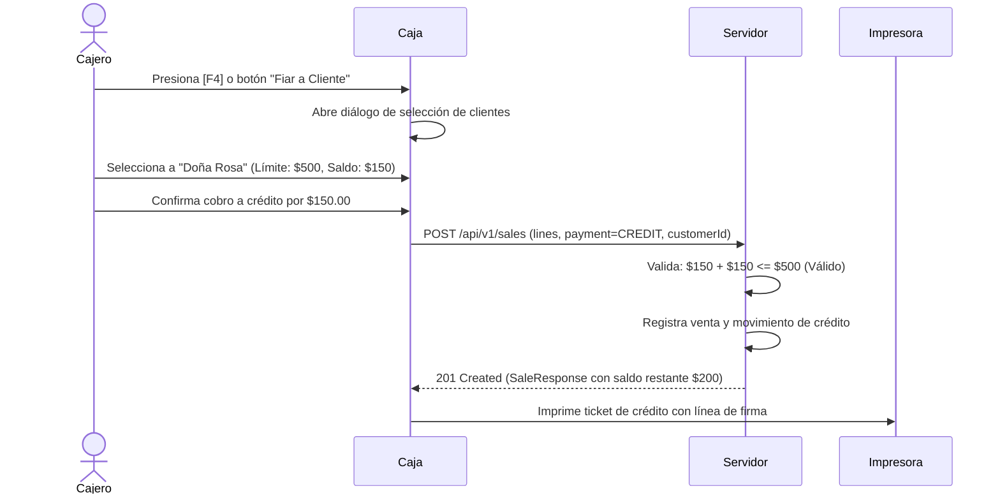

# Funcionalidad: Crédito y Fiado a Clientes

Este documento detalla la gestión del crédito tradicional (fiado en tienda de abarrotes), el control de límites deudores, cargos automáticos por venta y abonos en efectivo.

---

## 1. Objetivo
Permitir a los tenderos fiar mercancía a vecinos y clientes de confianza de forma segura y automatizada, evitando libretas de papel, controlando los topes de endeudamiento y registrando los abonos con ingreso directo al efectivo del turno.

---

## 2. Alcance

### Incluye:
- Registro y búsqueda de clientes por nombre, apodo o teléfono.
- Asignación de límite máximo de crédito por cliente (`credit_limit_cents`).
- Consulta del saldo deudor acumulado en tiempo real.
- Cobro de ventas con cargo a la cuenta corriente del cliente (`payment_method = CREDIT`).
- Validación estricta en el servidor: $\text{Saldo Actual} + \text{Venta} \le \text{Límite de Crédito}$.
- Registro de abonos en efectivo que descuentan la deuda y suman al efectivo de la caja activa.
- Liquidación total de la cuenta.
- Ticket de venta a crédito con desglose de deuda, saldo anterior, cargo actual, nuevo saldo y línea para firma.

### Queda fuera (Fases futuras):
- Cobro de intereses moratorios (en abarrotes tradicionales no se cobran intereses).
- Envío de estados de cuenta o recordatorios por WhatsApp (Fase 3).

---

## 3. Actores y Precondiciones

- **Actores:** Cajero, Encargado, Administrador, Cliente de la tienda.
- **Precondiciones:**
  1. El cliente debe estar dado de alta y en estado `ACTIVE`.
  2. Para fiar: el importe de la venta más la deuda actual no debe rebasar el límite autorizado.
  3. Para recibir abonos: el cajero debe tener sesión de caja abierta.

---

## 4. Flujo Funcional

### A. Venta a Crédito (Fiado en Mostrador)

### B. Recepción de Abono
1. El cliente acude al mostrador y entrega dinero en efectivo para abonar a su deuda (ej. $100.00).
2. El cajero selecciona al cliente y presiona **Registrar Abono**.
3. El cajero captura el importe entregado y confirma.
4. El servidor descuenta la deuda en `credit_movements` y simultáneamente registra una entrada en `cash_movements` de la sesión activa del cajero.
5. Se emite un comprobante de abono con el nuevo saldo deudor del cliente.

---

## 5. Reglas de Negocio

- **RN-CRE-01 (Cliente Requerido):** El pago a crédito exige seleccionar un cliente registrado; no existen créditos anónimos.
- **RN-CRE-02 (Límite de Crédito Exigible):** Todo cliente tiene un tope de crédito en centavos. Si una venta hace que la deuda supere el límite, el servidor rechaza la transacción con `422 CREDIT_LIMIT_EXCEEDED`.
- **RN-CRE-03 (Sobregiro Autorizado):** Un encargado o administrador puede autorizar una venta que supere el límite mediante su PIN de autorización.
- **RN-CRE-04 (Trazabilidad Inmutable):** Toda compra fiada (`CHARGE`), abono (`PAYMENT`) o ajuste (`ADJUSTMENT`) genera un registro en `credit_movements` con fecha, folio de venta (si aplica), cajero y nuevo saldo resultante.
- **RN-CRE-05 (Integración con Arqueo de Caja `RN-CAJ-04`):** El dinero recibido por abonos de clientes **ingresa físicamente al cajón de dinero**, por lo que se suma de inmediato al efectivo esperado del turno del cajero.
- **RN-CRE-06 (Firma de Conformidad):** El ticket emitido por venta a crédito debe incluir la leyenda *Venta a Crédito*, el desglose del saldo y el campo para firma autógrafa del cliente.

---

## 6. Diseño Técnico

- **Vistas UI:** [`CustomerSelectionDialog.kt`](file:///Users/eddch/Documents/OzafryDev/NexusPOS/client/app/src/commonMain/kotlin/mx/nexuspos/client/features/credit/CustomerSelectionDialog.kt).
- **Gestor de Estado:** [`SalesViewModel.checkoutCredit()`](file:///Users/eddch/Documents/OzafryDev/NexusPOS/client/app/src/commonMain/kotlin/mx/nexuspos/client/features/sales/SalesViewModel.kt), `selectCustomer()`.
- **Servicio Backend:** [`CreditService.kt`](file:///Users/eddch/Documents/OzafryDev/NexusPOS/server/src/main/kotlin/mx/nexuspos/server/modules/credit/CreditService.kt).
- **Contratos DTO:** [`CreditDtos.kt`](file:///Users/eddch/Documents/OzafryDev/NexusPOS/shared/contracts/src/commonMain/kotlin/mx/nexuspos/contracts/credit/CreditDtos.kt) (`CustomerDto`, `RegisterCreditPaymentRequest`, `CreditMovementDto`).
- **Endpoints:**
  - `GET /api/v1/credit/customers` (Búsqueda por nombre o teléfono)
  - `POST /api/v1/credit/customers` (Alta de cliente)
  - `POST /api/v1/credit/customers/{id}/payments` (Registro de abono en efectivo)
  - `GET /api/v1/credit/customers/{id}/history` (Historial de movimientos)

---

## 7. Feature Flags y Configuraciones

- `allow_credit_overdraw_with_supervisor`: Permite que un supervisor capture su PIN para saltarse el límite de crédito en una venta específica.

---

## 8. Errores y Casos Límite

| Escenario | Comportamiento del Sistema |
| :--- | :--- |
| **Venta que supera el límite de crédito** | El servidor rechaza la transacción con `422 CREDIT_LIMIT_EXCEEDED` detallando el monto disponible. |
| **Abono mayor a la deuda total** | Se restringe el abono para que el cliente no quede con saldo a favor inesperado (a menos que se habilite saldo a favor). |
| **Intento de abono sin sesión de caja** | Se rechaza con `409 SESSION_CLOSED`, ya que el efectivo del abono debe quedar asignado a un cajero responsable. |

---

## 9. Pruebas y Criterios de Aceptación

1. Vender $150.00 fiados a un cliente con saldo $0 y límite $500 debe autorizarse, dejando saldo deudor de $150.00 y crédito disponible de $350.00.
2. Un segundo intento de venta fiada por $400.00 al mismo cliente debe ser **rechazado por el servidor** ($150 + $400 = $550 > $500).
3. Registrar un abono de $50.00 en efectivo debe reducir la deuda a $100.00 y sumar $50.00 al arqueo de caja del turno.
- **Suite de pruebas:** [`ServerComprehensiveTest.testCreditLimitAndPaymentFlow()`](file:///Users/eddch/Documents/OzafryDev/NexusPOS/server/src/test/kotlin/mx/nexuspos/server/ServerComprehensiveTest.kt#L91-L104), [`ReceiptPrinterTest.testFormatCreditSaleReceipt()`](file:///Users/eddch/Documents/OzafryDev/NexusPOS/client/desktop/src/test/kotlin/mx/nexuspos/desktop/hardware/ReceiptPrinterTest.kt#L82-L135).

---

## 10. Referencias
- [ADR-004: Precisión Financiera con Value Classes](file:///Users/eddch/Documents/OzafryDev/NexusPOS/docs/architecture/technical-decisions.md#adr-004-precision-financiera-con-value-classes-money-y-quantity)
- [Reglas de Crédito en Diseño Funcional](file:///Users/eddch/Documents/OzafryDev/NexusPOS/docs/architecture/diseno-funcional.md#42-venta-a-credito-fiado)
