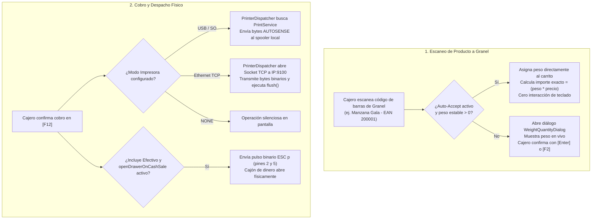

# Funcionalidad: Hardware POS y Periféricos Industriales (Báscula Serial, Impresión Térmica y Cajón)

Este documento detalla la arquitectura de integración de hardware comercial para punto de venta en **NexusPOS**, cubriendo la comunicación con básculas electrónicas seriales, impresoras térmicas ESC/POS y cajones de dinero RJ11.

---

## 1. Objetivo

Proveer una capa de abstracción de hardware desacoplada, multiplataforma (macOS, Windows, Linux) y de alta velocidad que permita la operación fluida en mostrador: pesaje instantáneo de artículos a granel sin captura manual, emisión de tickets y etiquetas térmicas por USB o red Ethernet, y control del cajón de efectivo, con tolerancia a desconexiones físicas.

---

## 2. Alcance

### A. Básculas Electrónicas Seriales (RS-232 y USB-Serial)
- **Librería Multiplataforma:** Integración de `com.fazecast:jSerialComm:2.11.0` con binarios nativos precompilados embebidos para macOS (Apple Silicon y x86_64), Windows y Linux (cero dependencias de drivers externos del SO).
- **Protocolos Industriales Compatibles:**
  - **Torrey (`TorreyScaleProtocolParser`):** Protocolo de sondeo estándar para modelos L-EQ, MFQ, PCR y W-Label enviando el comando `'P'` (`0x50`) con decodificación de tramas ASCII, detección de peso estable y limpieza de unidades.
  - **Rhino (`RhinoScaleProtocolParser`):** Decodificación de tramas continuas para modelos BAR-8, BAPCA e I-QY con prefijos `WN`, discriminando estados estables vs en movimiento.
  - **Genérico / NCI / Toledo (`GenericScaleProtocolParser`):** Parser resiliente basado en expresiones regulares con conversión automática de unidades (gramos y libras a kilogramos estándar).
  - **Simulador Virtual (`SimulatedScaleDriver`):** Emulador en memoria para pruebas unitarias, demostraciones comerciales y desarrollo continuo sin requerir hardware físico conectado.
- **Flujos Operativos en Caja:**
  - **Pesaje Continuo:** Monitoreo reactivo en tiempo real reflejado en la cabecera [`TopHeader.kt`](file:///Users/eddch/Documents/OzafryDev/NexusPOS/client/app/src/commonMain/kotlin/mx/nexuspos/client/features/header/TopHeader.kt) y en la barra de pie [`SystemFooter.kt`](file:///Users/eddch/Documents/OzafryDev/NexusPOS/client/app/src/commonMain/kotlin/mx/nexuspos/client/features/footer/SystemFooter.kt).
  - **Captura Manual Asistida:** En [`WeightQuantityDialog.kt`](file:///Users/eddch/Documents/OzafryDev/NexusPOS/client/app/src/commonMain/kotlin/mx/nexuspos/client/features/sales/WeightQuantityDialog.kt), muestra tarjeta visual destacada con el peso en vivo y botón `[Tomar Peso de Báscula (F2)]`.
  - **Auto-Aceptación al Escanear (Auto-Accept):** Si la opción está activa y el cajero escanea el código de barras de un artículo a granel con peso estable en platillo mayor a cero, el sistema agrega de inmediato el producto al carrito calculando el importe exacto sin abrir modales.
  - **Calibración y Diagnóstico en `[F5] Configuración`:** Pestaña dedicada con selector de puertos seriales detectados en caliente, tasa de baudios, intervalo de sondeo, prueba de peso en vivo y comandos físicos de **Tara** y **Cero**.
  - **Persistencia Local:** Parámetros almacenados de forma independiente por caja en `~/.nexuspos/scale.properties`.

### B. Impresoras Térmicas de Tickets ESC/POS
- **Despacho Dual:**
  - **Modo USB / Sistema Operativo:** Consume Java Print Service (JPS) localizando la impresora instalada por nombre y enviando secuencias binarias directas `AUTOSENSE`.
  - **Modo Red Ethernet / WiFi:** Conexión directa mediante Socket TCP al puerto 9100 de la impresora en la LAN con timeout configurable.
- **Formatos de Papel:** Adaptabilidad de diseño tipográfico y columnas para rollos de **80 mm** (42 columnas) y **58 mm** (32 columnas).
- **Tipos de Trabajos Térmicos Generados:**
  - Ticket de venta con desglose de formas de pago mixtas, impuestos, referencias y cambio.
  - Ticket de reimpresión oficial con marca auditable `*** COPIA DE REIMPRESIÓN ***`.
  - Ticket de Corte X (arqueo parcial informativo) y Corte Z (cierre oficial de turno con renglones de firma para cajero y supervisor).
  - Ticket consolidado de Reporte Financiero Diario con métricas de ventas, cobranza, movimientos de efectivo, COGS y margen bruto.
  - **Etiquetas de Anaquel:** Impresión de etiquetas para estantes con código de barras nativo Code 128 (`GS k 73`), texto legible inferior (HRI) y precio en gran formato.

### C. Cajón de Dinero (RJ11)
- **Apertura Binaria ESC/POS:** Emisión del comando binario estándar `ESC p` (pines 2 y 5) a través del puerto de la impresora térmica.
- **Disparadores:**
  - Apertura automática al confirmar cobro en efectivo.
  - Apertura automática al ejecutar el Corte Z de cierre de turno.
  - Apertura manual bajo demanda mediante atajo de teclado global **`[F7] Abrir Cajón`**.

---

## 3. Flujo Funcional



---

## 4. Reglas de Negocio

- **RN-HDW-01 (Pesaje No Bloqueante):** Las lecturas seriales se ejecutan en hilos secundarios dedicados de entrada/salida (`Dispatchers.IO`). Una báscula desconectada o con fallas de paridad nunca congela la interfaz de usuario ni la captura del teclado.
- **RN-HDW-02 (Criterio de Estabilidad):** Para la auto-aceptación en granel, el driver exige recibir al menos una trama con estado confirmado `STABLE` y un peso neto $> 0.005\text{ kg}$ para evitar capturas accidentales por vibración en el mostrador.
- **RN-HDW-03 (Tolerancia a Desconexión de Red en Impresión):** Si la impresora de red Ethernet no responde en el timeout configurado (ej. 3000 ms), el sistema captura la excepción, registra el incidente en bitácora y muestra advertencia no bloqueante al cajero, sin abortar la venta que ya fue registrada en la base de datos.
- **RN-HDW-04 (Configuraciones Locales por Terminal):** Los periféricos físicos están ligados a la máquina física local. La configuración de báscula e impresora se almacena en el directorio home del usuario de la terminal (`~/.nexuspos/*.properties`), permitiendo que la Caja 1 use báscula Torrey USB y la Caja 2 use báscula Rhino RS-232 sin interferencias.
- **RN-HDW-05 (Compatibilidad de Rollos Térmicos):** Todo ticket o etiqueta debe respetar estrictamente el número de columnas del papel configurado (42 para 80mm, 32 para 58mm). Textos que excedan el ancho son truncados o envueltos limpiamente sin desalinear los importes monetarios alineados a la derecha.

---

## 5. Diseño Técnico

```text
client/desktop/src/main/kotlin/mx/nexuspos/desktop/hardware/
├── EscPosReceiptPrinter.kt        # Generador binario de comandos ESC/POS y plantillas de texto
├── KeyboardWedgeBarcodeInput.kt   # Interceptor de lectores de código de barras USB
├── PrinterConfig.kt               # Modelos y enums (PrinterConnectionType, PaperWidth)
├── PrinterConfigRepository.kt     # Persistencia en ~/.nexuspos/printer.properties
├── PrinterDispatcher.kt           # Despachador dual (Java Print Service y Socket TCP 9100)
└── scale/
    ├── ScaleConfigRepository.kt   # Persistencia en ~/.nexuspos/scale.properties
    ├── ScaleDriver.kt             # Interface ScaleDriver, JSerialCommScaleDriver y SimulatedScaleDriver
    ├── ScaleManager.kt            # Coordinador de ciclo de vida en Desktop y flujos StateFlow
    └── ScaleProtocolParser.kt     # Parsers Torrey, Rhino y Genérico/Toledo
```

---

## 6. Errores y Casos Límite

| Escenario | Diagnóstico / Comportamiento |
| :--- | :--- |
| **Báscula apagada o cable serial desconectado** | El monitor de báscula en cabecera muestra estado `DESCONECTADA` en gris; la captura a granel permite entrada manual por teclado. |
| **Platillo con peso negativo (descalibrado)** | El parser detecta magnitud negativa y emite estado `UNSTABLE` o `ERROR`; el botón de cobro prohíbe auto-aceptar hasta calibrar con **[Cero]**. |
| **Impresora sin papel o con tapa abierta** | En red TCP se detecta timeout o rechazo de conexión; el ticket puede ser reimpreso posteriormente desde el historial `[Ctrl+H]`. |
| **Puerto serial ocupado por otra aplicación** | `jSerialComm` reporta puerto no disponible; el panel de configuración muestra banner descriptivo de puerto bloqueado. |

---

## 7. Pruebas Automatizadas

- **Parsers de Protocolo Serial:** [`ScaleProtocolParserTest.kt`](file:///Users/eddch/Documents/OzafryDev/NexusPOS/client/desktop/src/test/kotlin/mx/nexuspos/desktop/hardware/scale/ScaleProtocolParserTest.kt) (Torrey ASCII, Rhino WN, Genérico con conversión g/lb a kg).
- **Driver Simulado:** [`SimulatedScaleDriverTest.kt`](file:///Users/eddch/Documents/OzafryDev/NexusPOS/client/desktop/src/test/kotlin/mx/nexuspos/desktop/hardware/scale/SimulatedScaleDriverTest.kt) (Ciclo de vida, tara, cero y stream de pesos).
- **Despachador ESC/POS y TCP Socket:** [`PrinterDispatcherTest.kt`](file:///Users/eddch/Documents/OzafryDev/NexusPOS/client/desktop/src/test/kotlin/mx/nexuspos/desktop/hardware/PrinterDispatcherTest.kt) (Socket TCP 9100 simulado, comandos binarios `ESC p`, tickets de 58/80mm y manejo de fallos de red).
- **Auto-Aceptación en Granel:** [`SalesScaleFeatureTest.kt`](file:///Users/eddch/Documents/OzafryDev/NexusPOS/client/desktop/src/test/kotlin/mx/nexuspos/desktop/sales/SalesScaleFeatureTest.kt) (Adición instantánea al carrito al escanear vs apertura modal cuando el peso no es estable).
- **Configuración de Báscula en UI:** [`SettingsScaleFeatureTest.kt`](file:///Users/eddch/Documents/OzafryDev/NexusPOS/client/desktop/src/test/kotlin/mx/nexuspos/desktop/settings/SettingsScaleFeatureTest.kt) (Guardado y prueba de diagnóstico en vivo).
