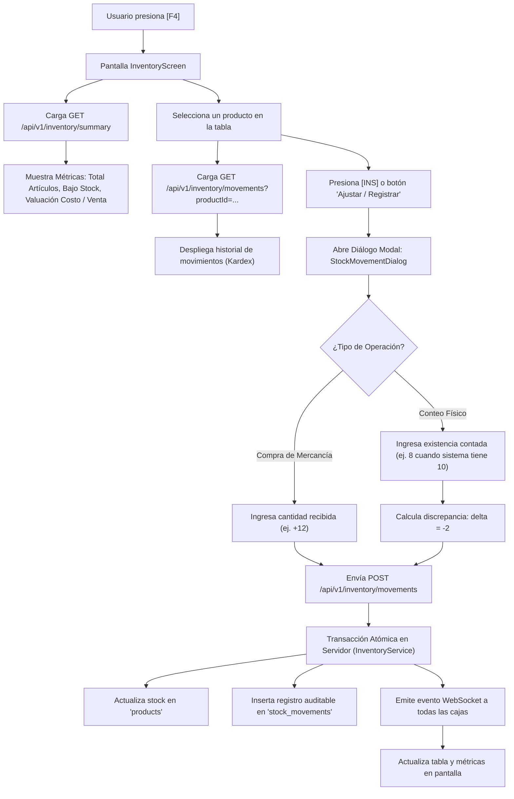

# Funcionalidad: Control de Existencias, Kardex y Ajustes ([F4] Inventario)

Este documento describe la especificación funcional y técnica del módulo de **Control de Existencias y Kardex** ([F4] Inventario) en **NexusPOS**, incluyendo el monitoreo de existencias, cálculo de valuación financiera, registro de compras, conteos físicos (ajuste de diferencias) e historial de trazabilidad de movimientos.

---

## 1. Objetivo
Proveer un control estricto, transparente y en tiempo real del inventario físico y monetario del negocio, permitiendo al tendero o administrador conocer el valor de su inventario (al costo y a la venta), auditar los movimientos de cada producto (Kardex) y conciliar discrepancias mediante ajustes físicos con auditoría completa.

---

## 2. Alcance

### Incluye:
- **Resumen Ejecutivo de Inventario:**
  - Total de artículos activos controlados por inventario.
  - Alerta de artículos con stock bajo o crítico ($\le \text{min\_stock}$).
  - Valuación monetaria total al costo ($\sum \text{stock} \times \text{costo}$).
  - Valuación monetaria total a la venta ($\sum \text{stock} \times \text{precio lista}$).
- **Tabla Central de Existencias:**
  - Consulta en tiempo real con columnas: Código / SKU, Producto, Departamento, Stock Actual, Stock Mínimo, Stock Máximo, Estado de Existencia (Normal, Bajo Stock, Agotado).
  - Filtro por texto y por departamento.
- **Kardex de Movimientos:**
  - Detalle histórico de auditoría por producto con: Fecha/Hora, Tipo de Movimiento (`PURCHASE`, `SALE`, `ADJUSTMENT`, `RETURN`), Cantidad del Movimiento, Stock Anterior, Stock Resultante, Referencia / Folio y Notas explicativas.
- **Diálogo Modal de Movimientos y Ajuste Físico:**
  - Selección de tipo de operación:
    - **Entrada por Compra (`PURCHASE`):** Incrementa las existencias en una cantidad determinada.
    - **Conteo Físico / Ajuste (`ADJUSTMENT`):** El usuario ingresa la existencia física contada en mostrador; el sistema calcula automáticamente la discrepancia (*delta*) y genera el movimiento de ajuste correspondiente.
  - Captura obligatoria de notas o motivo del ajuste (ej. "Merma por producto caducado", "Conteo físico semanal").
- **Notificación en Tiempo Real:**
  - Emisión de eventos WebSocket `inventory.movement.created` e `inventory.updated` para sincronizar instantáneamente todas las cajas en la red LAN.
- **Operación por Teclado:**
  - `[F4]` para ingresar al módulo de inventario.
  - `[INS]` para abrir el diálogo de ajuste sobre el producto seleccionado.
  - `[Esc]` para cerrar diálogos o regresar a `[F1] Ventas`.

### Queda fuera (Fases futuras):
- Generación automática de órdenes de compra a proveedores (Fase 2).
- Gestión de lotes, números de serie y fechas de caducidad por lote (Fase 3).
- Importación y exportación de inventarios en formato Excel (Fase 2).

---

## 3. Actores y Precondiciones

- **Actores:** Encargado de Tienda, Administrador, Cajero (sólo consulta según privilegios).
- **Precondiciones:**
  1. Los productos deben tener activada la bandera `uses_inventory = true`.
  2. Los factores de presentación se utilizan para convertir unidades de venta a unidades base (`factor_millis`).

---

## 4. Flujo Funcional

---

## 5. Reglas de Negocio

- **RN-INV-01 (Existencias Centralizadas):** El stock se almacena y calcula exclusivamente en el servidor central; las terminales de caja no gestionan inventarios aislados.
- **RN-INV-02 (Trazabilidad e Inmutabilidad del Kardex):** Los registros en la tabla `stock_movements` son estrictamente inmutables. Ningún movimiento se edita o borra; las correcciones se realizan únicamente mediante nuevos movimientos compensatorios de ajuste (`ADJUSTMENT`).
- **RN-INV-03 (Conteo Físico y Cálculo de Delta):**
  $$\text{Delta} = \text{Existencia Contada} - \text{Stock Actual}$$
  Si $\text{Delta} \ne 0$, se registra un movimiento de tipo `ADJUSTMENT` con la cantidad exacta de la discrepancia. Si la discrepancia es cero, el sistema confirma sin alterar la existencia.
- **RN-INV-04 (Política de Inventario Negativo Configurable):**
  - Si `allow_negative_stock = true`: Las ventas se procesan incluso si el stock es cero o insuficiente, registrando existencias en negativo.
  - Si `allow_negative_stock = false`: La venta se aborta si $\text{stock\_actual} < \text{cantidad\_solicitada}$, devolviendo `422 INSUFFICIENT_STOCK`.
- **RN-INV-05 (Valuación de Inventario):**
  $$\text{Valuación al Costo} = \sum (\text{Stock Base} \times \text{Costo Unitario})$$
  $$\text{Valuación a la Venta} = \sum (\text{Stock Base} \times \text{Precio de Presentación Principal})$$
- **RN-INV-06 (Alertas de Stock Crítico):** Se considera stock crítico si $\text{Stock Actual} \le \text{Stock Mínimo}$. La pantalla destaca estos artículos en color de advertencia y actualiza el contador de la tarjeta "Bajo Stock".

---

## 6. Diseño Técnico

### Componentes de UI (Desktop / Client)
- [`InventoryScreen.kt`](file:///Users/eddch/Documents/OzafryDev/NexusPOS/client/app/src/commonMain/kotlin/mx/nexuspos/client/features/inventory/InventoryScreen.kt): Vista principal con tarjetas métricas, tabla de existencias, selector de producto y panel inferior de Kardex con badges visuales por tipo de movimiento.
- [`StockMovementDialog.kt`](file:///Users/eddch/Documents/OzafryDev/NexusPOS/client/app/src/commonMain/kotlin/mx/nexuspos/client/features/inventory/StockMovementDialog.kt): Modal para registro de compras y conteo físico con cálculo automático de diferencia.
- [`InventoryViewModel.kt`](file:///Users/eddch/Documents/OzafryDev/NexusPOS/client/app/src/commonMain/kotlin/mx/nexuspos/client/features/inventory/InventoryViewModel.kt): Lógica de estado reactivo `InventoryUiState`.

### Contratos de Datos (DTOs)
- [`InventoryDtos.kt`](file:///Users/eddch/Documents/OzafryDev/NexusPOS/shared/contracts/src/commonMain/kotlin/mx/nexuspos/contracts/inventory/InventoryDtos.kt):
  - `InventoryItemDto`: Producto con existencias, costos, precios y alerta de stock.
  - `InventorySummaryDto`: Resumen de métricas globales de inventario y valuación.
  - `StockMovementDto`: Registro individual del Kardex con existencias previa y resultante.
  - `RegisterStockMovementRequest`: Petición de alta de movimiento con tipo, cantidad, referencia y notas.

### Backend y Persistencia
- [`InventoryService.kt`](file:///Users/eddch/Documents/OzafryDev/NexusPOS/server/src/main/kotlin/mx/nexuspos/server/modules/inventory/InventoryService.kt):
  - `getInventorySummary()`: Agregación SQL de artículos, alertas y valuaciones al costo y a la venta.
  - `getStockMovements(productId, type, limit)`: Consulta paginada del Kardex con joins informativos.
  - `registerMovement(req)`: Transacción atómica que actualiza la tabla `products` y registra la fila en `stock_movements`.
- [`Application.kt`](file:///Users/eddch/Documents/OzafryDev/NexusPOS/server/src/main/kotlin/mx/nexuspos/server/Application.kt): Endpoints REST `/api/v1/inventory/*`.

---

## 7. Atajos de Teclado del Módulo

| Atajo | Acción | Contexto |
| :--- | :--- | :--- |
| **F4** | Ingresar al Módulo de Inventario | Desde cualquier pantalla |
| **INS** | Registrar Entrada / Conteo Físico | Fila seleccionada en la tabla de inventario |
| **Esc** | Cerrar Diálogo / Volver a [F1] Ventas | Modal de movimiento abierto o pantalla principal |

---

## 8. Errores y Casos Límite

| Escenario | Comportamiento del Sistema |
| :--- | :--- |
| **Cantidad cero en Compra** | Validación en cliente y servidor: La cantidad a ingresar debe ser mayor a cero. |
| **Conteo físico sin cambios ($\text{delta} = 0$)** | El sistema no genera movimiento redundante y cierra el diálogo con mensaje informativo. |
| **Producto no encontrado** | `404 Not Found: Producto no encontrado`. |
| **Ajuste que llevaría a stock negativo (`allow_negative_stock=false`)** | Se permite el ajuste físico si el conteo real es cero o positivo; si la discrepancia genera inconsistencia, se valida antes de confirmar. |

---

## 9. Pruebas y Criterios de Aceptación

1. **Flujo de Kardex y Transacciones:** Registro de compra (`PURCHASE`) y ajuste físico (`ADJUSTMENT`) con verificación de actualización de existencias en `products` y generación de filas en `stock_movements` (`InventoryModuleTest.testRegisterStockMovementAndKardex`).
2. **Cálculo de Valuación Financiera:** Verificación de sumatorias correctas de costo y precio de lista en el resumen ejecutivo (`InventoryModuleTest.testInventorySummaryValuation`).
3. **Flujo de Pantalla Desktop:** Comportamiento del ViewModel con selección de productos, filtrado, carga de movimientos y ejecución de ajustes (`InventoryFeatureTest.testInventoryScreenFlowAndAdjustments`).

---

## 10. Referencias
- [Especificación de Endpoints REST](file:///Users/eddch/Documents/OzafryDev/NexusPOS/docs/api/endpoints.md#h-inventario-kardex-y-ajustes)
- [Funcionalidad: Catálogo de Productos y Departamentos](file:///Users/eddch/Documents/OzafryDev/NexusPOS/docs/features/catalog-inventory.md)
- [ADR-006: Política de Inventario Negativo Configurable](file:///Users/eddch/Documents/OzafryDev/NexusPOS/docs/architecture/technical-decisions.md#adr-006-politica-de-inventario-negativo-configurable-allow_negative_stock)
