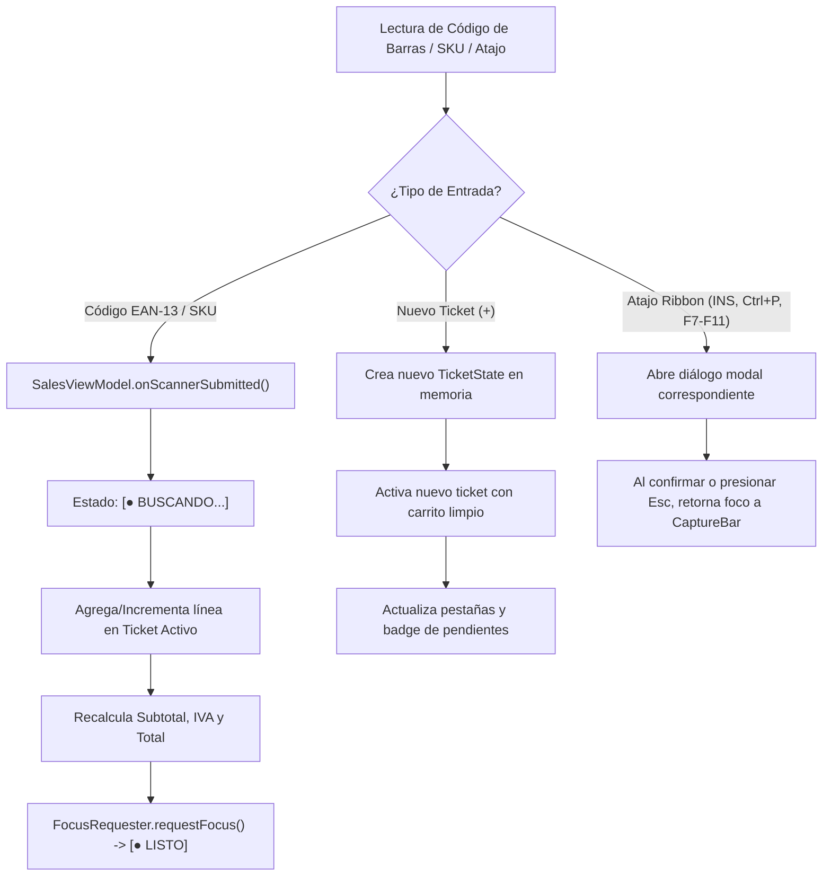

# Funcionalidad: Barra de Control de Venta y Captura Rápida (CaptureBar)

Este documento describe la especificación funcional y técnica del componente **CaptureBar** en **Compose Desktop**, diseñado para agilizar la operación de cobro en mostrador mediante escaneo continuo, gestión multi-ticket y acceso veloz por atajos de teclado.

---

## 1. Objetivo

Dotar a la pantalla de ventas de NexusPOS de un panel de comando centralizado de 3 niveles que permita a los cajeros gestionar múltiples tickets de venta en simultáneo sin pérdida de estado, ingresar códigos EAN-13 o SKUs a alta velocidad mediante foco permanente de teclado, y ejecutar operaciones auxiliares de caja (artículos varios, granel, mayoreo, entradas/salidas de efectivo) mediante atajos directos sin requerir el uso de ratón.

---

## 2. Alcance

### Incluye:
- **Gestión Multi-Ticket Dinámica (Fila 1):** Pestañas interactivas por ticket con total en tiempo real, botón de cierre (`x`), indicador visual de tickets pendientes en espera (`N pendientes`) y botón de apertura rápida (`+`).
- **Selector de Cliente en Mostrador (Fila 1):** Chip interactivo para visualización del cliente asignado (`Público en General` o nombre de cliente) y acceso directo al diálogo de fiado/crédito sin interceptar la tecla global `F2`.
- **Línea de Comando y Escaneo Continuo (Fila 2):** Caja de texto principal (`OutlinedTextField`) con retención de foco permanente (`FocusRequester`), indicador dinámico de estado del sensor (`[● LISTO]`, `[● LEYENDO]`, `[● BUSCANDO]`) y botón `[ENTER] Añadir`.
- **Cinta de Operaciones Auxiliares (Fila 3):**
  - `[INS] Varios`: Diálogo modal para captura libre de productos no catalogados con precio arbitrario.
  - `[Ctrl+P] Art. Común`: Acceso rápido a catálogo de artículos comunes (bolsas, envases, recargas telefónicas, etc.).
  - `[F10] Catálogo`: Búsqueda asistida en catálogo completo.
  - `[F11] Mayoreo`: Aplicación inmediata de precio o descuento de mayoreo a la línea seleccionada.
  - `[F7] Entradas`: Registro de ingreso de efectivo extraordinario al turno de caja.
  - `[F8] Salidas`: Registro de egreso / pago a proveedores con comprobante de turno.
  - `[F9] Granel`: Pesar y capturar producto a granel.
  - `[DEL] Borrar Art.`: Eliminación de la línea seleccionada en el ticket activo con estilo destructivo.
- **Selección Visual de Artículos en Ticket:** Resaltado de líneas en la tabla para asociar acciones dirigidas (`[DEL]` o `[F11]`).

### Queda fuera (Fases futuras):
- Suspensión prolongada de tickets en disco persistente / base de datos (Fase 2).
- Límite configurable de tickets simultáneos por usuario (Fase 2).

---

## 3. Actores y Precondiciones

- **Actores:** Cajero en mostrador, Encargado de tienda, Supervisor.
- **Precondiciones:**
  1. La aplicación de escritorio debe estar en el módulo activo `AppModule.SALES` (`[F1] Ventas`).
  2. La ventana principal debe capturar los eventos de hardware de teclado y escáner USB HID.

---

## 4. Flujo Funcional

---

## 5. Reglas de Negocio

- **RN-CAP-01 (Aislamiento de Cuentas Multi-Ticket):** Cada ticket mantiene en memoria su propia lista independiente de líneas de venta, cliente asignado, subtotal, impuestos y total. Conmutar entre tickets no altera ni mezcla productos.
- **RN-CAP-02 (Persistencia del Ticket Único):** Si únicamente existe un ticket activo y se presiona cerrar (`x`), el ticket no se destruye sino que se restablece a su estado inicial vacío ($0.00, sin cliente asignado).
- **RN-CAP-03 (Indicador de Ventas Pendientes):** Todo ticket inactivo que contenga al menos un artículo contabiliza en el contador visual de *Pendientes*, alertando al cajero de clientes en espera de despacho.
- **RN-CAP-04 (Retención Forzosa de Foco):** Tras cualquier acción de usuario (agregar producto, conmutar pestaña, cerrar modal de pago, borrar línea), el componente solicita automáticamente el foco sobre el campo de texto de escaneo para permitir lecturas continuas sin mouse.
- **RN-CAP-05 (Prioridad de Selección en Borrado y Mayoreo):** Los atajos destructivos `[DEL]` y de mayoreo `[F11]` aplican prioritariamente sobre la línea explícitamente marcada con clic en la tabla; si no hay selección manual, operan por defecto sobre el último producto ingresado.
- **RN-CAP-06 (Preservación de Atajos Globales):** La tecla `F2` se preserva intacta para navegación global al módulo de clientes; la selección rápida de cliente para el ticket de mostrador se opera desde el chip interactivo de la Fila 1.

---

## 6. Diseño Técnico

### Componentes UI:
- [`CaptureBar.kt`](file:///Users/eddch/Documents/OzafryDev/NexusPOS/client/app/src/commonMain/kotlin/mx/nexuspos/client/features/sales/CaptureBar.kt): Composable modular de 3 filas con elevación y bordes `MaterialTheme`.
- [`SalesAuxiliaryDialogs.kt`](file:///Users/eddch/Documents/OzafryDev/NexusPOS/client/app/src/commonMain/kotlin/mx/nexuspos/client/features/sales/SalesAuxiliaryDialogs.kt): Diálogos modales para artículos genéricos, comunes y movimientos de caja.
- [`SalesScreen.kt`](file:///Users/eddch/Documents/OzafryDev/NexusPOS/client/app/src/commonMain/kotlin/mx/nexuspos/client/features/sales/SalesScreen.kt): Integración del componente en el layout maestro de caja.
- [`Main.kt`](file:///Users/eddch/Documents/OzafryDev/NexusPOS/client/desktop/src/main/kotlin/mx/nexuspos/desktop/Main.kt): Despacho de atajos de teclado (`Insert`, `Ctrl+P`, `F7` a `F11`, `Delete`).

### Modelos y Estados:
- [`CaptureBarState.kt`](file:///Users/eddch/Documents/OzafryDev/NexusPOS/client/app/src/commonMain/kotlin/mx/nexuspos/client/features/sales/CaptureBarState.kt):
  - `TicketTabItem(id, label, totalFormatted, itemCount, isActive, canClose)`
  - `ScannerStatus`: `READY`, `READING`, `PROCESSING`.
  - `CaptureBarState`: Datos consolidados para renderizado.
  - `CaptureBarEvent`: Eventos de interacción de tabs, escáner y ribbon.
- [`SalesUiState.kt`](file:///Users/eddch/Documents/OzafryDev/NexusPOS/client/app/src/commonMain/kotlin/mx/nexuspos/client/features/sales/SalesUiState.kt): Modelo `TicketState` y función de proyección `toCaptureBarState()`.

---

## 7. Feature Flags y Configuraciones

| Parámetro | Tipo | Predeterminado | Descripción |
| :--- | :--- | :--- | :--- |
| `maxConcurrentTickets` | `Int` | `10` | Límite sugerido de pestañas simultáneas en memoria. |
| `wholesaleDiscountPercent` | `Double` | `0.10` | Porcentaje de descuento aplicado al activar mayoreo con `[F11]`. |

---

## 8. Errores y Casos Límite

| Escenario | Comportamiento del Sistema |
| :--- | :--- |
| **Pulsación de [DEL] con carrito vacío** | La acción es deshabilitada visualmente (gris) y se ignora sin arrojar excepciones. |
| **Cierre de ticket con productos capturados** | Si hay otros tickets abiertos, el ticket se retira y se activa el adyacente; si es el único, se limpian sus líneas. |
| **Conexión LAN intermitente durante escaneo** | El estado conmuta brevemente a `[● BUSCANDO...]` y al fallar reporta mensaje de error sin vaciar el carrito activo. |

---

## 9. Pruebas y Criterios de Aceptación

1. **Creación de Tickets:** Al pulsar `+` se genera una nueva pestaña independiente conservando los productos del ticket previo.
2. **Conmutación:** Alternar entre pestañas actualiza inmediatamente las líneas de la tabla y los totales sin fugas de memoria.
3. **Atajo de Mayoreo [F11]:** Modifica el importe unitario de la línea con el 10% de descuento y recalcula el ticket.
4. **Auto-foco:** Al terminar cualquier operación o cerrar diálogos con `Esc`, el cursor regresa inmediatamente al campo de captura.
5. **Cobertura Automatizada:** [`CaptureBarStateTest.kt`](file:///Users/eddch/Documents/OzafryDev/NexusPOS/client/desktop/src/test/kotlin/mx/nexuspos/desktop/sales/CaptureBarStateTest.kt) valida al 100% la lógica de tickets, cálculo de pendientes y atajos.

---

## 10. Referencias

- [CaptureBar.kt](file:///Users/eddch/Documents/OzafryDev/NexusPOS/client/app/src/commonMain/kotlin/mx/nexuspos/client/features/sales/CaptureBar.kt)
- [CaptureBarState.kt](file:///Users/eddch/Documents/OzafryDev/NexusPOS/client/app/src/commonMain/kotlin/mx/nexuspos/client/features/sales/CaptureBarState.kt)
- [SalesScreen.kt](file:///Users/eddch/Documents/OzafryDev/NexusPOS/client/app/src/commonMain/kotlin/mx/nexuspos/client/features/sales/SalesScreen.kt)
- [Ventas y Cobro (sales.md)](file:///Users/eddch/Documents/OzafryDev/NexusPOS/docs/features/sales.md)
