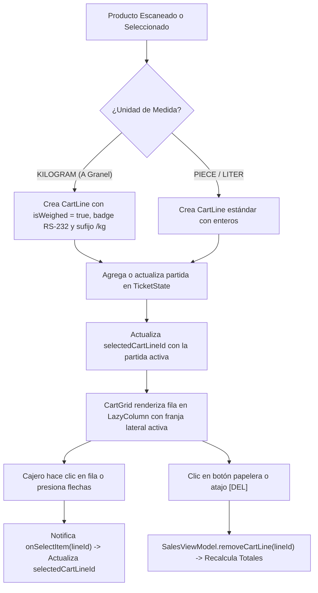

# Funcionalidad: Parrilla de Productos en Venta (CartGrid)

Este documento describe la especificación funcional y técnica del componente **CartGrid** (Parrilla de Productos / Data Grid Central del Carrito de Venta) en **Compose Desktop**, diseñado para presentar las partidas activas del ticket con alta legibilidad, soporte nativo de artículos a granel pesados por báscula RS-232, visualización contable y scroll virtualizado de alto rendimiento.

---

## 1. Objetivo

Proveer a la pantalla de ventas de NexusPOS de una tabla de datos centralizada con encabezado fijo y columnas proporcionales para visualizar las partidas agregadas a un ticket de venta en tiempo real, permitiendo identificar claramente partidas por pieza vs. partidas a granel (con badge visual RS-232), cantidades con indicador editable, existencias de inventario con alertas de stock, subtotales contables e interacción con teclado y ratón para selección y eliminación rápida de productos.

---

## 2. Alcance

### Incluye:
- **Encabezado Fijo de 8 Columnas Proporcionales:**
  1. `[#]`: Partida secuencial formateada a dos dígitos (`01`, `02`, etc.).
  2. `[CÓDIGO BARRAS]`: Código de barras EAN-13 o SKU en tipografía monoespaciada legible.
  3. `[DESCRIPCIÓN DEL PRODUCTO]`: Nombre principal del producto en negrita, subtexto con departamento/categoría e indicador visual (Badge `⚖ Báscula RS-232`) si la partida es pesada a granel.
  4. `[PRECIO VENTA]`: Precio unitario formateado en moneda local (`$45.00`), con sufijo `/kg` explícito para productos a granel.
  5. `[CANTIDAD]`: Contenedor interactivo `CartQuantityStepper` con stepper táctil/mouse (`[-]` y `[+]`) e input numérico editable directo. Permite sobreescritura rápida con teclado/numpad, confirmación con `[Enter]`, cancelación con `[Esc]`, y botón de báscula `[⚖]` para re-pesaje RS-232 en productos a granel.
  6. `[IMPORTE]`: Subtotal de la partida (precio x cantidad) en tipografía destacada con color primario del tema.
  7. `[EXISTENCIA]`: Indicador de inventario disponible en tiempo real (`Ilim` para partidas sin inventario o servicios, `28 pza` / `14.5 kg` con semáforo de color naranja/rojo en caso de stock bajo o agotado).
  8. `[ACCIÓN]`: Botón de eliminación directa con icono de papelera y color de error.
- **Resaltado Visual de Partida Activa:**
  - Franja indicadora izquierda con color primario (`3.5.dp`).
  - Fondo de fila tintado con `primaryContainer` translúcido al estar seleccionada (`selectedCartLineId`).
  - Alternancia sutil de color tipo cebra (`zebra striping`) para partidas inactivas pares/impares para máxima legibilidad.
- **Scroll Virtualizado de Alto Rendimiento:**
  - Implementación con `LazyColumn` y claves únicas estables (`key = { _, item -> item.id }`) para admitir tickets con decenas de artículos sin degradación gráfica.
- **Estado Vacío Elegante e Interactivo (Empty State):**
  - Indicador de estado de terminal lista para captura de artículos (`TERMINAL LISTA PARA CAPTURA`).
  - Ilustración compuesta con icono de carrito e insignia del escáner óptico USB activo.
  - Tarjetas táctiles e interactivas de accesos rápidos para operaciones frecuentes (`[F10]` Catálogo, `[Ctrl+P]` Artículos Comunes, `[INS]` Varios / Libre, `[F9]` Báscula RS-232).
  - Franja informativa inferior con tip operativo para cajeros (multiplicador con asterisco para captura rápida de múltiples piezas).

### Queda fuera (Fases futuras):
- Reordenamiento manual por arrastrar y soltar (drag & drop) de partidas.

---

## 3. Actores y Precondiciones

- **Actores:** Cajero en mostrador, Encargado de tienda, Supervisor de caja.
- **Precondiciones:**
  1. La aplicación de escritorio se encuentra en el módulo activo de ventas (`AppModule.SALES` / `[F1] Ventas`).
  2. El ticket activo (`TicketState`) cuenta con partidas en memoria o se encuentra inicializado.

---

## 4. Flujo Funcional



---

## 5. Estructura de Datos y Estado

### Modelo de Partida de Carrito (`CartLine`)
Ubicación: `client/app/src/commonMain/kotlin/mx/nexuspos/client/features/sales/SalesUiState.kt`

```kotlin
data class CartLine(
    val id: String,
    val productId: String?,
    val presentationId: String?,
    val barcode: String,
    val name: String,
    val category: String = "Abarrotes",
    val unit: ProductUnit,
    val quantity: Quantity,
    val unitPrice: Money,
    val taxRate: Double,
    val total: Money,
    val currentStockMillis: Long? = null,
    val isWeighed: Boolean = unit == ProductUnit.KILOGRAM
)
```

### Firma del Componente `CartGrid`
Ubicación: `client/app/src/commonMain/kotlin/mx/nexuspos/client/features/sales/CartGrid.kt`

```kotlin
@Composable
fun CartGrid(
    items: List<CartLine>,
    selectedLineId: String?,
    onSelectItem: (lineId: String) -> Unit,
    onRemoveItem: (lineId: String) -> Unit,
    onEditQuantity: ((line: CartLine) -> Unit)? = null,
    onSearchCatalog: (() -> Unit)? = null,
    onCommonArticles: (() -> Unit)? = null,
    onInsertGeneric: (() -> Unit)? = null,
    onWeighBulk: (() -> Unit)? = null,
    modifier: Modifier = Modifier,
    footer: @Composable (() -> Unit)? = null
)
```

---

## 6. Distribución de Columnas de la Tabla

| # | Columna | Peso / Ancho | Alineación | Características Clave |
|---|---|---|---|---|
| 1 | `[#]` | `36.dp` | Centro | Índice secuencial a 2 dígitos (`01`, `02`). |
| 2 | `[CÓDIGO BARRAS]` | `130.dp` | Inicio | Código EAN-13 o SKU en fuente monoespaciada. |
| 3 | `[DESCRIPCIÓN DEL PRODUCTO]` | `weight(0.36f)` | Inicio | Título en negrita, categoría y badge condicional `[⚖ Báscula RS-232]`. |
| 4 | `[PRECIO VENTA]` | `weight(0.12f)` | Fin | Precio unitario con sufijo `/kg` si aplica. |
| 5 | `[CANTIDAD]` | `weight(0.14f)` | Centro | Píldora editable con formato entero o decimal (`1.250 kg`) e icono de edición. |
| 6 | `[IMPORTE]` | `weight(0.13f)` | Fin | Total de línea en negrita con color primario. |
| 7 | `[EXISTENCIA]` | `weight(0.11f)` | Centro | Badge de inventario: `Ilim` o existencia con alerta de color si ≤ 5 o agotado. |
| 8 | `[ACCIÓN]` | `42.dp` | Centro | Botón de papelera con color de error (`onRemoveItem`). |

---

## 7. Casos de Prueba y Validación

Las pruebas unitarias automatizadas se localizan en `client/desktop/src/test/kotlin/mx/nexuspos/desktop/sales/CartGridTest.kt`:

1. **`testPieceProductCartLineProperties`**: Verifica propiedades de partida por pieza (cantidad entera, stock en piezas, `isWeighed == false`).
2. **`testWeighedProductCartLineProperties`**: Verifica partida a granel (formato decimal con sufijo `kg`, `isWeighed == true`, visualización de precio unitario).
3. **`testAddProductPresentationPopulatesCategoryAndStock`**: Verifica que `SalesViewModel.addProductPresentation` mapee adecuadamente el departamento y el stock de inventario desde `ProductDto`.
4. **`testUnlimitedStockIndicator`**: Verifica artículos con stock ilimitado (`currentStockMillis == null`) como servicios o artículos varios.

---

## 8. Rendimiento y Virtualización

- **`LazyColumn` Virtualizado:** A diferencia de una lista estática en `Column` con scroll simple, `LazyColumn` solo instancia composables para las filas visibles en pantalla, garantizando tiempos de renderizado inferiores a 16 ms incluso con cientos de partidas.
- **Uso de Claves Estables (`key`):** Se asigna `key = { _, item -> item.id }` en `itemsIndexed` para que Compose reutilice eficientemente las composiciones existentes durante inserciones, eliminaciones y reordenamientos.

---

## 9. Seguridad y Manejo de Errores

- **Prevención de Índices Negativos o Desbordamiento:** Formateo seguro de partidas con `index + 1`.
- **Valores Nulos Tolerados:** Si `currentStockMillis` es nulo, se muestra `"Ilim"` de forma transparente sin lanzar excepciones.
- **Aislamiento de Callback:** Las acciones destructivas (`onRemoveItem`) y de selección están aisladas para evitar recomposiciones en cascada no deseadas.

---

## 10. Trazabilidad con Requerimientos

| Requerimiento Solicitado | Implementación | Verificación |
|---|---|---|
| Encabezado fijo con 8 columnas proporcionales | `CartGridHeader()` con pesos proporcionales y anchos fijos | Inspección de layout y UI test |
| Nombre en negrita + categoría + badge Báscula RS-232 | Columna descripción con Badge condicional verde `[⚖ Báscula RS-232]` | `CartGridTest.kt` |
| Soporte de artículos por pieza y a granel | Clases `CartLine` con `isWeighed`, `ProductUnit.KILOGRAM` y `Quantity` | `CartGridTest.kt` |
| Resaltado visual de fila activa | Indicador lateral primario de `3.5.dp` y fondo `primaryContainer` | Inspección visual en Compose |
| Scroll eficiente con `LazyColumn` | `LazyColumn` con claves estables en `CartGrid.kt` | Compilación y ejecución nativa |
| Columna de Existencia con indicador visual | Badge con semáforo para stock bajo/agotado/ilimitado | `CartGridTest.kt` |
| Botón de acción con papelera para eliminar | `IconButton` con `Icons.Default.DeleteOutline` y color de error | `CartGridTest.kt` y `SalesScreen.kt` |
