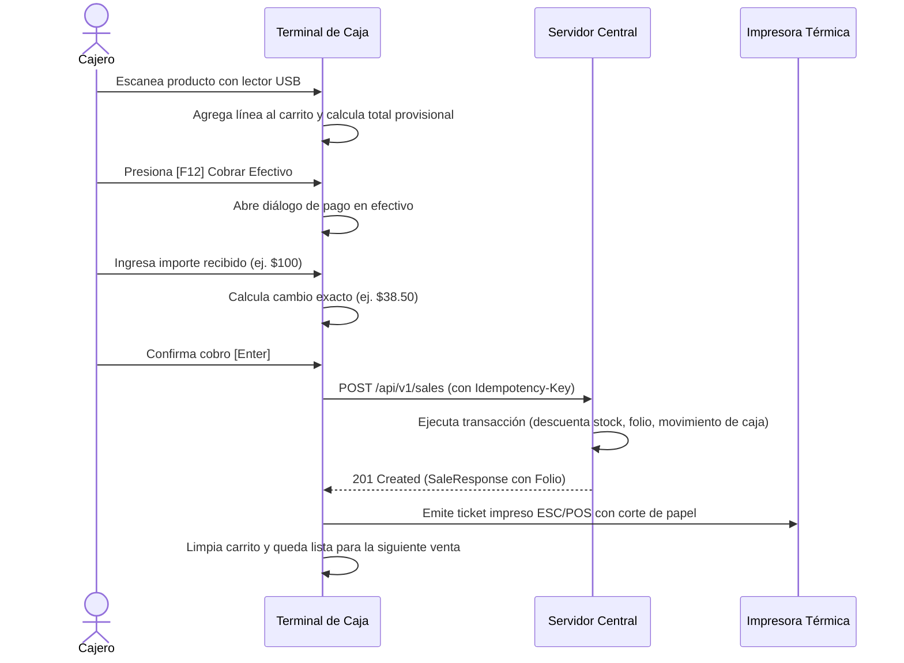

# Funcionalidad: Ventas y Cobro en Caja

Este documento describe el comportamiento funcional y técnico del módulo de ventas, captura de artículos, cobro y emisión de tickets.

---

## 1. Objetivo
Permitir a los cajeros registrar productos de forma ultra-rápida (mediante lector de código de barras USB o búsqueda de texto), calcular importes e impuestos exactos en tiempo real, cobrar en efectivo o crédito, y emitir tickets físicos, garantizando consistencia atómica sin duplicación de folios ni errores de centavos.

---

## 2. Alcance

### Incluye:
- Captura por escáner de código de barras EAN-13 o manual con teclado (`Enter`).
- Carrito de venta reactivo en memoria local.
- Cálculo automático de totales con IVA desglosado mediante tipos exactos [`Money`](file:///Users/eddch/Documents/OzafryDev/NexusPOS/shared/core/src/commonMain/kotlin/mx/nexuspos/core/Money.kt).
- Cobro en efectivo con cálculo inmediato de cambio.
- Asignación de venta a cuenta de crédito (fiado).
- Transacción atómica con clave de idempotencia (`Idempotency-Key`).
- Asignación de folio consecutivo único generado por el servidor.
- Generación de comandos binarios ESC/POS para impresoras térmicas de 58 mm y 80 mm.
- Soporte para reimpresión de tickets con marca distintiva `*** COPIA DE REIMPRESIÓN ***`.

### Queda fuera (Fases futuras):
- Cobro integrado con terminal bancaria con chip/contactless (Fase 2).
- Ventas en espera / múltiples carritos suspendidos simultáneos (Fase 2).
- Facturación electrónica CFDI 4.0 con timbrado PAC (Fase 3).

---

## 3. Actores y Precondiciones

- **Actores:** Cajero, Encargado, Administrador.
- **Precondiciones:**
  1. La terminal debe estar conectada al servidor autoritativo (`ServerConnectionState.CONNECTED`).
  2. El cajero debe tener una sesión de caja abierta activa (`activeSession != null`).
  3. Debe existir al menos un producto en el carrito para proceder al cobro.

---

## 4. Flujo Funcional

---

## 5. Reglas de Negocio

- **RN-VEN-01 (Precios Vigentes):** El precio de cada línea se toma de la presentación vigente en la base de datos al momento de confirmar el cobro.
- **RN-VEN-02 (Validación de Totales):** El servidor recalcula el total exacto; si difiere del total esperado enviado por el cliente por un cambio de precio concurrente, rechaza la venta con `409 PRICE_CHANGED`.
- **RN-VEN-03 (Foliador Consecutivo):** Los folios son estrictamente secuenciales (`1, 2, 3...`) por tienda, generados en base de datos mediante bloqueo exclusivo `SELECT ... FOR UPDATE` en la tabla `counters`.
- **RN-VEN-04 (Idempotencia Obligatoria):** Cada intento de cobro genera un UUID único (`idempotency_key`). Si el cliente reintenta la misma petición por corte de red, el servidor devuelve la venta original sin cobrar de nuevo ni descontar doble inventario.
- **RN-VEN-05 (Integración con Caja):** Toda venta en efectivo genera automáticamente un registro en `cash_movements` vinculado a la sesión activa del cajero.
- **RN-VEN-06 (Reimpresión Auditable):** Todo ticket reimpreso debe incluir visiblemente el encabezado `*** COPIA DE REIMPRESIÓN ***`.

---

## 6. Diseño Técnico

- **Vistas UI:** [`SalesScreen.kt`](file:///Users/eddch/Documents/OzafryDev/NexusPOS/client/app/src/commonMain/kotlin/mx/nexuspos/client/features/sales/SalesScreen.kt), [`CashPaymentDialog.kt`](file:///Users/eddch/Documents/OzafryDev/NexusPOS/client/app/src/commonMain/kotlin/mx/nexuspos/client/features/sales/CashPaymentDialog.kt).
- **Gestor de Estado:** [`SalesViewModel.kt`](file:///Users/eddch/Documents/OzafryDev/NexusPOS/client/app/src/commonMain/kotlin/mx/nexuspos/client/features/sales/SalesViewModel.kt), [`SalesUiState.kt`](file:///Users/eddch/Documents/OzafryDev/NexusPOS/client/app/src/commonMain/kotlin/mx/nexuspos/client/features/sales/SalesUiState.kt).
- **Cliente HTTP:** [`ApiClient.completeSale()`](file:///Users/eddch/Documents/OzafryDev/NexusPOS/client/app/src/commonMain/kotlin/mx/nexuspos/client/core/ApiClient.kt).
- **Servicio Backend:** [`SalesService.kt`](file:///Users/eddch/Documents/OzafryDev/NexusPOS/server/src/main/kotlin/mx/nexuspos/server/modules/sales/SalesService.kt).
- **Adaptadores de Hardware:** [`KeyboardWedgeBarcodeInput.kt`](file:///Users/eddch/Documents/OzafryDev/NexusPOS/client/desktop/src/main/kotlin/mx/nexuspos/desktop/hardware/KeyboardWedgeBarcodeInput.kt), [`EscPosReceiptPrinter.kt`](file:///Users/eddch/Documents/OzafryDev/NexusPOS/client/desktop/src/main/kotlin/mx/nexuspos/desktop/hardware/EscPosReceiptPrinter.kt).
- **Endpoints Involucrados:** `POST /api/v1/sales`, `GET /api/v1/sales/{id}`, `GET /api/v1/sales/{id}/print`.

---

## 7. Feature Flags y Configuraciones

| Configuración | Ubicación | Efecto |
| :--- | :--- | :--- |
| `allow_negative_stock` | Tabla `settings` / `SettingsDto` | Si es `true`, permite cobrar aunque el stock quede en números negativos. Si es `false`, arroja `422 INSUFFICIENT_STOCK`. |
| `ticket_header` / `footer` | Tabla `settings` / `SettingsDto` | Mensaje personalizado impreso en el encabezado y pie de ticket. |

---

## 8. Errores y Casos Límite

| Escenario | Comportamiento del Sistema |
| :--- | :--- |
| **Servidor no disponible (`NO_SERVER`)** | El botón de cobro se deshabilita; la caja muestra advertencia en rojo pero el carrito permanece intacto en pantalla. |
| **Sesión de caja cerrada** | El servidor responde `409 SESSION_CLOSED`; se bloquea el cobro hasta abrir turno con fondo inicial. |
| **Importe recibido menor al total** | La UI deshabilita el botón de confirmación hasta cubrir el total exacto. |
| **Caída de red durante el POST** | El cliente reintenta con la misma `Idempotency-Key`; el servidor devuelve la venta ya persistida sin duplicar. |

---

## 9. Pruebas y Criterios de Aceptación

1. Escanear un código de barras debe agregar el producto al carrito en < 100 ms.
2. Cobro de $61.50 con billete de $100.00 debe calcular exactamente $38.50 de cambio.
3. Dos ventas concurrentes no deben recibir nunca el mismo número de folio consecutivo.
4. Una petición duplicada con la misma `Idempotency-Key` no debe restar inventario dos veces.
5. El ticket generado debe contener los comandos ESC/POS válidos y cortar el papel.
- **Suite de pruebas:** [`ServerComprehensiveTest.kt`](file:///Users/eddch/Documents/OzafryDev/NexusPOS/server/src/test/kotlin/mx/nexuspos/server/ServerComprehensiveTest.kt), [`ReceiptPrinterTest.kt`](file:///Users/eddch/Documents/OzafryDev/NexusPOS/client/desktop/src/test/kotlin/mx/nexuspos/desktop/hardware/ReceiptPrinterTest.kt).

---

## 10. Referencias
- [ADR-002: LAN-First con Servidor Autoritativo](file:///Users/eddch/Documents/OzafryDev/NexusPOS/docs/architecture/technical-decisions.md#adr-002-pivote-a-lan-first-con-servidor-autoritativo-vs-sqlite-offline-first-distribuido)
- [ADR-004: Precisión Financiera con Value Classes](file:///Users/eddch/Documents/OzafryDev/NexusPOS/docs/architecture/technical-decisions.md#adr-004-precision-financiera-con-value-classes-money-y-quantity)
- [Reglas de Negocio en Diseño Funcional](file:///Users/eddch/Documents/OzafryDev/NexusPOS/docs/architecture/diseno-funcional.md#41-venta-normal-en-efectivo)
