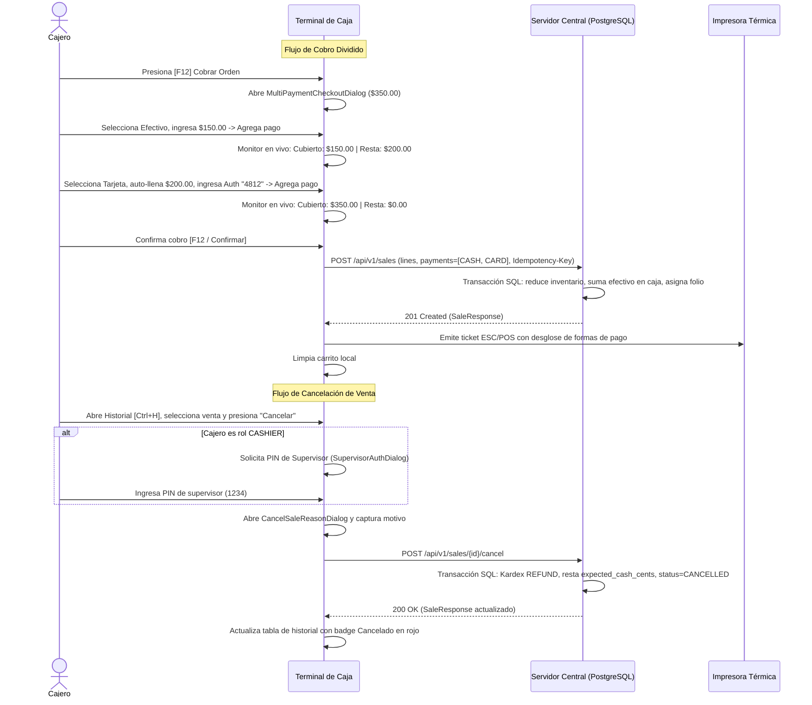

# Funcionalidad: Ventas, Cobro Multi-Pago, Historial y Cancelaciones

Este documento describe la especificación técnica y funcional del módulo de ventas en **NexusPOS**, incluyendo captura de artículos en mostrador, cobro multi-pago (Split Payment), emisión térmica de tickets, consulta de historial de ventas del turno y cancelaciones atómicas con reversión de inventario y caja.

---

## 1. Objetivo

Permitir a los cajeros registrar productos a máxima velocidad (mediante escáner de código de barras USB, balanza o teclado), procesar cobros divididos en múltiples formas de pago, imprimir tickets térmicos ESC/POS, y gestionar cancelaciones y reimpresiones de forma transparente y auditable con autorización por PIN de supervisor.

---

## 2. Alcance

### Incluye:
- **Captura Ultrarrápida:** Lectores de código de barras USB (Keyboard Wedge), SKU por teclado (`Enter`), o artículos genéricos (`[INS]`).
- **Carrito Reactivo y Cálculos Exactos:** Desglose automático de subtotal, impuestos y total con clases inmutables [`Money`](file:///Users/eddch/Documents/OzafryDev/NexusPOS/shared/core/src/commonMain/kotlin/mx/nexuspos/core/Money.kt) para garantizar cero errores de redondeo de centavos.
- **Cobro Multi-Pago / Dividido (Split Payment):**
  - Diálogo modal [`MultiPaymentCheckoutDialog.kt`](file:///Users/eddch/Documents/OzafryDev/NexusPOS/client/app/src/commonMain/kotlin/mx/nexuspos/client/features/sales/MultiPaymentCheckoutDialog.kt) activado mediante **`[F12]`**.
  - Permite combinar en una misma venta: **Efectivo**, **Tarjeta Bancaria** (con número de autorización o voucher), **Transferencia** (con clave de rastreo / folio SPEI) y **Crédito / Fiado** (con validación de saldo del cliente).
  - Monitores KPI en tiempo real: `TOTAL A COBRAR`, `CUBIERTO`, `RESTA` (en rojo si falta cubrir) y `CAMBIO` (en verde para efectivo).
  - Botón de acceso directo `[⚡ Cobro Rápido en Efectivo]` para ventas de contado simples sin pasos intermedios.
- **Historial de Ventas del Turno:**
  - Panel maestro-detalle [`SalesHistoryDialog.kt`](file:///Users/eddch/Documents/OzafryDev/NexusPOS/client/app/src/commonMain/kotlin/mx/nexuspos/client/features/sales/SalesHistoryDialog.kt) (`Ctrl+H` o botón en panel inferior).
  - Filtros rápidos por estado (`TODOS`, `COMPLETADOS`, `CANCELADOS`) y buscador por folio.
  - Métricas de sesión en vivo (Total Vendido, Tickets Emitidos, Tickets Cancelados).
- **Reimpresión Oficial:**
  - Previsualizador térmico en pantalla [`TicketReceiptPreviewDialog.kt`](file:///Users/eddch/Documents/OzafryDev/NexusPOS/client/app/src/commonMain/kotlin/mx/nexuspos/client/features/sales/TicketReceiptPreviewDialog.kt) con leyenda obligatoria `*** COPIA DE REIMPRESIÓN ***`.
  - Envío directo a impresora física ESC/POS (USB o Ethernet TCP).
- **Cancelación Atómica de Ventas:**
  - Diálogo de captura de motivos [`CancelSaleReasonDialog.kt`](file:///Users/eddch/Documents/OzafryDev/NexusPOS/client/app/src/commonMain/kotlin/mx/nexuspos/client/features/sales/CancelSaleReasonDialog.kt) con razones predefinidas y notas adicionales.
  - Reversión atómica en servidor: reingreso a stock (Kardex `REFUND`), reversión de deuda a cliente (`REVERSAL`), y deducción de efectivo de caja en `expected_cash_cents`.
  - Elevación de privilegios: cajeros con rol `CASHIER` requieren obligatoriamente autorización con PIN de supervisor para cancelar.
- **Descuentos Libres en Línea y Globales (`Ctrl+D`):**
  - Diálogo interactivo [`ApplyDiscountDialog.kt`](file:///Users/eddch/Documents/OzafryDev/NexusPOS/client/app/src/commonMain/kotlin/mx/nexuspos/client/features/sales/ApplyDiscountDialog.kt) accesible por atajo de teclado y botón en la barra de captura.
  - Soporta modalidades por porcentaje (%) con presets rápidos (5%, 10%, 15%, 20%, 25%) o por importe fijo en pesos ($).
  - Puede aplicarse a la partida seleccionada del carrito o prorratearse proporcionalmente sobre todo el carrito.
  - Validación de política: los descuentos mayores al límite configurable del cajero (`maxCashierDiscountPercent`, default 10%) solicitan automáticamente autorización mediante PIN de supervisor.
  - Desglose contable transparente reflejado en la parrilla de venta, en el servidor y en el ticket impreso ESC/POS.

### Queda fuera:
- Facturación electrónica CFDI 4.0 con timbrado PAC (Fase 3).
- Devoluciones parciales de artículos dentro de un ticket (Fase 3).

---

## 3. Actores y Precondiciones

- **Actores:** Cajero, Supervisor, Administrador.
- **Precondiciones:**
  1. Terminal conectada al servidor autoritativo LAN (`ServerConnectionState.CONNECTED`).
  2. Sesión de caja abierta en la terminal (`activeSession != null`).
  3. Al menos un producto agregado al carrito.

---

## 4. Flujo Funcional

---

## 5. Reglas de Negocio

- **RN-VEN-01 (Precios Vigentes):** El precio de cada línea se toma de la presentación vigente en la base de datos al momento de confirmar el cobro.
- **RN-VEN-02 (Validación de Totales):** El servidor recalcula el total exacto; si difiere del total esperado enviado por el cliente por un cambio de precio concurrente, rechaza la venta con `409 PRICE_CHANGED`.
- **RN-VEN-03 (Foliador Consecutivo):** Los folios son estrictamente secuenciales (`1, 2, 3...`) por tienda, generados en base de datos mediante bloqueo exclusivo `SELECT ... FOR UPDATE` en la tabla `counters`.
- **RN-VEN-04 (Idempotencia Obligatoria):** Cada intento de cobro genera un UUID único (`idempotency_key`). Si el cliente reintenta la misma petición por corte de red, el servidor devuelve la venta original sin cobrar de nuevo ni descontar doble inventario.
- **RN-VEN-05 (Cobro Dividido y Cambio Exclusivo de Efectivo):** En cobros multi-pago, el cambio a entregar se calcula única y exclusivamente sobre la diferencia entre el efectivo entregado y el importe asignado a efectivo:
  $$\text{Cambio} = \max(0, \text{Efectivo Entregado} - \text{Monto en Efectivo})$$
  Los pagos con tarjeta, transferencia o crédito no generan cambio en efectivo.
- **RN-VEN-06 (Reversión Atómica al Cancelar):** La cancelación de una venta (`POST /api/v1/sales/{id}/cancel`) es 100% reversible y atómica:
  1. Reingresa las existencias físicas al Kardex con tipo `REFUND`.
  2. Si hubo abono a crédito fiado, disminuye la deuda del cliente con movimiento `REVERSAL`.
  3. Si hubo cobro en efectivo, descuenta el importe cobrado de `cash_sessions.expected_cash_cents`, garantizando que el arqueo de caja `[F6]` no presente faltantes ficticios.
- **RN-VEN-07 (Reimpresión Auditable):** Todo ticket reimpreso debe incluir visiblemente el encabezado `*** COPIA DE REIMPRESIÓN ***`.
- **RN-VEN-08 (Elevación de Supervisor para Cancelaciones):** Un cajero regular (`CASHIER`) no puede cancelar ventas sin la aprobación de un usuario con rol `ADMIN` o `SUPERVISOR` validada mediante PIN de 4 dígitos.
- **RN-VEN-09 (Políticas y Descuentos Libres):** Los descuentos libres en línea o globales pueden definirse en porcentaje o en centavos fijos sin exceder el importe total de la partida. Si un cajero aplica un descuento superior al límite establecido en los parámetros de la tienda (`maxCashierDiscountPercent`), se requiere autorización al vuelo mediante PIN de supervisor. El descuento reduce el importe de la venta y se desglosa contablemente en el ticket térmico.
- **RN-VEN-10 (Devoluciones Parciales de Mercancía y Notas de Devolución):** Permite regresar uno o varios productos individuales con cantidades exactas o fraccionales (`quantityMillis`) sin anular la venta completa:
  1. **Reingreso a Stock Condicional:** Si `reenterStock` es `true`, reingresa el stock a `stock_balances` y genera un movimiento Kardex `REFUND`. Si es `false`, se registra como merma/desecho sin inflar el inventario físico.
  2. **Impacto Financiero en Turno Activo:** El reembolso se liquida desde la sesión de caja activa actual del cajero que atiende al cliente, descontando `expected_cash_cents` y sumando `refunds_cash_cents`. Si el método es crédito/fiado, reduce el saldo deudor del cliente (`credit_movements` con tipo `REFUND`).
  3. **Estados de Venta:** La venta transiciona a `PARTIALLY_REFUNDED` si aún quedan artículos vigentes, o a `REFUNDED` cuando el 100% de los artículos ha sido devuelto.
  4. **Protección Anti-Duplicación:** Las ventas con devoluciones parciales no pueden cancelarse por completo (`cancelSale` es rechazado con `400 Bad Request`).
  5. **Foliador y Comprobante Térmico:** Cada devolución genera un folio consecutivo oficial (`counters` `sale_refund_folio`) e imprime una *"NOTA DE DEVOLUCIÓN"* en ticket térmico ESC/POS con desglose de artículos, firmas y motivo.
  6. **Elevación de Privilegios:** Todo cajero (`CASHIER`) requiere PIN de Encargado/Administrador para procesar cualquier devolución.

---

## 6. Diseño Técnico

- **Vistas UI Compose:**
  - Pantalla principal: [`SalesScreen.kt`](file:///Users/eddch/Documents/OzafryDev/NexusPOS/client/app/src/commonMain/kotlin/mx/nexuspos/client/features/sales/SalesScreen.kt).
  - Modal multi-pago: [`MultiPaymentCheckoutDialog.kt`](file:///Users/eddch/Documents/OzafryDev/NexusPOS/client/app/src/commonMain/kotlin/mx/nexuspos/client/features/sales/MultiPaymentCheckoutDialog.kt).
  - Diálogo de devoluciones parciales: [`RefundSaleLinesDialog.kt`](file:///Users/eddch/Documents/OzafryDev/NexusPOS/client/app/src/commonMain/kotlin/mx/nexuspos/client/features/sales/RefundSaleLinesDialog.kt).
  - Diálogo de descuentos: [`ApplyDiscountDialog.kt`](file:///Users/eddch/Documents/OzafryDev/NexusPOS/client/app/src/commonMain/kotlin/mx/nexuspos/client/features/sales/ApplyDiscountDialog.kt).
  - Historial de ventas: [`SalesHistoryDialog.kt`](file:///Users/eddch/Documents/OzafryDev/NexusPOS/client/app/src/commonMain/kotlin/mx/nexuspos/client/features/sales/SalesHistoryDialog.kt).
  - Motivo de cancelación: [`CancelSaleReasonDialog.kt`](file:///Users/eddch/Documents/OzafryDev/NexusPOS/client/app/src/commonMain/kotlin/mx/nexuspos/client/features/sales/CancelSaleReasonDialog.kt).
  - Previsualización térmica: [`TicketReceiptPreviewDialog.kt`](file:///Users/eddch/Documents/OzafryDev/NexusPOS/client/app/src/commonMain/kotlin/mx/nexuspos/client/features/sales/TicketReceiptPreviewDialog.kt).
  - Autorización al vuelo: [`SupervisorAuthDialog.kt`](file:///Users/eddch/Documents/OzafryDev/NexusPOS/client/app/src/commonMain/kotlin/mx/nexuspos/client/features/auth/SupervisorAuthDialog.kt).
- **Gestor de Estado:** [`SalesViewModel.kt`](file:///Users/eddch/Documents/OzafryDev/NexusPOS/client/app/src/commonMain/kotlin/mx/nexuspos/client/features/sales/SalesViewModel.kt), [`SalesUiState.kt`](file:///Users/eddch/Documents/OzafryDev/NexusPOS/client/app/src/commonMain/kotlin/mx/nexuspos/client/features/sales/SalesUiState.kt).
- **Servicio Backend:** [`SalesService.kt`](file:///Users/eddch/Documents/OzafryDev/NexusPOS/server/src/main/kotlin/mx/nexuspos/server/modules/sales/SalesService.kt).
- **Rutas HTTP:** [`Application.kt`](file:///Users/eddch/Documents/OzafryDev/NexusPOS/server/src/main/kotlin/mx/nexuspos/server/Application.kt) (`POST /api/v1/sales`, `GET /api/v1/sales`, `GET /api/v1/sales/{id}`, `POST /api/v1/sales/{id}/cancel`, `POST /api/v1/sales/{id}/refund`, `GET /api/v1/sales/{id}/refunds`).

---

## 7. Errores y Casos Límite

| Escenario | Comportamiento del Sistema |
| :--- | :--- |
| **Suma de pagos insuficiente** | El botón de confirmar cobro permanece deshabilitado mostrando *"Faltan $XX.XX"*. |
| **Intento de fiar sin cliente** | El selector de método Crédito bloquea la captura exigiendo seleccionar primero a un cliente con saldo disponible. |
| **Cancelación de ticket ya cancelado** | El servidor y cliente detectan el estado y muestran advertencia: *"El ticket #X ya se encuentra cancelado."* |
| **Cancelación de ticket con devoluciones** | Bloqueado con error 400: *"No se puede cancelar una venta que ya cuenta con devoluciones parciales"*. |
| **Devolución que excede cantidad vendida** | Bloqueado en UI y validado en backend: cantidad máxima retornable = `quantityMillis - refundedQuantityMillis`. |
| **Descuento mayor al tope sin supervisor** | El diálogo bloquea la aplicación directa y eleva automáticamente a `SupervisorAuthDialog`. |
| **Falla de conexión en la transacción de cobro** | El cliente reintenta con la misma `Idempotency-Key`; el servidor devuelve la venta ya persistida sin duplicar cargos ni restar doble inventario. |

---

## 8. Pruebas Automatizadas

- **Pruebas de Devoluciones Parciales y Stock:** [`SaleRefundModuleTest.kt`](file:///Users/eddch/Documents/OzafryDev/NexusPOS/server/src/test/kotlin/mx/nexuspos/server/SaleRefundModuleTest.kt) (`testPartialRefundStockAndCashSessionIntegrity`).
- **Pruebas de UI y Formateador de Devoluciones:** [`SaleRefundFeatureTest.kt`](file:///Users/eddch/Documents/OzafryDev/NexusPOS/client/desktop/src/test/kotlin/mx/nexuspos/desktop/sales/SaleRefundFeatureTest.kt) (`testPromptRefundSaleAndDismiss`, `testCashierRoleRequiresSupervisorElevationForRefund`, `testEscPosReceiptPrinterSaleRefundFormat`).
- **Pruebas de Descuentos Libres y Autorización:** [`DiscountFeatureTest.kt`](file:///Users/eddch/Documents/OzafryDev/NexusPOS/client/desktop/src/test/kotlin/mx/nexuspos/desktop/sales/DiscountFeatureTest.kt) (`testApplyLineDiscountDirectlyWhenUnderThreshold`, `testApplyDiscountAboveThresholdRequestsSupervisor`, `testEscPosReceiptPrinterIncludesDiscounts`).
- **Pruebas de Reglas de Precios y Descuento:** [`PricingRulesDiscountTest.kt`](file:///Users/eddch/Documents/OzafryDev/NexusPOS/shared/core/src/commonTest/kotlin/mx/nexuspos/core/PricingRulesDiscountTest.kt) (`testCalculateLineTotalWithPercentageDiscount`, `testCalculateLineTotalWithFixedCentsDiscount`, `testDiscountCannotExceedTotal`).
- **Pruebas de Pagos Mixtos:** [`MixedPaymentFeatureTest.kt`](file:///Users/eddch/Documents/OzafryDev/NexusPOS/client/desktop/src/test/kotlin/mx/nexuspos/desktop/sales/MixedPaymentFeatureTest.kt) (`testSplitPaymentCashAndCard`, `testSplitPaymentWithCreditRequiresCustomer`, `testEmptyPaymentsRejected`).
- **Pruebas de Historial y Cancelación:** [`SalesHistoryFeatureTest.kt`](file:///Users/eddch/Documents/OzafryDev/NexusPOS/client/desktop/src/test/kotlin/mx/nexuspos/desktop/sales/SalesHistoryFeatureTest.kt) (`testOpenSalesHistoryLoadsShiftSales`, `testReprintTicketGeneratesLegend`, `testExecuteCancelSaleUpdatesStatus`).
- **Pruebas Backend Integradas:** [`ServerComprehensiveTest.kt`](file:///Users/eddch/Documents/OzafryDev/NexusPOS/server/src/test/kotlin/mx/nexuspos/server/ServerComprehensiveTest.kt) (`testSalesHistoryAndCancellationFlow`).
