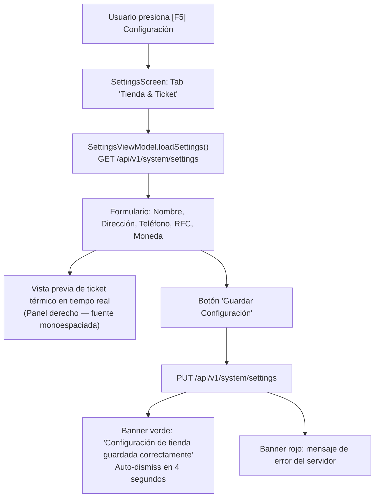
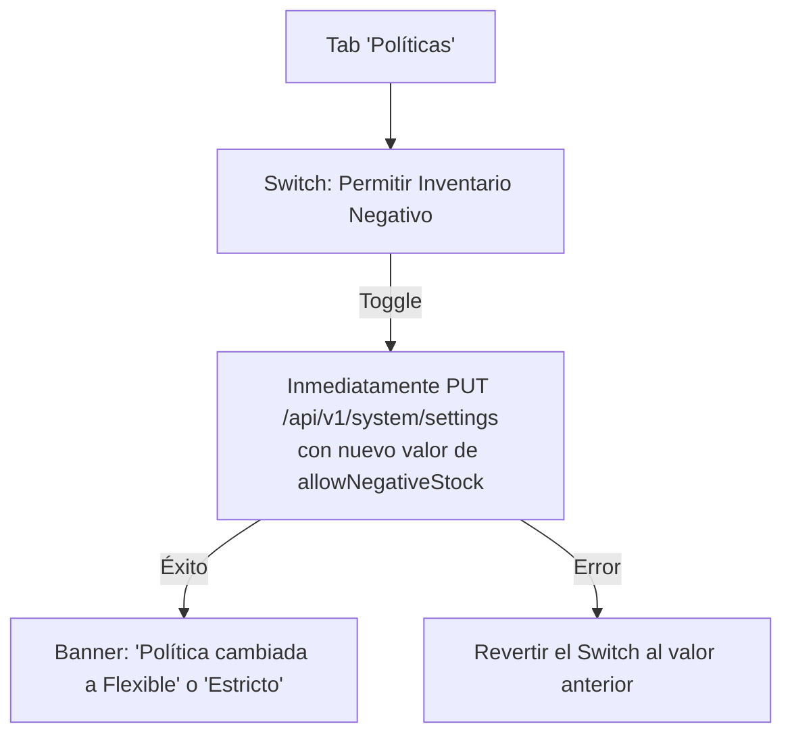
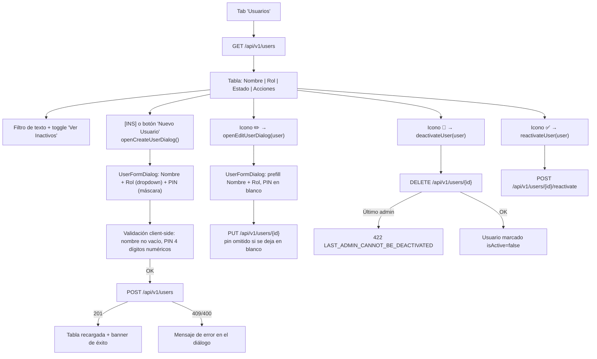

# Funcionalidad: Configuración del Sistema ([F5] Configuración)

Este documento detalla el módulo de administración del sistema en **NexusPOS**, incluyendo la configuración de datos de la tienda, personalización de la leyenda del ticket (con vista previa en tiempo real), la política operativa de inventario negativo y la gestión completa de usuarios/cajeros con PINs cifrados mediante BCrypt.

---

## 1. Objetivo

Proveer un módulo centralizado y seguro ([F5] Configuración) que permita al administrador de la tienda:

1. **Personalizar los datos del negocio** que aparecen en los tickets impresos (nombre, dirección, teléfono, RFC y símbolo de moneda).
2. **Definir la leyenda del ticket** (encabezado y pie) con una vista previa de ticket térmico en tiempo real.
3. **Controlar la política de inventario negativo**, eligiendo entre modo Flexible (ventas permitidas sin stock) o Estricto (ventas bloqueadas sin stock).
4. **Gestionar usuarios y cajeros**: alta, edición, desactivación lógica y reactivación, con PIN de 4 dígitos cifrado con BCrypt y control de roles (ADMIN, SUPERVISOR, CASHIER).

---

## 2. Alcance

### Incluye:
- **Tab 1 — Tienda & Ticket:** Formulario de datos de la tienda + vista previa de ticket térmico en tiempo real con fuente monoespaciada.
- **Tab 2 — Políticas:** Interruptor (Switch) para la política de inventario negativo con persistencia inmediata y confirmación visual.
- **Tab 3 — Usuarios:** Tabla de cajeros y administradores con buscador, filtro de inactivos, badges de rol/estado y botones de acción.
- **Tab 4 — Impresora Térmica:** Parámetros de conexión física (Desactivada, USB/SO vía Java Print Service, o Red Ethernet/WiFi vía Socket TCP puerto 9100), selector de ancho de papel (80mm vs 58mm), interruptores de impresión automática al cobrar, apertura automática de cajón y botón de diagnóstico de impresión en vivo.
- **Tab 5 — Báscula Serial:** Selección de protocolo (Torrey, Rhino, Genérico/Toledo, Simulador), selector de puerto COM/tty detectado en caliente, baudrate, intervalo de sondeo, switch de auto-aceptación de peso en granel, lectura diagnóstica en vivo y botones de **Tara** y **Cero**.
- **Tab 6 — Red / Servidor LAN:** Configuración de IP/Hostname del servidor central, puerto, ID de caja (`caja-1`), nombre de terminal, prueba de ping en vivo a `/health` y reconexión en caliente.
- **Diálogo de Usuario:** `AlertDialog` para crear o editar usuarios con campo de PIN enmascarado (`PasswordVisualTransformation`), selector de rol y validación client-side.
- **Protección del último Administrador:** El servidor bloquea la desactivación o degradación del último usuario activo con rol `ADMIN`.
- **Atajos de teclado:** `[F5]` para entrar al módulo, `[INS]` para nuevo usuario (en Tab Usuarios), `[Esc]` para cerrar diálogos o regresar a `[F1] Ventas`.

### Queda fuera (Fases futuras):
- Control horario de cajeros y auditoría biométrica de accesos (Fase 3).
- Importación de usuarios vía CSV/directorio LDAP (Fase 3).

---

## 3. Actores y Precondiciones

- **Actores:** Administrador (`ADMIN`), Encargado de Tienda (`SUPERVISOR` con permisos limitados).
- **Precondiciones:**
  1. Al menos un usuario con rol `ADMIN` activo debe existir en todo momento (invariante protegida por el servidor).
  2. La tabla `settings` y `users` debe haber sido inicializada por las migraciones Flyway.
  3. El servidor debe estar accesible en la red LAN para que `SettingsViewModel` cargue los datos al entrar al módulo.

---

## 4. Flujo Funcional

### Tab 1: Configuración de Tienda y Ticket



### Tab 2: Política de Inventario



### Tab 3: Gestión de Usuarios



---

## 5. Reglas de Negocio

- **RN-CFG-01 (PIN de 4 Dígitos Numéricos):** Todo PIN de usuario debe coincidir con la expresión regular `^\d{4}$`. El servidor valida el formato y rechaza con `400 Bad Request` cualquier PIN inválido.
- **RN-CFG-02 (PIN Cifrado con BCrypt):** Los PINs nunca se almacenan en texto plano. El servidor aplica BCrypt (cost factor 12) antes de persitir. La verificación de PIN durante el login usa `BCrypt.checkpw()`.
- **RN-CFG-03 (Unicidad de PIN):** No pueden existir dos usuarios activos con el mismo PIN. El servidor verifica la unicidad en cada creación o actualización mediante comparación BCrypt contra todos los hashes existentes (O(n) full scan). La violación genera `409 PIN_ALREADY_IN_USE`.
- **RN-CFG-04 (Protección del Último Administrador):**
  - `DELETE /api/v1/users/{id}`: Si el usuario a desactivar es el único `ADMIN` activo, el servidor responde `422 LAST_ADMIN_CANNOT_BE_DEACTIVATED`.
  - `PUT /api/v1/users/{id}` con cambio de rol de `ADMIN` a otro: Aplica la misma guardia antes de degradar.
- **RN-CFG-05 (PIN Opcional en Edición):** Al actualizar un usuario, si el campo `pin` se omite o envía `null`, el servidor conserva el PIN actual sin modificarlo. Solo si se envía un nuevo valor de 4 dígitos el servidor procede a re-hashear.
- **RN-CFG-06 (Desactivación Lógica de Usuarios):** Los usuarios no se eliminan físicamente de la base de datos para preservar la trazabilidad de tickets y movimientos de caja. Se marca `is_active = false`. Pueden reactivarse con `POST /api/v1/users/{id}/reactivate`.
- **RN-CFG-07 (Persistencia Inmediata de Políticas):** El interruptor de inventario negativo persiste en el servidor en el acto, sin requerir un botón "Guardar". Si la operación falla, el Switch se revierte al valor anterior para mantener consistencia visual.
- **RN-CFG-08 (Símbolo de Moneda):** El símbolo de moneda configurado (`currencySymbol`) se usa en la vista previa del ticket.
- **RN-CFG-09 (Persistencia Local de Hardware por Terminal):** Los ajustes de hardware (puertos seriales de báscula en `~/.nexuspos/scale.properties` e impresora en `~/.nexuspos/printer.properties`) son locales a cada máquina física, permitiendo configuraciones heterogéneas entre diferentes cajas de la tienda.
- **RN-CFG-10 (Reconexión Dinámica de Red LAN):** La pestaña de red almacena los parámetros en `~/.nexuspos/config.properties`. Al guardar o probar la conexión, el cliente actualiza `apiClient.baseUrl` en caliente sin reiniciar la aplicación.

---

## 6. Estructura de Archivos

```text
shared/
└── contracts/src/commonMain/kotlin/mx/nexuspos/contracts/
    ├── identity/IdentityDtos.kt         # UserDto, CreateUserRequest, UpdateUserRequest
    └── system/SettingsDto.kt            # SettingsDto (storeName, storeAddress, storePhone,
                                         # storeTaxId, ticketHeader, ticketFooter,
                                         # allowNegativeStock, currencySymbol)

server/src/main/kotlin/mx/nexuspos/server/
├── Application.kt                       # Rutas: PUT /api/v1/system/settings
│                                        # GET/POST/PUT/DELETE/reactivate /api/v1/users
├── modules/system/SettingsService.kt    # Persist/retrieve de todos los campos en tabla key-value
└── modules/identity/IdentityService.kt  # CRUD usuarios: BCrypt, PIN regex, rol guard, last-admin

server/src/test/kotlin/mx/nexuspos/server/
└── SettingsAndUserManagementTest.kt     # 4 tests de integración con H2 en memoria

client/app/src/commonMain/kotlin/mx/nexuspos/client/
├── core/ApiClient.kt                    # updateSettings(), getUsers(), createUser(),
│                                        # updateUser(), deactivateUser(), reactivateUser()
└── features/settings/
    ├── SettingsUiState.kt               # Estado para los 3 tabs y el diálogo de usuario
    ├── SettingsViewModel.kt             # Lógica reactiva con StateFlow, auto-dismiss de banners
    ├── UserFormDialog.kt                # AlertDialog: nombre, rol (dropdown), PIN (enmascarado)
    └── SettingsScreen.kt                # 3 tabs + SettingsTopToolbar + ThermalTicketPreview
                                         # + PoliciesTab + UsersTab + UserTableRow + badges

client/desktop/src/
├── main/kotlin/mx/nexuspos/desktop/Main.kt          # Wiring: SettingsViewModel, SettingsScreen,
│                                                     # INS→openCreateUserDialog, Esc→closeUserDialog
└── test/kotlin/mx/nexuspos/desktop/settings/
    └── SettingsFeatureTest.kt                        # 10 tests unitarios de UiState y validación PIN
```

---

## 7. Componentes de UI

### `SettingsScreen`
Pantalla principal con tres secciones seleccionables mediante `FilterChip` en la barra superior:

| Tab | Componente | Descripción |
|-----|-----------|-------------|
| **Tienda & Ticket** | `StoreTicketTab` | Formulario izquierda + vista previa de ticket térmico derecha |
| **Políticas** | `PoliciesTab` | Switch de inventario negativo + tarjetas explicativas Flexible/Estricto |
| **Usuarios** | `UsersTab` | Tabla de usuarios con buscador, badges de rol/estado y acciones CRUD |

### `ThermalTicketPreview`
Vista previa del ticket en tiempo real sobre fondo oscuro, usando `FontFamily.Monospace`. Muestra:
- Encabezado (`ticketHeader`)
- Nombre de tienda, dirección, teléfono y RFC
- 3 artículos de muestra con símbolo de moneda configurable
- Subtotal, Total, Efectivo y Cambio
- Pie de ticket (`ticketFooter`)

### `UserFormDialog`
`AlertDialog` Material3 con:
- `OutlinedTextField` para nombre (auto-foco recomendado)
- `DropdownMenu` con roles: Cajero / Supervisor / Administrador
- `OutlinedTextField` con `PasswordVisualTransformation` + `KeyboardType.NumberPassword`, limitado a 4 caracteres
- Texto de ayuda en edición: *"Dejar en blanco para conservar el PIN actual"*
- Banner de error inline desde `userFormError`
- `CircularProgressIndicator` en botón de confirmar durante `isSaving`

### Badges

| Tipo | Valor | Color |
|------|-------|-------|
| Rol | `ADMIN` | Púrpura `#7C3AED` |
| Rol | `SUPERVISOR` | Ámbar `#D97706` |
| Rol | `CASHIER` | Verde `#059669` |
| Estado | Activo | Verde `#059669` |
| Estado | Inactivo | Gris `#6B7280` |

---

## 8. API Reference

### `GET /api/v1/system/settings`
Devuelve la configuración actual de la tienda.

**Respuesta 200 OK:**
```json
{
  "storeName": "Abarrotes La Esperanza",
  "storeAddress": "Calle Principal #123, Col. Centro",
  "storePhone": "333-456-7890",
  "storeTaxId": "XAXX010101000",
  "ticketHeader": "¡Bienvenido! Gracias por su preferencia",
  "ticketFooter": "No se aceptan devoluciones sin ticket",
  "allowNegativeStock": true,
  "currencySymbol": "$"
}
```

---

### `PUT /api/v1/system/settings`
Actualiza toda la configuración de la tienda.

**Cuerpo de Solicitud:**
```json
{
  "storeName": "Abarrotes La Esperanza",
  "storeAddress": "Calle Principal #123, Col. Centro",
  "storePhone": "333-456-7890",
  "storeTaxId": "XAXX010101000",
  "ticketHeader": "¡Bienvenido! Gracias por su preferencia",
  "ticketFooter": "No se aceptan devoluciones sin ticket",
  "allowNegativeStock": false,
  "currencySymbol": "$"
}
```

**Respuestas:**
- `200 OK` — Configuración actualizada y retornada.

---

### `GET /api/v1/users`
Lista todos los usuarios del sistema.

**Query params:**
| Parámetro | Tipo | Descripción |
|-----------|------|-------------|
| `includeInactive` | `Boolean` | Si `true`, incluye usuarios con `isActive=false`. Default: `false`. |

**Respuesta 200 OK:**
```json
[
  {
    "id": "usr-a1b2c3d4",
    "name": "Administrador Principal",
    "role": "ADMIN",
    "isActive": true
  },
  {
    "id": "usr-e5f6g7h8",
    "name": "Juan Pérez",
    "role": "CASHIER",
    "isActive": true
  }
]
```

---

### `POST /api/v1/users`
Crea un nuevo usuario con PIN cifrado.

**Cuerpo de Solicitud:**
```json
{
  "name": "María González",
  "role": "SUPERVISOR",
  "pin": "5678"
}
```

**Respuestas:**
| Código | Descripción |
|--------|-------------|
| `201 Created` | Usuario creado. Retorna `UserDto`. |
| `400 Bad Request` | PIN inválido (no es `^\d{4}$`) o nombre vacío. |
| `409 Conflict` | `PIN_ALREADY_IN_USE` — el PIN pertenece a otro usuario activo. |

---

### `GET /api/v1/users/{id}`
Obtiene los datos de un usuario por su ID.

**Respuesta 200 OK:** `UserDto`.
**Respuesta 404 Not Found:** Usuario no encontrado.

---

### `PUT /api/v1/users/{id}`
Actualiza nombre, rol y/o PIN de un usuario existente.

**Cuerpo de Solicitud:**
```json
{
  "name": "María González López",
  "role": "SUPERVISOR",
  "pin": null
}
```
> Si `pin` es `null` o se omite, el PIN actual no cambia.

**Respuestas:**
| Código | Descripción |
|--------|-------------|
| `200 OK` | Usuario actualizado. Retorna `UserDto`. |
| `400 Bad Request` | PIN inválido. |
| `404 Not Found` | Usuario no encontrado. |
| `409 Conflict` | `PIN_ALREADY_IN_USE`. |
| `422 Unprocessable Entity` | `LAST_ADMIN_CANNOT_BE_DEMOTED` — intento de degradar al último admin. |

---

### `DELETE /api/v1/users/{id}`
Desactiva lógicamente a un usuario (`isActive = false`).

**Respuestas:**
| Código | Descripción |
|--------|-------------|
| `200 OK` | Usuario desactivado. Retorna `UserDto` con `isActive=false`. |
| `404 Not Found` | Usuario no encontrado. |
| `422 Unprocessable Entity` | `LAST_ADMIN_CANNOT_BE_DEACTIVATED`. |

---

### `POST /api/v1/users/{id}/reactivate`
Reactiva un usuario previamente desactivado.

**Respuesta 200 OK:** `UserDto` con `isActive=true`.

---

## 9. Estrategia de Pruebas

### Tests de Integración — Servidor (`SettingsAndUserManagementTest.kt`)

| Test | Descripción |
|------|-------------|
| `testUpdateAndRetrieveStoreSettings` | Verifica que `PUT` persiste todos los campos y `GET` los devuelve correctamente, incluyendo `storeTaxId` y `currencySymbol`. |
| `testUserLifecycleCrud` | Ciclo completo: crear usuario, obtener por ID, actualizar nombre/rol, desactivar y reactivar. |
| `testPinValidationRules` | Verifica que PINs inválidos (vacío, 3 dígitos, 5 dígitos, con letras) generan `400 Bad Request`. |
| `testPreventDeactivatingLastAdmin` | Verifica que intentar desactivar al único admin retorna `422`. |

### Tests Unitarios — Cliente (`SettingsFeatureTest.kt`)

| Test | Descripción |
|------|-------------|
| `testDefaultUiState` | Verifica todos los valores por defecto del estado inicial. |
| `testTabSelection` | Ciclo completo de selección de los 3 tabs. |
| `testStoreFieldUpdates` | Actualización de todos los campos de tienda mediante `copy()`. |
| `testNegativeStockPolicyToggle` | Alternado de `allowNegativeStock`. |
| `testUserListFilterAndInactiveToggle` | Filtrado de usuarios por texto y toggle de inactivos. |
| `testUserFormDialogOpenCreateState` | Estado del diálogo al abrir para crear (campos vacíos). |
| `testUserFormDialogOpenEditState` | Estado del diálogo al editar (nombre/rol prefill, PIN vacío). |
| `testUserFormPinValidation` | Lógica de validación: 4 dígitos numéricos exactos. |
| `testUserFormCloseDialog` | Reseteo del estado al cerrar el diálogo. |
| `testBannerManagement` | Ciclo de banners éxito/error y limpieza. |
| `testUserRoles` | Verificación de roles válidos (ADMIN, SUPERVISOR, CASHIER). |

---

## 10. Consideraciones de Seguridad

> [!IMPORTANT]
> El módulo de configuración maneja credenciales de acceso al sistema. Las siguientes medidas son obligatorias y no negociables.

- **BCrypt obligatorio:** Ningún PIN se persiste en texto plano. El campo `pin` del `UserDto` retornado por la API nunca incluye el hash — `UserDto` solo expone `id`, `name`, `role` e `isActive`.
- **Verificación sin timing attacks:** `BCrypt.checkpw()` usa comparación de tiempo constante, mitigando ataques de temporización.
- **Validación en doble capa:** El cliente valida el formato del PIN antes de enviar la solicitud. El servidor re-valida independientemente con la regex `^\d{4}$`. Nunca confiar solo en la validación del cliente.
- **Invariante de acceso garantizada:** La protección del último `ADMIN` está implementada en el servidor (`IdentityService`), no en el cliente. Cualquier cliente alternativo que intente saltarla recibirá `422`.
- **Unicidad de PIN entre usuarios activos:** Protege contra que dos cajeros compartan PIN de acceso, lo que permitiría suplantación de identidad en el registro de ventas y movimientos de caja.

> [!CAUTION]
> En modo de desarrollo con H2 en memoria, los PINs se calculan con BCrypt en cada test, lo que puede ralentizar la suite si se agregan muchos tests de PIN. Considerar reducir el `cost factor` de BCrypt a `4` en el perfil de test si el tiempo de ejecución se vuelve un problema.

---

## 11. Decisiones de Diseño

| Decisión | Alternativa Considerada | Razón de Elección |
|----------|------------------------|-------------------|
| **BCrypt para PINs de 4 dígitos** | SHA-256 con salt | BCrypt es resistente a ataques de fuerza bruta por su costo ajustable; un PIN de 4 dígitos (10,000 combinaciones) sin BCrypt es trivialmente atacable offline si se roba la base de datos. |
| **Verificación de unicidad de PIN O(n)** | Índice UNIQUE en columna hash | BCrypt genera hashes no deterministas (salt aleatorio), por lo que no es posible usar un índice de base de datos. La comparación manual es necesaria. |
| **Persistencia inmediata del toggle de política** | Botón "Guardar" separado | El switch de políticas tiene impacto operativo inmediato (bloquear o permitir ventas); persitir en el acto evita que el cajero olvide guardar y opere con la política equivocada. |
| **UI en 3 tabs** | Pantalla única con scroll | La configuración cubre 3 dominios conceptualmente distintos (datos de tienda, política operativa, gestión de personas). La separación en tabs reduce la carga cognitiva y acelera la navegación. |
| **Vista previa de ticket en tiempo real** | Vista previa en diálogo separado | Permite al usuario ver el impacto de cada cambio de texto instantáneamente, sin necesidad de guardar primero, reduciendo iteraciones. |
