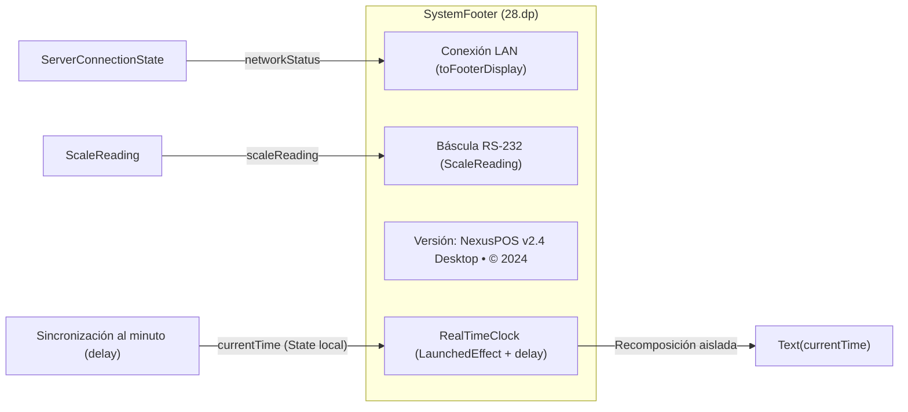

# Funcionalidad: Barra Inferior de Estado y Telemetría (SystemFooter / StatusBar)

Este documento describe la especificación funcional y técnica del componente **SystemFooter** (o **StatusBar**) en **Compose Desktop**, diseñado para presentar de forma compacta y permanente la telemetría del sistema, el monitoreo del servidor LAN, el estado de la báscula serial RS-232 y el reloj en tiempo real con aislamiento estricto de recomposición.

---

## 1. Objetivo

Dotar a la terminal de punto de venta NexusPOS de un panel de estado inferior permanente (`Scaffold.bottomBar`), de baja altura (`28.dp`), que consolide la supervisión de infraestructura LAN y periféricos de pesaje, la identificación de versión de la aplicación y un reloj digital local que actualice cada minuto sin provocar la recomposición de la ventana principal, el carrito ni la línea de captura del cajero.

---

## 2. Alcance

### Incluye:
- **Monitoreo de Infraestructura y Conexión LAN (Sección Izquierda):**
  - Dot visual con código de color dinámico y texto descriptivo:
    - `🟢 Servidor LAN sincronizado` (Conexión activa con el servidor autoritativo Ktor).
    - `🟡 Conectando...` (Intento de reconexión o enlace inestable).
    - `🔴 Servidor Desconectado` (Sin comunicación con la base de datos o servidor local).
- **Monitor de Báscula Serial RS-232 (Sección Izquierda):**
  - Indicador dinámico de lectura de peso (`0.000 kg`, `1.230 kg`) con icono `⚖`.
  - Dot visual circular (`7.dp`) y estado descriptivo homogéneo al monitor del servidor: `🟢 Estable`, `🟡 Leyendo...`, `🔵 En cero`, `⚪ Desconectada`.
  - Callback opcional de clic para calibración o diagnóstico (`onScaleClick`).
  - Divisor vertical sutil que separa la conectividad LAN del periférico de báscula.
- **Información del Sistema (Sección Central):**
  - Versión del producto y copyright: `"NexusPOS v2.4 Desktop • © 2024"`.
- **Reloj en Tiempo Real Aislado (Sección Derecha):**
  - Formato local estándar: `"15 - oct 10:12 am"`.
  - Icono de reloj `Icons.Default.Schedule`.
  - Ciclo de actualización sincronizado al límite exacto de cada minuto mediante corrutina en `LaunchedEffect` y `delay`, confinado a un sub-composable `RealTimeClock` para garantizar cero recomposiciones en el resto de la aplicación.
- **Limpieza de Cabecera Superior (TopHeader):**
  - Retiro de los widgets redundantes de báscula y semáforo LAN de `TopHeader.kt`, dejando la cabecera enfocada exclusivamente en la navegación por módulos (`F1-F6`), datos de la sesión activa (`Caja 01 • Cajero`) y botón de salida (`Salir [Esc]`).

### Queda fuera (Fases futuras):
- Despliegue de ping o latencia en milisegundos hacia el servidor local (Fase 2).
- Ventana modal de diagnóstico de puerto serial COM/TTY (Fase 2).

---

## 3. Actores y Precondiciones

- **Actores:** Cajero en mostrador, Técnico de soporte en tienda, Supervisor.
- **Precondiciones:**
  1. La aplicación de escritorio debe estar en ejecución en cualquier módulo (`AppModule.SALES`, etc.).
  2. La ventana principal debe contener el `Scaffold` con slot `bottomBar` activado.

---

## 4. Flujo Funcional



---

## 5. Estructura de Datos y Estado

### Modelo de Estado del Footer (`SystemFooterState.kt`)
Ubicación: `client/app/src/commonMain/kotlin/mx/nexuspos/client/features/footer/SystemFooterState.kt`

```kotlin
data class SystemFooterUiState(
    val networkStatus: ServerConnectionState = ServerConnectionState.CONNECTED,
    val scaleReading: ScaleReading = ScaleReading(),
    val versionText: String = "NexusPOS v2.4 Desktop • © 2024"
)

data class NetworkStatusDisplay(
    val label: String,
    val indicatorColor: Color,
    val dotSymbol: String = "●"
)

fun ServerConnectionState.toFooterDisplay(): NetworkStatusDisplay
fun formatTerminalDateTime(dateTime: LocalDateTime): String
fun formatTerminalDateTime(dayOfMonth: Int, monthNumber: Int, hour24: Int, minute: Int): String
fun getCurrentFormattedTerminalTime(): String
```

### Firma del Componente `SystemFooter`
Ubicación: `client/app/src/commonMain/kotlin/mx/nexuspos/client/features/footer/SystemFooter.kt`

```kotlin
@Composable
fun SystemFooter(
    networkStatus: ServerConnectionState = ServerConnectionState.CONNECTED,
    scaleReading: ScaleReading = ScaleReading(),
    versionText: String = "NexusPOS v2.4 Desktop • © 2024",
    onScaleClick: (() -> Unit)? = null,
    modifier: Modifier = Modifier
)

@Composable
fun StatusBar(...) = SystemFooter(...)
```

---

## 6. Especificación de Componentes y Diseño Visual

| Sección | Componente | Altura / Peso | Tipografía / Estilo | Comportamiento |
|---|---|---|---|---|
| **Izquierda: LAN** | Dot + Texto | `11.sp` Medium | Verde `#2E7D32`, Naranja `#F57F17`, Rojo `#C62828` | Reactivo a cambios en `ServerConnectionState`. |
| **Izquierda: Báscula** | Icono `⚖` + Peso + Dot + Texto | `11.5.sp` Bold + `11.sp` Medium | Dot circular de `7.dp` y texto (`Estable`, `Leyendo...`, etc.) | Muestra lecturas en vivo de la báscula serial con diseño armónico al servidor LAN. |
| **Centro** | Versión del software | `11.sp` Normal | Color `onSurfaceVariant` (alpha 0.8f) | Informativo / Marca estática. |
| **Derecha** | Reloj Digital | `11.sp` Medium | Icono `Schedule` (12.dp) + formato `"15 - oct 10:12 am"` | Actualización al cambio de minuto exacto con `delay`. |

---

## 7. Casos de Prueba y Validación

Las pruebas unitarias automatizadas se localizan en `client/desktop/src/test/kotlin/mx/nexuspos/desktop/footer/SystemFooterTest.kt`:

1. **`testFormatTerminalDateTimeMorning`**: Verifica formato de mañana en octubre (`"15 - oct 10:12 am"`).
2. **`testFormatTerminalDateTimeAfternoon`**: Verifica conversión a formato 12 horas y sufijo `"pm"` (`"04 - may 06:45 pm"`).
3. **`testFormatTerminalDateTimeMidnight`**: Verifica manejo de las 00:05 horas (`"01 - ene 12:05 am"`).
4. **`testFormatTerminalDateTimeNoon`**: Verifica manejo de las 12:00 horas (`"31 - dic 12:00 pm"`).
5. **`testNetworkStatusDisplayMapping`**: Mapeo riguroso de `CONNECTED`, `RECONNECTING` y `NO_SERVER` a sus etiquetas y colores correspondientes.
6. **`testScaleReadingProperties`**: Verificación de texto de peso y etiqueta de estado de la báscula.
7. **`testSystemFooterUiStateDefaults`**: Verificación de valores por defecto de la clase de estado.

---

## 8. Rendimiento y Aislamiento de Recomposición

- **Aislamiento en `RealTimeClock`:** En Compose, las recomposiciones se limitan al árbol de llamadas que lee un `State`. Al declarar `var currentTime by remember { mutableStateOf(...) }` y leerlo exclusivamente dentro de `RealTimeClock`, cada tick de minuto produce la recomposición de únicamente dos nodos de texto e icono dentro del footer. La ventana principal, el `TopHeader`, el `CaptureBar` y el `CartGrid` permanecen inmutables.
- **Sincronización Exacta:** En lugar de un intervalo fijo de `60_000L` que puede desfasarse respecto al reloj del sistema operativo, el timer calcula `60_000L - (nowMillis % 60_000L)`, provocando que el reloj cambie de minuto en el segundo `:00` exacto.

---

## 9. Seguridad y Manejo de Errores

- **Tolerancia a Nulos y Estados Indeterminados:** Si la báscula o la conexión no emiten eventos, se presentan los estados por defecto (`CONNECTED`, `0.000 kg ESTABLE`).
- **Control de Ciclo de Vida:** La corrutina en `LaunchedEffect(Unit)` supervisa la bandera `isActive` y se cancela automáticamente al desmontarse la ventana o cambiar de composición, evitando fugas de memoria.

---

## 10. Trazabilidad con Requerimientos

| Requerimiento Solicitado | Implementación | Verificación |
|---|---|---|
| Monitoreo de infraestructura local (Izquierda) | `InfrastructureStatusSection` con dot dinámico y etiquetas | `SystemFooterTest.kt` |
| Traslado de la báscula al footer | Lectura de peso y chip de estado reubicados en la sección izquierda del footer | `SystemFooterTest.kt` y `Main.kt` |
| Información del sistema (Centro) | `SystemInfoSection` con versión y copyright | `SystemFooterTest.kt` |
| Reloj en tiempo real local (Derecha) | `RealTimeClock` con formato `"15 - oct 10:12 am"` | `SystemFooterTest.kt` |
| Actualización dinámica sin recomponer la app | `LaunchedEffect` y `delay` encapsulados en sub-composable | Inspección de recomposición y pruebas |
| Parámetro inyectado para conexión | Parámetro `networkStatus: ServerConnectionState` | `SystemFooter.kt` y `Main.kt` |
| Retiro de báscula y LAN de TopHeader | Limpieza en `TopHeader.kt` | `TopHeaderStateTest.kt` |
