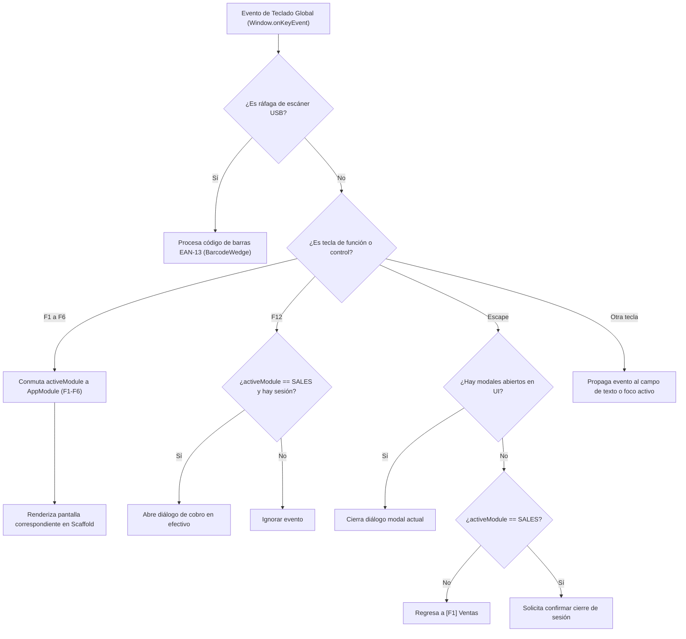

# Funcionalidad: Cabecera Global y Navegación Multimódulo (Top Header)

Este documento describe la especificación funcional y el diseño técnico del componente de cabecera persistente de **NexusPOS**, el sistema de navegación rápida por pestañas y la orquestación global de atajos de teclado para la aplicación de escritorio.

---

## 1. Objetivo

Proveer una cabecera global persistente en Compose Desktop que unifique la navegación rápida por módulos mediante teclado (`F1`–`F6`), monitoree el estado de la red LAN y periféricos críticos en tiempo real (báscula digital), y exhiba la identidad del negocio y la sesión activa de caja en una interfaz amigable para terminales de mostrador de alta velocidad.

---

## 2. Alcance

### Incluye:
- **Identidad de marca:** Identificador visual destacado (`NexusPOS`) y subtexto descriptivo del giro (`Abarrotes & Miscelánea`).
- **Navegación central por módulos:** Pestañas directas para los 6 módulos base del sistema con indicador visual de atajo:
  - `[F1] Ventas` (módulo activo por defecto).
  - `[F2] Clientes`.
  - `[F3] Productos`.
  - `[F4] Inventario`.
  - `[F5] Configuración`.
  - `[F6] Cortes`.
- **Despacho global de atajos de teclado:** Escucha en tiempo real de teclas de función (`F1` a `F6`), tecla contextual `Escape` y atajo de cobro rápido `F12`.
- **Semáforo LAN visual:** Indicador del estado de comunicación con el servidor autoritativo (`🟢 Conectado`, `🟡 Reconectando`, `🔴 Sin Servidor`), enfocado en la comprensión inmediata del cajero sin exponer tecnicismos de red.
- **Widget visual de báscula:** Visualización continua del peso en kilogramos con tres decimales (ej. `0.000 kg`) y etiqueta de estado (`ESTABLE`, `LEYENDO`, `EN CERO`, `DESCONECTADA`).
- **Identificador de sesión:** Número de terminal de caja asignada (`Caja: 01`) y nombre del cajero en turno (`👤 Don Pepe`).
- **Acción de salida:** Botón interactivo `Salir [Esc]` para cerrar ventanas modales o solicitar cierre de turno.
- **Desacoplamiento de UI:** Retiro de barras de herramientas superiores redundantes en pantallas hijas (`SalesScreen`).

### Queda fuera (Fases futuras):
- Calibración y configuración interactiva del puerto serial de báscula desde un menú desplegable de cabecera (Fase 2).
- Alternancia de tema / modo de alto contraste para visibilidad extrema bajo luz solar (Fase 2).
- Selector multitienda / franquicias en la cabecera (Fase 3).

---

## 3. Actores y Precondiciones

- **Actores:** Cajero en turno, Encargado de tienda, Administrador del sistema.
- **Precondiciones:**
  1. La ventana principal de Compose Desktop debe estar inicializada.
  2. El monitor de conexión local ([`ServerConnection`](file:///Users/eddch/Documents/OzafryDev/NexusPOS/client/app/src/commonMain/kotlin/mx/nexuspos/client/core/ServerConnection.kt)) debe estar instanciado para alimentar el semáforo LAN.

---

## 4. Flujo Funcional

---

## 5. Reglas de Negocio

- **RN-NAV-01 (Prioridad del Lector USB):** Los caracteres emitidos a alta velocidad por el lector de código de barras USB (emulación de teclado HID) son procesados por el buffer del wedge antes de cualquier atajo de navegación global, impidiendo que lecturas numéricas conmuten módulos de forma involuntaria.
- **RN-NAV-02 (Módulo Predeterminado):** Al iniciar la aplicación de escritorio, el módulo activo inicial es siempre `[F1] Ventas`.
- **RN-NAV-03 (Jerarquía Contextual de la tecla Escape):**
  1. Si existen diálogos modales visibles (cobro, búsqueda de productos, cliente fiado, arqueo), `Escape` cierra prioritariamente el diálogo activo.
  2. Si no existen diálogos modales abiertos y el usuario se encuentra en un módulo secundario (`F2` a `F6`), `Escape` conmuta inmediatamente de vuelta a `[F1] Ventas`.
  3. Si el usuario ya está en `[F1] Ventas` sin diálogos, el atajo `Salir [Esc]` permite confirmar el cierre de sesión del cajero.
- **RN-NAV-04 (Restricción de Atajo de Cobro F12):** La tecla `F12` únicamente dispara el diálogo de cobro en efectivo si el módulo activo es `AppModule.SALES`, el carrito local contiene al menos un producto y existe una sesión de caja activa.
- **RN-NAV-05 (Semáforo LAN Simplificado para Mostrador):** El semáforo de red muestra el estado de salud de la conexión mediante colores e iconos intuitivos (`🟢 Conectado`, `🟡 Reconectando`, `🔴 Sin Servidor`), sin exhibir direcciones IP complejas en la vista estándar de cobro para evitar saturación visual y confusiones al operador.
- **RN-NAV-06 (Monitor de Báscula):** El indicador visual de la báscula debe presentar el peso en formato fijo con tres cifras decimales (`0.000 kg`) y reflejar el badge de estabilidad cromática (`ESTABLE` en verde, `LEYENDO` en ámbar, `EN CERO` en azul).

---

## 6. Diseño Técnico

### Componentes UI:
- [`TopHeader.kt`](file:///Users/eddch/Documents/OzafryDev/NexusPOS/client/app/src/commonMain/kotlin/mx/nexuspos/client/features/header/TopHeader.kt): Composable principal estructurado en 3 secciones horizontales:
  - `BrandSection`: Logotipo de texto y subtítulo de tienda.
  - `ModuleTabsSection`: Pestañas interactivas con bordes y fondos tonales acordes a `MaterialTheme`.
  - `StatusAndActionsSection`: Badges de báscula, semáforo LAN, identificador de sesión y botón de salida.
- [`Main.kt`](file:///Users/eddch/Documents/OzafryDev/NexusPOS/client/desktop/src/main/kotlin/mx/nexuspos/desktop/Main.kt): Ventana de escritorio que aloja el `TopHeader` en el slot superior de un `Scaffold`, coordina la intercepción de teclado en `Window.onKeyEvent` y renderiza la pantalla activa según `activeModule`.
- [`SalesScreen.kt`](file:///Users/eddch/Documents/OzafryDev/NexusPOS/client/app/src/commonMain/kotlin/mx/nexuspos/client/features/sales/SalesScreen.kt): Vista principal de ventas, ajustada para recibir `Modifier` y ocupar la totalidad del espacio de trabajo vertical.

### Modelos y Estados ([`TopHeaderState.kt`](file:///Users/eddch/Documents/OzafryDev/NexusPOS/client/app/src/commonMain/kotlin/mx/nexuspos/client/features/header/TopHeaderState.kt)):
- `enum class AppModule(keyShortcut, title)`:
  - `SALES` ("F1", "Ventas")
  - `CUSTOMERS` ("F2", "Clientes")
  - `PRODUCTS` ("F3", "Productos")
  - `INVENTORY` ("F4", "Inventario")
  - `SETTINGS` ("F5", "Config")
  - `SHIFTS` ("F6", "Cortes")
- `enum class ScaleStatus(label)`: Estados de lectura del sensor de peso.
- `data class ScaleReading(weightText, status)`: Modelo inmutable de pesaje.
- `data class TopHeaderUiState(...)`: Estado inmutable consolidado que representa los datos de las 3 zonas de la barra superior.
- `sealed interface TopHeaderEvent`: Eventos de interacción (`SelectModule`, `LogoutClicked`, `ScaleClicked`).

---

## 7. Feature Flags y Configuraciones

| Configuración / Propiedad | Tipo | Valor Predeterminado | Efecto |
| :--- | :--- | :--- | :--- |
| `stationNumber` | `String` | `"01"` | Número de caja física mostrado en el badge de sesión. |
| `cashierName` | `String` | `"Don Pepe"` | Nombre del cajero o usuario con turno activo. |
| `scaleReading` | `ScaleReading` | `0.000 kg` (`STABLE`) | Peso y estabilidad reportados por el puerto serial. |

---

## 8. Errores y Casos Límite

| Escenario | Comportamiento del Sistema |
| :--- | :--- |
| **Corte o desconexión del servidor LAN** | El semáforo conmuta a `🔴 Sin Servidor`. La cabecera permanece 100% responsiva y permite alternar entre pestañas locales sin bloqueo ni congelamiento. |
| **Escaneo concurrente mientras se pulsa F1–F6** | El lector USB tiene prioridad estricta en `KeyboardWedgeBarcodeInput`, garantizando que ningún dígito del código de barras se interprete erróneamente como tecla funcional. |
| **Pulsación de F12 fuera del módulo de ventas** | La pulsación es ignorada de forma segura para evitar inconsistencias de cobro en vistas secundarias. |
| **Báscula desconectada o en error de puerto** | El widget muestra el badge gris `DESCONECTADA` y el texto `--.--- kg` sin interrumpir las ventas de productos por pieza. |

---

## 9. Pruebas y Criterios de Aceptación

1. **Atajos Funcionales:** Presionar `F1` a `F6` debe cambiar instantáneamente la pestaña seleccionada y la pantalla en la ventana principal.
2. **Prioridad de Escape:**
   - Si un modal de cobro o arqueo está abierto, presionar `Esc` debe cerrarlo sin salir del módulo de ventas.
   - Si se está en `[F3] Productos`, presionar `Esc` debe conmutar inmediatamente a `[F1] Ventas`.
3. **Persistencia Visual:** La cabecera permanece fija en la parte superior sin desplazarse cuando la lista de productos del ticket excede la altura de la pantalla.
4. **Semáforo Dinámico:** Al simular una caída de red, el badge de conexión actualiza su color a rojo de forma inmediata.
5. **Cobertura Automatizada:** Las pruebas unitarias en [`TopHeaderStateTest.kt`](file:///Users/eddch/Documents/OzafryDev/NexusPOS/client/desktop/src/test/kotlin/mx/nexuspos/desktop/header/TopHeaderStateTest.kt) deben compilar y pasar al 100%.

---

## 10. Referencias

- [TopHeader.kt](file:///Users/eddch/Documents/OzafryDev/NexusPOS/client/app/src/commonMain/kotlin/mx/nexuspos/client/features/header/TopHeader.kt)
- [TopHeaderState.kt](file:///Users/eddch/Documents/OzafryDev/NexusPOS/client/app/src/commonMain/kotlin/mx/nexuspos/client/features/header/TopHeaderState.kt)
- [Main.kt](file:///Users/eddch/Documents/OzafryDev/NexusPOS/client/desktop/src/main/kotlin/mx/nexuspos/desktop/Main.kt)
- [Ventas y Cobro (sales.md)](file:///Users/eddch/Documents/OzafryDev/NexusPOS/docs/features/sales.md)
- [Flujo de Datos y Red (data-flow.md)](file:///Users/eddch/Documents/OzafryDev/NexusPOS/docs/architecture/data-flow.md)
