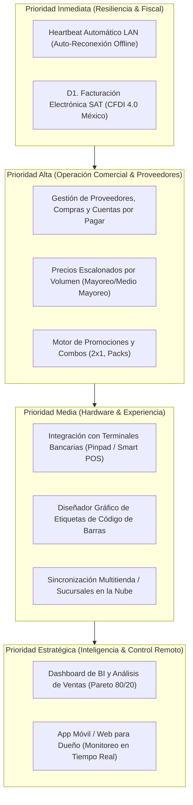

# Inventario y Hoja de Ruta de Mejoras Pendientes — NexusPOS

Este documento consolida el inventario técnico y funcional de las **mejoras y nuevos módulos pendientes** para NexusPOS, complementando los módulos ya implementados y validados.

---

## 📊 1. Resumen del Estado Actual (Línea Base)

El sistema cuenta con una arquitectura **LAN-First con Servidor Autoritativo**, bases de datos PostgreSQL + H2 (tests), cliente Compose Multiplatform Desktop y los siguientes módulos **100% operativos y probados**:

| Módulo / Feature | Alcance Funcional | Estatus |
| :--- | :--- | :---: |
| **Fase 1 (MVP Base)** | Login PIN, RBAC, Control de turnos, Cortes X/Z, Impresión ESC/POS, Cajón de dinero y Empaquetado JRE nativo. | ✅ Completado |
| **Pagos Mixtos (Multi-Pago)** | Cobro dividido (Efectivo, Tarjeta, Crédito, Monedero) en una sola transacción con cálculo de cambio. | ✅ Completado |
| **Tickets en Espera (Parked)** | Aparcado persistente en BD central con difusión LAN por WebSockets y reanudación multicaja. | ✅ Completado |
| **Importador/Exportador Catálogo** | Carga masiva Excel/CSV (RFC 4180 UTF-8 BOM) e impresión de etiquetas de anaquel Code 128. | ✅ Completado |
| **Báscula Serial RS-232/USB** | Lectura continua de peso (Torrey/Rhino), detección de peso estable y agregado automático. | ✅ Completado |
| **Grupo A (Caja y Seguridad)** | Arqueo por denominaciones (billetes/monedas), Modo Arqueo Ciego y Descuentos con PIN de supervisor. | ✅ Completado |
| **Grupo B1 (Devoluciones)** | Devoluciones parciales con reingreso condicional a stock, notas de devolución y foliado auditado. | ✅ Completado |
| **Grupo B2 (Stock y Resurtido)** | Alertas de stock mínimo, semáforos, motor de pedido sugerido a proveedor y exportación WhatsApp/CSV. | ✅ Completado |
| **Grupo B3 (Caducidades)** | Lotes de perecederos, semáforo de vencimiento, bajas por merma en 1 clic y auditoría física. | ✅ Completado |
| **Grupo C1 (Fidelización)** | Monedero electrónico con cashback configurable, saldo de cliente, pago con monedero y ajustes. | ✅ Completado |
| **Grupo C2 (Tickets WhatsApp)** | Envío digital de tickets, estado de cuenta con CLABE y notas de devolución con formato monoespaciado. | ✅ Completado |
| **Grupo D2 (Contingencia Offline)** | Caché local de catálogo, folios `OFF-XXXX`, cobro efectivo/tarjeta sin red y sincronización asíncrona. | ✅ Completado |

---

## 🧭 2. Clasificación de Mejoras y Módulos Pendientes

---

## 📋 3. Detalle Técnico de Módulos y Mejoras Pendientes

### Bloque 1: Resiliencia y Cumplimiento Fiscal (Inmediato)

#### 1.1. Heartbeat Automático de Red (Auto-Reconexión Offline)
- **Problema:** Tras un apagón o reinicio del servidor central, la terminal en `NO_SERVER` espera a que el cajero pulse manualmente el botón `[🔄]` para enterarse de que el servidor ya regresó.
- **Solución Técnica:**
  - Loop de latido en segundo plano en `SalesViewModel` ejecutando `checkHealth()` cada 15 o 30 segundos.
  - Al detectar `CONNECTED`, conmuta de inmediato el semáforo visual a verde, descarga actualizaciones del catálogo y despacha la cola de ventas offline acumuladas sin intervención del usuario.
- **Esfuerzo:** Muy Bajo (0.5 etapa).

#### 1.2. D1. Facturación Electrónica SAT (CFDI 4.0 México)
- **Problema:** Los clientes solicitan comprobante fiscal digital deducible según la normativa del SAT en México.
- **Solución Técnica:**
  - Integración con PAC (Proveedor Autorizado de Certificación) mediante API REST (ej. Facturama, Finkok o SW Sapien).
  - Emisión de CFDI 4.0 con campos obligatorios: RFC, Razón Social, Régimen Fiscal, Uso de CFDI y Código Postal del receptor.
  - Catálogos SAT integrados: Clave Prod/Serv (c_ClaveProdServ) y Clave Unidad (c_ClaveUnidad).
  - Generación de archivo XML timbrado con sello digital y PDF con cadena original y código QR.
  - Impresión de código/liga de auto-facturación en el ticket térmico para que el cliente facture desde casa si lo prefiere.
- **Esfuerzo:** Alto (2 etapas).

---

### Bloque 2: Operación Comercial y Compras (Fase Siguiente)

#### 2.1. Gestión de Proveedores, Compras y Cuentas por Pagar
- **Problema:** Las entradas de inventario se realizan por ajuste manual; falta rastrear facturas de compra, costos reales de adquisición y adeudos con proveedores.
- **Solución Técnica:**
  - Catálogo de Proveedores: Razón social, RFC, días de crédito, plazo de entrega, contactos y teléfonos.
  - Registro de Orden de Compra y Recepción de Mercancía: Alta de productos al almacén actualizando el Costo Promedio Ponderado (CPP).
  - Módulo de Cuentas por Pagar (CxP): Calendario de vencimiento de facturas de compra, registro de abonos o liquidaciones en efectivo/transferencia.
- **Esfuerzo:** Medio-Alto (1.5 etapas).

#### 2.2. Precios Escalonados por Volumen (Menudeo, Mayoreo y Paquete)
- **Problema:** En misceláneas y abarroteras es común dar precio especial a partir de cierta cantidad (ej. 3 piezas o caja cerrada).
- **Solución Técnica:**
  - Definición de reglas de precio por presentación y escala en la tabla de productos:
    - Escala 1: Menudeo (1 a 2 piezas) ➡️ $20.00
    - Escala 2: Mayoreo (3 a 11 piezas) ➡️ $18.00
    - Escala 3: Caja / Bulto (12+ piezas) ➡️ $16.50
  - Recálculo automático en el carrito de venta conforme el cajero escanea o incrementa piezas.
- **Esfuerzo:** Medio (1 etapa).

#### 2.3. Motor de Promociones y Combos Dinámicos
- **Problema:** Falta automatizar ofertas temporales comunes (2x1, 3x2, combos de botana + refresco).
- **Solución Técnica:**
  - Módulo de promociones con vigencia de fechas y horas.
  - Tipos de promoción:
    - `N x M` (ej. 3x2 en galletas seleccionadas).
    - Descuento porcentual en la segunda unidad (ej. 50% en la 2da pieza).
    - Combo / Paquete: Grupo de productos a precio fijo cerrado (ej. Refresco 2L + Papas 170g por $65.00).
- **Esfuerzo:** Medio (1 etapa).

---

### Bloque 3: Hardware y Experiencia en Caja

#### 3.1. Terminales Bancarias Integradas (Pinpad / Smart POS)
- **Problema:** Al cobrar con tarjeta, el cajero debe digitar manualmente el monto en la terminal bancaria externa, arriesgando errores de dedo.
- **Solución Técnica:**
  - Integración mediante SDK / API local de terminales bancarias comunes (Mercado Pago Point, Clip, NetPay o terminales bancarias vía protocolo DLL/Serial).
  - Al presionar cobro con Tarjeta en `BottomCheckoutPanel`, el POS envía el monto exacto por USB/red a la terminal y espera la respuesta de aprobación (número de autorización y últimos 4 dígitos) antes de cerrar la venta.
- **Esfuerzo:** Medio-Alto (depende del proveedor de hardware).

#### 3.2. Diseñador y Plantillas Visuales de Etiquetas de Anaquel
- **Problema:** Las etiquetas de anaquel actuales tienen un formato estándar de 58mm/80mm sin personalización de logotipo ni campos adicionales.
- **Solución Técnica:**
  - Selector de tamaños de etiqueta (50x25mm, 58mm continuo, 80mm).
  - Inclusión configurable de: Logotipo de la tienda, Código de barras Code 128 o EAN-13, Precio por unidad de medida (ej. "$45.00 / KG"), Fecha de vigencia y SKU.
- **Esfuerzo:** Bajo-Medio (0.8 etapa).

---

### Bloque 4: Inteligencia de Negocio y Control Remoto

#### 4.1. Dashboard de BI y Reportes Analíticos (Pareto 80/20)
- **Problema:** La administración necesita visibilidad estratégica más allá del corte diario de caja.
- **Solución Técnica:**
  - Análisis ABC / Pareto (identificar el 20% de productos que generan el 80% de ingresos).
  - Mapa de calor de afluencia: Horas y días de la semana con mayor volumen de transacciones para optimizar turnos de personal.
  - Margen de ganancia bruto y neto por departamento y categoría en periodos mensuales.
  - Alertas de productos estancados o de nula rotación ("huesos de inventario").
- **Esfuerzo:** Medio (1 etapa).

#### 4.2. Portal Web / App Móvil para el Propietario (Nexus Cloud Sync)
- **Problema:** El dueño del negocio no puede ver cómo van las ventas ni el arqueo si no está físicamente en el local.
- **Solución Técnica:**
  - Agente de sincronización en segundo plano en el servidor local que suba métricas resumidas (sin detener la operación local) a un servicio cloud seguro.
  - PWA / App móvil ligera donde el propietario consulta:
    - Ventas en vivo del día por caja.
    - Cortes de turno con diferencias de efectivo.
    - Notificaciones push ante cancelaciones de venta o bajas por merma sospechosas.
- **Esfuerzo:** Alto (2 etapas).

---

## 📊 4. Matriz de Priorización (Esfuerzo vs. Impacto Comercial)

| Funcionalidad / Módulo | Complejidad | Impacto Operativo | Prioridad Recomendada |
| :--- | :---: | :---: | :---: |
| **Heartbeat Automático LAN** | Muy Baja | ⭐⭐⭐⭐⭐ (Resiliencia silenciosa) | **1 (Inmediato)** |
| **Facturación CFDI 4.0 SAT** | Alta | ⭐⭐⭐⭐⭐ (Requisito fiscal México) | **2 (Próximo Bloque)** |
| **Precios Escalonados (Mayoreo)** | Media | ⭐⭐⭐⭐ (Aumenta ticket promedio) | **3** |
| **Proveedores y Compras (CxP)** | Media-Alta | ⭐⭐⭐⭐ (Control financiero total) | **4** |
| **Promociones Dinámicas (Combos)**| Media | ⭐⭐⭐⭐ (Competitividad comercial) | **5** |
| **Pinpad Integrado (Tarjetas)** | Media-Alta | ⭐⭐⭐ (Cero errores de captura) | **6** |
| **Dashboard BI y Rotación ABC** | Media | ⭐⭐⭐⭐ (Toma de decisiones) | **7** |
| **App Móvil / Cloud para Dueño** | Alta | ⭐⭐⭐⭐⭐ (Supervisión remota) | **8** |

---

## 📌 5. Próximo Paso Sugerido

Para continuar el avance sistemático, se sugiere abordar:
1. **Paso Inmediato:** Implementar el **Heartbeat Automático LAN (15s)** en `SalesViewModel` para que la reconexión y sincronización offline opere 100% en segundo plano sin clic del cajero.
2. **Siguiente Gran Módulo:** Iniciar la especificación y diseño del **Grupo D1: Facturación Electrónica SAT (CFDI 4.0)**.
