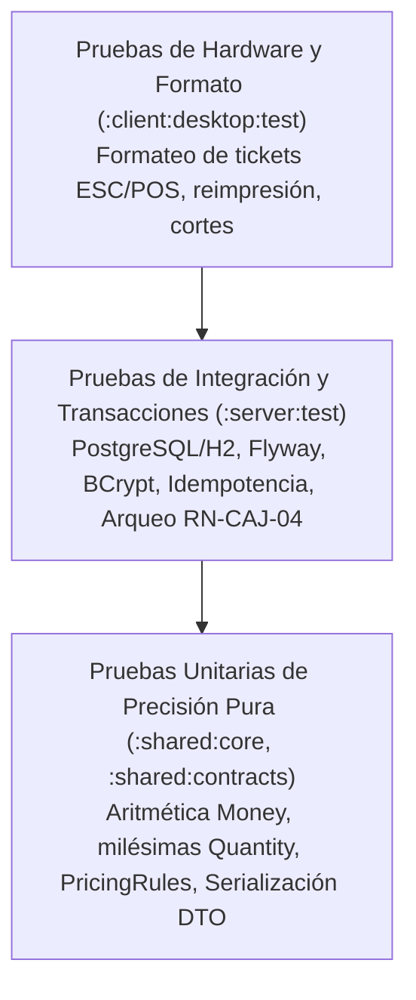

# Estrategia de Pruebas y Aseguramiento de Calidad (Testing Strategy)

Este documento describe la pirámide de pruebas, las herramientas utilizadas y los criterios de verificación implementados en NexusPOS para garantizar la consistencia financiera y la estabilidad operativa.

---

## 1. Pirámide de Pruebas

NexusPOS implementa una estrategia de pruebas multinivel orientada a detectar errores lo más temprano posible en el ciclo de desarrollo:



---

## 2. Niveles de Prueba y Módulos

### Nivel 1: Pruebas Unitarias de Lógica Pura y Dominio (`:shared:core`)
- **Ubicación:** [`CoreCalculationsTest.kt`](file:///Users/eddch/Documents/OzafryDev/NexusPOS/shared/core/src/commonTest/kotlin/mx/nexuspos/core/CoreCalculationsTest.kt).
- **Alcance:**
  - Operaciones aritméticas y sobrecarga de operadores de [`Money`](file:///Users/eddch/Documents/OzafryDev/NexusPOS/shared/core/src/commonMain/kotlin/mx/nexuspos/core/Money.kt) en centavos (`+`, `-`, `*`, `/`).
  - Formateo visual exacto de dinero (`$35.00`, `-$15.50`).
  - Conversión y operaciones de [`Quantity`](file:///Users/eddch/Documents/OzafryDev/NexusPOS/shared/core/src/commonMain/kotlin/mx/nexuspos/core/Quantity.kt) en milésimas de pieza, kilogramo o litro.
  - Reglas canónicas de cálculo en [`PricingRules`](file:///Users/eddch/Documents/OzafryDev/NexusPOS/shared/core/src/commonMain/kotlin/mx/nexuspos/core/PricingRules.kt) con redondeo *Round Half-Up*.
  - Cálculo exacto de cambio de efectivo y desglose de IVA (0% vs 16%).
- **Comando:**
  ```bash
  ./gradlew :shared:core:jvmTest
  ```

---

### Nivel 2: Pruebas de Contratos y Serialización (`:shared:contracts`)
- **Ubicación:** [`ContractsSerializationTest.kt`](file:///Users/eddch/Documents/OzafryDev/NexusPOS/shared/contracts/src/commonTest/kotlin/mx/nexuspos/contracts/ContractsSerializationTest.kt).
- **Alcance:**
  - Serialización y deserialización estricta de todos los DTOs de `/api/v1` (`CreateSaleRequest`, `SaleResponse`, `CashSessionSummary`, etc.).
  - Tolerancia a claves desconocidas en JSON (`ignoreUnknownKeys = true`).
  - Validación de campos opcionales (clientes en ventas de contado, notas en cortes).
- **Comando:**
  ```bash
  ./gradlew :shared:contracts:jvmTest
  ```

---

### Nivel 3: Pruebas de Integración y Transacciones (`:server`)
- **Ubicación:** [`ServerComprehensiveTest.kt`](file:///Users/eddch/Documents/OzafryDev/NexusPOS/server/src/test/kotlin/mx/nexuspos/server/ServerComprehensiveTest.kt).
- **Alcance:**
  - Migración real de base de datos con **Flyway** al iniciar el test.
  - Autenticación de cajeros y supervisores mediante hash **BCrypt**.
  - Alternancia de la política de inventario negativo: rechazo con `422 INSUFFICIENT_STOCK` cuando `allow_negative_stock = false` y aprobación cuando está en `true`.
  - Transacción atómica de venta completa con deducción de existencias por factor de presentación, movimiento de caja y bloqueo de folios con `Idempotency-Key`.
  - Control de crédito (fiado): autorización dentro del límite, rechazo en sobregiro y recepción de abono con ingreso al efectivo de la caja.
  - Arqueo de caja conforme a la fórmula canónica `RN-CAJ-04`: fondo inicial, ventas, abonos, retiros y cálculo de diferencia de corte.
- **Comando:**
  ```bash
  ./gradlew :server:test
  ```

---

### Nivel 4: Pruebas de Hardware y Formato Térmico (`:client:desktop`)
- **Ubicación:** [`ReceiptPrinterTest.kt`](file:///Users/eddch/Documents/OzafryDev/NexusPOS/client/desktop/src/test/kotlin/mx/nexuspos/desktop/hardware/ReceiptPrinterTest.kt).
- **Alcance:**
  - Generación del formato de ticket de venta en texto claro (80 mm y 58 mm).
  - Emisión de ticket de venta a crédito con saldo deudor y firma del cliente.
  - Generación de marca de copia de reimpresión (`*** COPIA DE REIMPRESIÓN ***`).
  - Generación de ticket de corte de turno con desglose y firmas.
  - Generación de secuencias de bytes ESC/POS válidas (corte de papel `GS V A 16`).
- **Comando:**
  ```bash
  ./gradlew :client:desktop:test
  ```

---

## 3. Ejecución Completa de Pruebas

Para validar el sistema completo antes de cada commit o despliegue:
```bash
./gradlew :shared:core:jvmTest :shared:contracts:jvmTest :server:test :client:app:jvmJar :client:desktop:test
```
*Tiempo promedio de ejecución: ~5 segundos con caché de compilación.*
